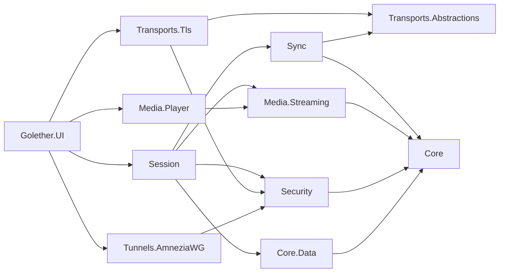

# Architektur von Golether

## Ziel

Gemeinsam ein Video ansehen, mit den Kameras der Teilnehmer:

- das Video nimmt den größten Teil des Fensters ein, rechts sind die Kacheln der Teilnehmer (bis zu 5 Personen
  einschließlich des Gastgebers);
- das Video läuft bei allen synchron; Pause, Spulen und Start von jedem Teilnehmer wirken bei allen;
- beim Start beginnen alle an derselben Position im selben Moment;
- die Datei wird nicht auf einem Server gespeichert: Der Gastgeber stellt sie in Originalqualität bereit;
- ein Ping über 1000 ms ist zulässig, eine leichte Abweichung ist hinnehmbar;
- ein Fremder kann sich nicht verbinden; ist der direkte Weg blockiert, wird AmneziaWG verwendet.

## Entscheidungen

| Frage | Entscheidung | Warum |
|---|---|---|
| Wie das Video übertragen wird | Die Originaldatei wird in Stücken von 256 KiB übertragen, kein Sendestrom | Keine Qualität geht verloren, der Ping beeinflusst nur die Synchronisationszeit |
| Player | libmpv (P/Invoke), eigenes Protokoll `golether://` | Der FFmpeg-Decoder wie bei MPC, aber er läuft auf jedem Betriebssystem und lässt sich genau steuern |
| Transport | Gegenseitiges TLS über TCP, fixierte Schlüssel | `System.Net.Quic` funktioniert unter Windows 10 und macOS nicht; QUIC ist eine künftige Optimierung |
| Synchronisation | Der Zustand wird durch die Zeit bestimmt, der Gastgeber entscheidet, Uhren im Geist von NTP | Die Übertragungsverzögerung beeinflusst das Ergebnis nicht |
| Sicherheit | Geräteschlüssel ECDSA P-256, kurzlebige Einladungen, Einlass durch den Gastgeber, Prüfcode | Ohne Zertifizierungsstelle und ohne Server |
| Tunnel | AmneziaWG „jeder mit dem Gastgeber“, die Pakete „Angebot / Antwort“ geben die Menschen selbst weiter | Kein eigener VPS |
| Graue IPs ohne Portweiterleitung | Eigener Vermittlungsserver: Er stellt die Seiten einander vor und beantwortet STUN, die Verbindung wird direkt durchgeschlagen (TCP simultaneous open) | Der Server leitet nichts weiter und sieht nichts von der Sitzung; ein Rechner mit öffentlicher IP genügt |
| Kameras und Sprache | GStreamer `webrtcbin` | LGPL, WebRTC, Aufnahme und Echounterdrückung in einem Framework; SIPSorcery ist mit der GPL unvereinbar |
| Daten | SQLite, Schema über FluentMigrator, Zugriff über EF Core | Eine Projektvorgabe |
| Sprachen | Texte liegen in JSON-Dateien, eine pro Sprache; der Code holt einen Text per Schlüssel aus dem Paket der gewählten Sprache | Eine neue Sprache ist eine neue Datei, der Code hat keine Verzweigungen nach Sprache |

## Module

```
Sources/
  Core/Golether.Core                       PeerId, PlaybackState, DriftCorrector, MediaDescriptor, PeerEndpoint, AppDataPaths
  Core/Golether.Localization               Sprachen: JSON-Dateien mit Texten, Sprachwahl, Localizer und Texts
  Core/Golether.Core.Data                  EF Core: Kontakte, Tunnel, Einstellungen
  Core/Golether.Core.Data.Migrations       FluentMigrator: Migrationen auf SQL-Skripten und der Runner
  Core/Golether.Core.Data.Migrations.SQLite SQL-Skripte und Versionen für SQLite
  Database/Golether.Dbs.SQLite.DbMigrator  der Konsolen-Migrator
  Security/Golether.Security               Geräteschlüssel, Schutz von Geheimnissen, Einladungen, Prüfcode, Einlass,
                                           die versiegelte Adresse des Vermittlungsservers
  Components/Golether.Components          Katalog der nativen Komponenten (libmpv, GStreamer, AmneziaWG), Suche und Installation
  Tools/Golether.Tools.Components          das Werkzeug golether-components: bereitet die Komponenten für einen Paketbau vor
  Transports/Golether.Transports.Abstractions  PeerStream, Connector und Listener, FrameChannel
  Transports/Golether.Transports.Tls       mTLS über TCP mit fixiertem Schlüssel
  Transports/Golether.Transports.PortMapping  Portweiterleitung am Router: NAT-PMP und UPnP IGD, Verlängerung der Lease
  Transports/Golether.Transports.Relay     das TURN-Relay des Gastgebers für Kameras und Sprache (RFC 5766 über TCP)
  Transports/Golether.Transports.Rendezvous  Protokoll des Vermittlungsservers, Client für Gastgeber und Teilnehmer, TCP hole punching
  Sync/Golether.Sync                       Protokoll, Schätzung des Uhrenversatzes, PlaybackAuthority, PlaybackFollower
  Media/Golether.Media.Streaming           Stück-Server, paralleler Client, Cache, Vorauslesen, Stream für den Player
  Media/Golether.Media.Player              libmpv (P/Invoke, Einbettung, golether://), ein simulierter Player
  Media/Golether.Media.Conference          Vertrag für Kameras und Sprache, ein Platzhalter
  Media/Golether.Media.Conference.GStreamer  Kameras und Sprache: Aufnahme, VP8/Opus, webrtcbin, Mischer, Echounterdrückung
  Tunnels/Golether.Tunnels.AmneziaWG       X25519-Schlüssel, Verschleierung, .conf, signierte Pakete, Steuerung über die CLI
  Session/Golether.Session                 HostSession und ParticipantSession
  Apps/Golether.UI                         Avalonia: Fenster, Dialoge, Zusammensetzung der Abhängigkeiten
  Apps/Golether.Web.Server                 der Vermittlungsserver (eine eigene Anwendung, siehe RendezvousServer.md)
  Apps/Golether.Web.Server.Contracts       was Server und Monitor teilen: Einstellungen, Dienstnamen, Zustand, Journal
  Apps/Golether.Web.Server.UI              Golether Server Monitor: Zustand, Journal, Dienst und Einstellungen
  Apps/Golether.Pages                      die Projektseite auf GitHub Pages: Startseite, Einladungen per Link, die
                                           Dateien mit der neuesten Version und der Adresse des Vermittlungsservers (statisch)
```

Abhängigkeiten zeigen nach innen: Core hängt von nichts ab; die Oberfläche setzt alles in `AppServices` zusammen.



## Kanäle zwischen den Knoten

Jeder Stream ist eine eigene TLS-Verbindung mit der Präambel `GLTH`, einer Version und einem Zweck:

- **Control**: JSON-Nachrichten der Sitzung (Willkommen, Zustand, Uhren, Status), eine Verbindung pro Teilnehmer.
- **MediaData**: binäre Anfragen nach Stücken der Datei. Ein Teilnehmer öffnet bis zu 4 parallele Verbindungen, damit
  auf Strecken mit großer RTT die Geschwindigkeit nicht durch einen TCP-Stream begrenzt wird.
- **Relay**: Der TURN-Verkehr von Kameras und Sprache zum Relay des Gastgebers läuft in einem TLS-Stream der Sitzung,
  auf demselben Weg wie die anderen Streams (eine direkte Adresse oder ein Treffen über den Vermittlungsserver). Auf der
  Seite des Teilnehmers zeigt `webrtcbin` auf den lokalen Port von `RelayTunnel` (`127.0.0.1`); alle Verbindungen dorthin
  teilen sich einen Stream `RelayShared` als Kanäle von `RelayMultiplexer` (bei einem Gastgeber einer früheren Version
  bekommt jede einen eigenen `Relay`-Stream); der Gastgeber übergibt jeden Kanal eines eingelassenen Teilnehmers an
  `TurnServer`. Deshalb funktionieren Kameras und Sprache überall, wo die Sitzung funktioniert, auch wenn UDP blockiert
  und der Relay-Port von außen geschlossen ist. ICE bietet trotzdem auch direktes UDP an und nimmt es, wenn es
  durchkommt.
- **TURN** (Sitzungsport + 1): das Relay `Golether.Transports.Relay` für WebRTC (RFC 5766 über TCP, Weiterleitung über
  UDP). Einen eigenen Port brauchen nur Teilnehmer früherer Versionen. Die Zugangsdaten des Relays werden für eine
  Sitzung erzeugt und erreichen einen Teilnehmer erst im Willkommen nach dem Einlass; das Relay leitet Pakete nur an
  Adressen weiter, für die der Client eine Berechtigung angelegt hat. Für die Adressen des Gastgeber-Computers selbst
  (Loopback) und für Broadcast- und Multicast-Adressen gibt es keine Berechtigung: Jeder Teilnehmer kennt das
  Relay-Passwort, und es darf keinen Weg zu den Diensten des Gastgebers öffnen. Eine Zuweisung, die der Client vor
  Ablauf nicht erneuert hat, wird zusammen mit der Verbindung geschlossen, damit verschwundene Clients keinen Platz
  belegen. Die Medien bleiben mit DTLS-SRTP verschlüsselt; der Gastgeber kann sie nicht sehen.
- **Treffen über den Vermittlungsserver**: Hat keine Adresse der Einladung innerhalb von 4 Sekunden geantwortet, trifft
  der Teilnehmer den Gastgeber über den in der Einladung genannten Server: Beide verbinden sich mit dem Server von den
  Ports aus, von denen sie durchschlagen wollen, erfahren die öffentlichen Adressen des jeweils anderen und verbinden
  sich im selben Moment direkt miteinander. Die durchgeschlagene Verbindung trägt dasselbe TLS mit dem fixierten
  Schlüssel; der Gastgeber übergibt solche Verbindungen an seinen `TlsPeerListener` (`Adopt`). Der gewählte Weg wird für
  jeden Stream der Sitzung verwendet. Details: [RendezvousServer.md](RendezvousServer.md).
- **Moderation**: Die Nachricht `moderate` vom Gastgeber schaltet Mikrofon und/oder Kamera eines Teilnehmers aus; das
  Protokoll hat keinen Befehl zum Einschalten. Teilnehmer melden den Zustand ihrer Geräte im Status (`MicrophoneOff`,
  `CameraOff`).

Formate im Detail: [Protocol.md](Protocol.md).

## Synchronisation

Der Zustand der Sitzung (`PlaybackState`): „Im Moment `ReferenceTime` nach der Uhr des Gastgebers war die Position
`Position` und die Geschwindigkeit `Rate`“. Jeder Knoten berechnet die nötige Position selbst:
`Position + (now − ReferenceTime) × Rate`.

- **Uhren.** Ein Teilnehmer schickt `ping/pong`-Proben (6 schnelle, dann eine alle 2 s). Der Versatz
  `((t1 − t0) + (t2 − t3)) / 2` wird aus der Probe mit der kleinsten RTT in einem Fenster von 16 genommen. Solange der
  Versatz unbekannt ist, wird der Zustand nicht auf den Player angewendet.
- **Entscheidungen.** `PlaybackAuthority` beim Gastgeber nimmt die Anfragen aller Teilnehmer in der Reihenfolge ihres
  Eintreffens an (die letzte gewinnt) und vergibt Versionen. Knoten wenden nur neuere Versionen an.
- **Start.** Das Abspielen wird für `now + max(RTT) + 1,5 s` geplant (höchstens 8 s); die Oberfläche zeigt einen
  Countdown.
- **Pause.** Der Auslöser pausiert sofort und schickt sein Bild; die anderen springen dorthin.
- **Kein Befehlsecho.** Die Absichten des Benutzers kommen nur aus Befehlen der Oberfläche; mpv-Ereignisse werden nicht
  weitergeleitet. So wird eine Aktion, die auf fremden Befehl ausgeführt wurde, nie erneut verschickt.
- **Korrektur** (`DriftCorrector`):

| Abweichung | Aktion |
|---|---|
| < 150 ms | nichts (läuft bereits eine Korrektur, bis 50 ms: Hysterese) |
| 150 ms – 2 s | Geschwindigkeit ± bis zu 5 % für 8 s, die Tonhöhe bleibt erhalten |
| > 2 s | ein exakter Sprung; 1,5 s nach einem Sprung keine Korrektur |

- **Filmende.** Erreicht die erwartete Position die Dauer, legt der Gastgeber eine Pause auf dem letzten Bild fest
  (Ursache `Ended`). Ein Follower erwartet nie eine Position jenseits der Dauer und springt oder startet am Ende den
  Player nicht (mpv mit `keep-open` pausiert von selbst). „Abspielen“ am Ende startet den Film von vorn.
- **Puffern.** Die Strategie `WaitForAll`: Puffert ein Teilnehmer und liegt mehr als 2 s zurück, pausiert der
  Gastgeber alle und macht weiter, wenn jeder ≥ 5 s Daten hat. Die Alternative ist `LetLaggardsCatchUp`.
- **Bereitschaft vor dem Start.** Unter `WaitForAll` setzt „Abspielen“ zunächst alle in eine Pause an der nötigen
  Position (Ursache `WaitingForParticipants`), bis jeder Teilnehmer die Datei geöffnet und ≥ 5 s an dieser Position
  geladen hat (nahe dem Filmende: was übrig ist). Dann beginnt die Vorstellung von selbst (`ParticipantsReady`). Der
  Gastgeber kann das Warten überspringen (`PlayNow`), und nach 45 Sekunden endet das Warten von selbst; beides ergibt
  die Ursache `StartedWithoutWaiting`.

## Chat, Reaktionen, der Stift und die Rückkehr

- Chatnachrichten, Reaktionen und Stiftstriche laufen über denselben TLS-Kanal der Sitzung wie die Synchronisation: Der
  Gastgeber prüft den Inhalt, begrenzt die Rate, setzt den geprüften Absender ein und schickt sie an alle. Nichts wird
  auf die Festplatte geschrieben.
- Reaktionen leben 3 Sekunden und werden in einem eigenen transparenten Fenster über dem Video gezeichnet (das
  mpv-Fenster würde sie sonst verdecken). Unter Windows antwortet dieses Fenster beim Hit-Testing mit `HTTRANSPARENT`,
  sodass Klicks auf das Video hindurchgehen. Das Fenster bleibt die ganze Sitzung offen: Die Bindungen eines
  geschlossenen Popups sind inaktiv, und eine verschwundene Reaktion käme beim nächsten Öffnen zurück.
- Dasselbe Fenster bedeckt die ganze Videofläche und trägt `StrokeCanvas`, die Leinwand des Stifts. Solange der Stift
  aus ist, bleibt das Fenster für die Maus durchlässig; wird die Schaltfläche gedrückt, hört
  `ClickThroughWindow.SetClickThrough` auf, `HTTRANSPARENT` zu antworten, und die Leinwand erhält die Zeigerereignisse
  selbst. `DrawingViewModel` sammelt Punkte und schickt sie in Paketen (~60 ms) und zeichnet nur, was der Gastgeber
  zurückgegeben hat, die eigenen Striche eingeschlossen, damit die Reihenfolge bei allen gleich ist.
- Die Koordinaten eines Strichs sind Anteile des *Bildes*, nicht des Fensters: `StrokeCanvas` berechnet das Bildrechteck
  aus dem von mpv gemeldeten Seitenverhältnis (`video-params/aspect`), sodass die eingekreiste Stelle unabhängig von der
  Form der Fenster passt. Die Farbe eines Strichs ist die Teilnehmerfarbe aus `ParticipantColors`, dieselbe wie die des
  Avatars.
- Beim Einlass erhält ein Teilnehmer ein Ticket (`reconnectTicket`), das bis zum Ende der Sitzung gilt. Nach einer
  Unterbrechung versucht `SessionService` acht Mal zurückzukommen, mit Pausen von 2, 3, 5, 10, 20 und 30 Sekunden; der
  Gastgeber bestätigt den Eintritt jedes Mal.

## Bereitstellung der Datei

- `MediaDescriptor`: Name, Größe, Stückgröße, eine schnelle Kennung (SHA-256 der Größe und dreier Proben zu 1 MiB).
- `ChunkServer` gibt Stücke mit ihrem SHA-256 aus; der Client prüft Hash und Länge.
- `RemoteChunkSource` entfernt doppelte Anfragen und baut fehlgeschlagene Streams neu auf (3 Versuche).
- `CachedMediaReader` hält Stücke im Speicher (LRU, 1 GiB) und liest 32 Stücke im Voraus in Paketen zu 4.
- `MediaReadStream` wird libmpv über `mpv_stream_cb_add_ro` übergeben; ein Lesevorgang wird über `cancel_fn`
  abgebrochen.
- Ein Teilnehmer mit derselben Datei (die schnelle Kennung stimmt überein) spielt sie von der Festplatte.
- **Ladeanzeige.** Der Player meldet, welche Bereiche bereits im Cache sind (`demuxer-cache-state` von mpv), und die
  Zeitleiste zeigt sie mit einer hellen Füllung: Man sieht, wo ein Sprung kein Warten braucht. Für den Gastgeber und
  für einen Teilnehmer mit eigener Kopie der Datei ist die ganze Zeitleiste markiert.
- **Teilen zwischen Zuschauern** (`Media.Streaming.Sharing`): Teilnehmer melden einander, welche Stücke sie haben (den
  Cache im Speicher oder eine ganze lokale Kopie), und geben sie über einen WebRTC-Datenkanal weiter.
  `SwarmChunkSource` nimmt ein Stück von einem Teilnehmer, prüft sein SHA-256 gegen den Hash, den der Gastgeber ohne
  Daten liefert (die Operation GetHash), und lädt das Stück bei jedem Fehler vom Gastgeber. So gibt der Gastgeber jedes
  Stück einmal aus, nicht an jeden Zuschauer.

## Sicherheit

- **Gerät:** ECDSA P-256 und ein selbstsigniertes Zertifikat; `PeerId` = SHA-256 der SubjectPublicKeyInfo. Der
  Schlüssel liegt in `identity/device.key` unter DPAPI (Windows) oder mit Modus 600 (Linux/macOS, bis zum Umzug nach
  libsecret/Keychain).
- **Einladung:** `golether://join/v1/<base64url JSON>` mit dem Fingerabdruck des Gastgebers, Adressen, einem
  128-Bit-Token und einer Ablaufzeit; der Gastgeber behält nur den Hash des Tokens. Token und Ablaufzeit stehen im JSON
  zuerst: Alles andere ist in jeder Einladung einer Sitzung gleich, so unterscheidet sich eine neue Einladung ab den
  ersten Zeichen.
  - *Zwei Schreibweisen.* Der **Schlüssel** (`golether://…`) wird in die Anwendung eingefügt, der **Link**
    (`https://depthrel.github.io/Golether/join/#…`) ist in jedem Messenger anklickbar; der Inhalt ist derselbe. Das
    Einladungsfenster gibt sie als zwei Einladungen mit eigenen Token aus: Der Link lebt 15 Minuten, der Schlüssel
    15 Minuten oder eine Stunde. `InviteRegistry` gibt nichts aus, was länger als eine Stunde lebt.
  - *Eine für die ganze Runde.* Alle, die der Gastgeber eingeladen hat, treten mit einer Einladung bei, bis sie abläuft
    oder 16 Anfragen gebracht hat (`InviteRegistry.MaxUses`, die Grenze für einen durchgesickerten Link). Nicht die
    Einladung lässt Menschen herein, sondern der Gastgeber, der jeden bestätigt.
  - *Die Gültigkeit wird nur beim Eintritt geprüft* (vom Teilnehmer vor dem Verbinden, vom Gastgeber in
    `InviteRegistry.TryUse`): Ein eingelassener Teilnehmer bleibt in der Sitzung und kommt nach einer Unterbrechung mit
    dem Ticket zurück, nicht mit der Einladung.
  - *Entfernt und abgelehnt.* Der Gastgeber merkt sich das Gerät zusammen mit der Nummer der letzten bis dahin
    ausgegebenen Einladung (`HostSession._turnedAway`). Diese Einladungen lassen dieses Gerät nicht mehr herein,
    funktionieren aber für die anderen weiter; eine später erstellte Einladung schon. Das ist keine Sperre, und ein
    Gastgeber, der einfach nicht rechtzeitig geantwortet hat, hat niemanden abgelehnt. Das Gerät bekommt den Grund
    sofort, ohne dass der Gastgeber gefragt wird. Ein eingelassener Teilnehmer, den der Gastgeber entfernt hat oder
    dessen Sitzung der Gastgeber beendet hat, bekommt den Grund in einer eigenen Meldung angezeigt
    (`ISessionService.ClosedByHost`): Die Ereignisliste verschwindet zusammen mit der Sitzung.
- **Verbindung:** Der Teilnehmer fixiert den Schlüssel des Gastgebers während des TLS-Handshakes. Der Gastgeber nimmt
  jedes Zertifikat an, berechnet die `PeerId`, prüft das Token (vertraute Kontakte brauchen keines) und fragt den
  Benutzer.
- **Prüfcode:** drei Wörter und eine Zahl aus beiden `PeerId` und dem Kontext; die Seiten vergleichen ihn per Sprache.
  Die Wörter werden in der Sprache jeder Seite angezeigt (siehe „Sprachen der Oberfläche“).
- **Die Datei** wird nur eingelassenen Teilnehmern gegeben; verlässt ein Teilnehmer die Sitzung, wird er entfernt oder
  verbindet er sich neu, werden seine Datenstreams geschlossen.
- **Kameras und Sprache** werden mit DTLS-SRTP verschlüsselt. `webrtcbin` prüft das Zertifikat der Gegenseite nicht
  gegen den Fingerabdruck aus dem SDP, daher tut `WebRtcPeer` das selbst: Das SDP kommt nur über den geschützten Kanal
  der Sitzung, keine Bilder und kein Ton werden gesendet (`valve`) oder angenommen, bis das Zertifikat passt, und bei
  einer Abweichung wird die Verbindung getrennt. Fremde STUN/TURN-Server werden nicht verwendet; nennt die Einladung
  einen Vermittlungsserver, dient sein UDP-Port als STUN-Server der Sitzung (`IConferenceMedia.SetStunServer`), und die
  Kameras gehen ebenfalls direkt durch das NAT.
- **Eine ausgeschaltete Kamera oder ein ausgeschaltetes Mikrofon** wird freigegeben: Das Gerät wird gestoppt, nicht nur
  stummgeschaltet.
- **Eingehende Daten** (JSON, Pakete, Konfigurationen, Dateinamen) werden geprüft und in der Größe begrenzt.

## AmneziaWG-Tunnel

- Der Gastgeber hält eine Schnittstelle `golether0` mit dem Subnetz `10.64–127.x.0/24`; jeder Teilnehmer ist ein
  `/32`-Peer.
- Ein Angebot: der öffentliche AWG-Schlüssel, Adressen, die zugewiesene Adresse, die gemeinsamen Parameter
  `S1/S2/H1–H4`, ein ephemerer P-256-Schlüssel, eine Ablaufzeit, das Gerätezertifikat, eine Signatur. Eine Antwort:
  dasselbe von der Seite des Teilnehmers.
- PSK = SHA-256(ECDH(ephemere P-256-Schlüssel)); er geht nie über das Netz.
- Private Schlüssel verlassen das Gerät nicht; Geheimnisse in der Datenbank schützt `ISecretProtector`.
- Ein Tunnel wird mit `amneziawg.exe /installtunnelservice` (Windows) oder `awg-quick up` (Linux/macOS) aufgebaut. Die
  Konfiguration wird in einem mit AmneziaVPN kompatiblen Format exportiert.
- **Eigene Engine.** Unter Windows hat die Anwendung ihr eigenes AmneziaWG: Es ist nicht Teil des Anwendungspakets,
  sondern wird bei Bedarf als Komponente `Tunnel` heruntergeladen (die Schaltfläche „Installieren“ im Tunnelfenster).
  Es ist das offizielle Paket `amneziawg-<arch>-3.1.0.msi`, fixiert durch SHA-256 und Größe, aus dem `msiexec /a`
  `amneziawg.exe`, `awg.exe` und `wintun.dll` nach `data/components/tunnel/<version>/amneziawg` extrahiert. Nichts wird
  ins System installiert, und das Entpacken braucht keine Administratorrechte. `ComponentLocator` sucht absichtlich
  **nicht** nach einem vom Benutzer installierten AmneziaWG: Golether ruft nur seine eigene Kopie auf, sodass der
  Systemclient und seine Tunnel unberührt bleiben. Ohne die Komponente fällt `AwgCliOptions.WindowsExecutable` auf den
  Pfad in Program Files zurück. Das erhöhte Hilfsprogramm `--tunnel-helper` berechnet denselben Pfad, sodass beide
  Seiten dasselbe Programm aufrufen. Der Pfad wird **vor jedem Aufruf** ermittelt
  (`AwgCliOptions.FindCarriedExecutable`), nicht einmal beim Start: Die Komponente lässt sich ohne Neustart der
  Anwendung installieren. Installiert wird sie aus dem Tunnelfenster, das die Komponentenkarte zeigt; ohne die Engine
  geben `UpAsync` und `DownAsync` sofort einen klaren Fehler statt eines gescheiterten Prozessstarts.
- Der Adressbereich der Tunnel `10.64–127.x.0/24` ist so gewählt, dass er sich nicht mit typischen Heimnetzen
  (`192.168.x`, `10.0.0.x`) und vom Benutzer selbst aufgebauten Tunneln überschneidet.
- **Öffentliche Adresse und NAT-Traversal** (`NatTraversal`). Vor dem Erstellen eines Angebots und vor dem Annehmen
  einer Antwort öffnet eine Seite einen UDP-Socket auf dem Port des künftigen Tunnels und fragt öffentliche STUN-Server,
  wie dieser Port von außen aussieht. Die Adresse kommt nur in das Paket, wenn zwei Server **denselben** Port genannt
  haben: Verschiedene bedeuten ein symmetrisches NAT, und eine solche Adresse ist nutzlos. Dann schickt jede Seite
  einige Pakete von demselben Port an die Adressen der anderen: Das erste Paket wird vom anderen Router verworfen,
  öffnet aber ein Loch im eigenen, und der Handshake kommt durch. Der Socket wird direkt vor dem Start des Tunnels
  geschlossen: Die Zuordnung im Router lebt merklich länger.
- Die Liste der STUN-Server wird im Konstruktor von `TunnelWorkflow` übergeben; eine leere Liste schaltet jede Anfrage
  nach außen ab (die Tests arbeiten so, und es lässt sich für die Privatsphäre tun).
- **Ein Tunnel lebt so lange wie die Anwendung.** Die Namen der aufgebauten Schnittstellen werden in
  `data/tunnels/raised.txt` geschrieben; beim Beenden baut `AppServices.DisposeAsync` sie ab (höchstens zwei Minuten;
  das Ablehnen der Administratorabfrage hält das Beenden nicht auf). Die Datei übersteht einen Absturz, sodass ein
  vergessener Tunnel beim nächsten Start entfernt wird, und das Tunnelfenster hat die Schaltfläche „Tunnel abbauen“, um
  nicht bis zum Beenden zu warten. Tunnel, die Golether nicht aufgebaut hat, bleiben unberührt: Die Datei listet nur die
  eigenen.
- Der Port der Schnittstelle wird aus 40000–60000 **mit einer Prüfung, ob er frei ist,** gewählt: Der Bereich
  überschneidet sich mit den Ports, die Windows an beliebige Programme vergibt, und ein belegter Port bedeutete sowohl
  einen gescheiterten Tunnel als auch keine Möglichkeit, die öffentliche Adresse zu erfahren.

## Sprachen der Oberfläche

Alles, was der Benutzer liest (Bildschirme, Dialoge, Fehlermeldungen, Sitzungsereignisse, der Diagnosebericht), kommt
aus den Sprachpaketen `Sources/Core/Golether.Localization/Languages/<code>.json`: ein flaches Objekt „Schlüssel → Text“,
in dem `Language.Code` und `Language.Name` die Sprache benennen (`en` ist „English“, `de` ist „Deutsch“, `ru` ist
„Русский“). Die Anwendung bringt Englisch, Deutsch, Spanisch, Französisch, Portugiesisch und Russisch mit. Die Pakete
sind in die Assembly eingebettet; `LanguageCatalog` findet sie selbst. Englisch ist die Standardsprache und die Quelle
der Texte, die einer anderen Sprache fehlen.

Wie es gebaut ist:

- `ILanguagePack` ist eine Strategie: die Texte einer Sprache. `Localizer` sucht einen Schlüssel im Paket der aktuellen
  Sprache, dann im englischen, dann gibt er den Schlüssel selbst zurück (die Lücke ist sichtbar, der Bildschirm bricht
  nicht). Er fragt nie, welche Sprache aktiv ist.
- `Texts` (`Texts.Get(key)`, `Texts.Format(key, values)`) ist der Zugang für Code ohne View-Model: Ausnahmen,
  Sitzungsereignisse, Hinweise. `Texts.Scope(...)` gibt einem Arbeitsfluss eine eigene Sprache (die Tests brauchen das).
- XAML: `Text="{loc:Loc Main.Title}"`, mit Wert: `{loc:Loc Key=Main.Device, Arg={Binding Fingerprint}}`. Die Bindung
  geht über `LocalizationSource`, sodass sich jeder Text beim Sprachwechsel sofort ändert, ohne Neustart. Texte, die
  View-Models selbst zusammensetzen, werden in `MainWindowViewModel.RefreshTexts` neu gelesen.
- Schlüssel, die von einer Aufzählung abhängen, werden aus ihren Werten gebildet: `Session.Reject.<RejectReason>`,
  `Session.Playback.<PlaybackCause>`, `Component.Source.<ComponentSource>`, `Component.Stage.<InstallStage>`,
  `Log.Level.<LogLevel>`. Tests stellen sicher, dass jeder Wert in jeder Sprache einen Text hat.

Die Wahl der Sprache (`LanguageService`, die Einstellung `ui.language` in der Tabelle `Settings`):

1. Erster Start: Die Datenbank hat keine Sprache, daher wird die Sprache des Betriebssystems
   (`CultureInfo.CurrentUICulture`) genommen, wenn es ein Paket dafür gibt, unabhängig von der Region (`de-CH` bekommt
   Deutsch, `pt-BR` Portugiesisch), sonst Englisch. Das Ergebnis wird gespeichert und sofort in der Liste der Sprachen
   angezeigt.
2. Spätere Starts: Die Sprache wird aus der Datenbank gelesen; das System wird nicht mehr gefragt.
3. Der Benutzer wählt die Sprache im Einstellungsfenster (die Flagge `Assets/Flags/<code>.png` und der Name der Sprache
   in dieser Sprache); die Wahl wird mit der Schaltfläche „Übernehmen“ angewendet, sofort für jeden Text, und gespeichert.

Der Monitor des Servers verwendet dieselben Pakete (die Schlüssel `Monitor.*`) und dieselben Flaggen; er speichert seine
Wahl in `config/monitor.json` des Serverordners.

Die Wörter des Prüfcodes werden übersetzt: `VerificationCode` hält drei Wortnummern (0–63) und eine Zahl, und jedes
Paket benennt dieselben 64 Dinge in derselben Reihenfolge (`Verification.Word.00` … `Verification.Word.63`). Der Code
ist daher auf beiden Seiten derselbe, welche Sprachen sie auch haben, und zwei Menschen mit verschiedenen
Oberflächensprachen sehen Übersetzungen der Wörter des anderen.

Was nicht von der Sprache der Oberfläche abhängt:

- über das Netz gehen Gründe, keine Texte: `rejected` trägt einen `RejectReason`, `bye` hat keinen Text; der Leser
  formuliert den Grund in seiner eigenen Sprache (Gastgeber und Teilnehmer können verschiedene Sprachen verwenden);
- das Hilfsprogramm für Tunnel und Firewall (ein eigener Prozess mit Administratorrechten) kennt keine Sprache: Es
  meldet Fakten (Programm, Exitcode, Ausgabe), und die Anwendung macht daraus Worte (`TunnelHelper.DescribeFailure`);
- Meldungen des Betriebssystems und von .NET (`Win32Exception`, `HttpRequestException`) und die Ausgabe externer
  Programme werden so gezeigt, wie sie sind; Protokollmeldungen für Entwickler (`ILogger`) bleiben englisch, nur die
  Kennzeichnung der Ebene in einer Protokollzeile wird übersetzt.

## Projektseite, Beitritt per Link und eine einzige Instanz

Die Seite `Sources/Apps/Golether.Pages` (GitHub Pages, die Adressen stehen in `ProjectSite`) ist eine Bequemlichkeit,
keine Abhängigkeit: Ein Schlüssel funktioniert ohne sie, der Vermittlungsserver lässt sich von Hand eintragen, die
Update-Quelle lässt sich ersetzen.

- **Einladungslink.** `join/` liest die Einladung nach dem `#` (der Browser schickt diesen Teil nicht an den Server),
  zeigt den Namen der Sitzung und den des Gastgebers und geht zu `golether://join/v1/…`. Die Seite lädt nichts von
  anderen Servern und schickt nichts irgendwohin (`Content-Security-Policy`), und sie entfernt die Einladung sofort aus
  der Adressleiste. Ein zweiter Link im selben Tab lässt die Seite neu laden, sodass sie nie die vorige Einladung
  weitergibt.
- **Das Schema `golether://`** wird bei der Installation registriert: Windows nutzt `Software\Classes\golether`
  (Inno Setup, `HKA`), macOS `CFBundleURLTypes` in `Info.plist`, Linux `MimeType=x-scheme-handler/golether` in der
  `.desktop`-Datei.
- **Eine einzige Instanz** (`SingleInstance`): Ein benannter Mutex pro Benutzer und Datenordner entscheidet, wer zuerst
  da ist; ein zweiter Start übergibt seine Argumente dem ersten über eine benannte Pipe, die nur dem aktuellen Benutzer
  offensteht, und endet. Die Nachricht ist in der Größe begrenzt und wird als kurze Liste von Zeichenketten gelesen.
  Unter macOS kommt ein Link als Ereignis (`IActivatableLifetime`).
- **Ein Beitritt ist nie stillschweigend.** Jede Seite kann `golether://` öffnen, daher liest
  `MainWindowViewModel.OfferInviteAsync` zuerst die Einladung und fragt dann: „Der Sitzung beitreten?“ oder, wenn eine
  Sitzung läuft, „Zu einer anderen Sitzung wechseln?“. Die Namen in der Frage stammen aus der Einladung, also von ihrem
  Ersteller; wer der Gastgeber wirklich ist, bestätigen der fixierte Schlüssel und der Prüfcode.
- **Adresse des Vermittlungsservers** (`RendezvousMode`): „Automatisch“ heißt, `RendezvousDirectory` liest
  `config.json` der Seite (bis zu 5 Sekunden, bis zu 4 KiB), sonst nimmt es die letzte gute Antwort aus der Einstellung
  `network.rendezvousDirectory`, sonst läuft die Sitzung ohne Server, und der Gastgeber sieht ein Ereignis dazu;
  „Direkt“ heißt kein Server; „Eigener Server“ heißt die Adresse aus der Einstellung `network.rendezvousServer`. Die
  Adresse in der Datei ist mit `EndpointSeal` versiegelt (AES-256-GCM, der Schlüssel ist in die Anwendung eingebaut):
  Das ist eine Maske gegen Scanner, kein Geheimnis, denn der Schlüssel steht im offenen Quellcode, und die Adresse ist
  Teil jeder Einladung. Eine gefälschte Datei könnte einem fremden Server zeigen, wer wen trifft, und das Treffen
  verderben, aber keine Sitzung lesen und sich nicht als Gastgeber ausgeben: Der Teilnehmer fixiert den Schlüssel des
  Gastgebers aus der Einladung. Den Text für die Datei erzeugt das Werkzeug des Eigentümers `Golether.AdminSettings`
  (ein eigenes Repository) mit einer eigenen Kopie des Algorithmus; `EndpointSealTests` bewahrt ein Muster seiner
  Ausgabe.

## Updates und Berichte

- `UpdateService` liest das Manifest von der Projektseite (`updates.json`) oder von der Adresse in den Einstellungen
  (`updates.url`, nur `https://` oder eine lokale Adresse) und vergleicht die Version. Die Anwendung meldet eine neue
  Version mit einer Leiste, deren Schaltfläche die Downloadseite öffnet (das Feld `page` der Version, sonst `url`); das
  Häkchen „Diese Version ignorieren“ speichert die Version in `updates.ignoredVersion`, und die Prüfung wird mit der
  Einstellung `updates.check` abgeschaltet. Nichts wird von selbst heruntergeladen oder installiert. Das Herunterladen
  mit SHA-256-Prüfung (`DownloadAsync`) ist noch im Dienst, aber die Oberfläche ruft es nicht auf; ohne Hash im
  Manifest verweigert es.
- `FileLogProvider` schreibt das Protokoll nach `data/logs/golether-<date>.log` (7 Tage, bis zu 8 MiB pro Tag) und
  schneidet lange hexadezimale Zeichenketten, Schlüssel und Relay-Passwörter heraus.
- Eine unbehandelte Ausnahme, an der die Anwendung gestoppt hat, und Fehler von Hintergrundaufgaben, auf die niemand
  gewartet hat, erreichen ebenfalls das Protokoll (`App.LogCrashes`): Nach einem Absturz gibt es etwas, das man einem
  Bericht beilegen kann.
- `DiagnosticReport` baut daraus den Bericht: Version, System, Komponenten, der Zustand der Sitzung (ohne den Dateinamen)
  und das Ende des Protokolls.
- Das Installationsprogramm (`Scripts/App/golether.iss`, Inno Setup) fragt, für wen installiert wird: „nur für mich“
  (Standard) installiert nach `%LOCALAPPDATA%\Programs\Golether` ohne Administratorrechte, mit den Daten in `data`
  innerhalb der Installation; „für alle“ installiert nach `C:\Program Files\Golether`, legt `golether.shared` neben
  `golether.install`, und die Daten jedes Benutzers liegen in `%LOCALAPPDATA%\Golether`. Die Wahl ist eine Seite des
  Assistenten: Inno Setup kann seine Rechte nicht auf halbem Weg ändern, daher startet „für alle“ die Installation mit
  Administratorrechten neu (`/ALLUSERS`). Der Assistent spricht Englisch, Deutsch, Spanisch, Französisch, Portugiesisch
  und Russisch: Die Sprache von Windows ist vorausgewählt, Englisch, wenn der Assistent sie nicht spricht. Die Bilder
  mit dem Logo zeichnet `Scripts/Assets/generate-installer-art.ps1`. Persönliche Daten werden nie überschrieben und nur
  mit gesonderter Zustimmung entfernt. Das Installationsprogramm des Vermittlungsservers
  (`Scripts/Server/golether-server.iss`) ist genauso gebaut, installiert aber immer für alle Benutzer.

## Daten

Die Anwendung ist eigenständig: `AppDataPaths` sucht die Markierung `golether.install` im Programmordner und bis zu drei
übergeordneten Ordnern (die Pakete legen sie in die Wurzel von `Golether/`, neben `app/` oder `Golether.app`) und hält
alles in `data` daneben; ohne die Markierung (ein Build aus `bin`) in `data` neben der ausführbaren Datei. Das
Benutzerprofil wird nicht verwendet, außer bei einer Installation „für alle Benutzer“ (die Markierung
`golether.shared`), wo ein gewöhnlicher Benutzer nicht schreiben darf; die Daten früher Builds aus
`%LOCALAPPDATA%\Golether` werden einmal verschoben. `GOLETHER_DATA_DIR` überschreibt den Pfad für Entwicklung und Tests.

| Tabelle | Inhalt |
|---|---|
| `Contacts` | bekannte Geräte: Name, Vertrauensflag, letzte Adresse, Zeit |
| `HostTunnelInterfaces` | geschützte Schlüssel und Parameter der Schnittstelle des Gastgebers |
| `Tunnels` | Angebote und Tunnel: Rolle, Status, Adresse, Peer, geschützte Geheimnisse |
| `Settings` | Einstellungen (Benutzername, Sprache der Oberfläche `ui.language`, Lautstärke, Geräte) |

Das Schema wird durch Migrationen beim Start der Anwendung oder über `Golether.Dbs.SQLite.DbMigrator` erstellt.

## Etappen

| Etappe | Stand |
|---|---|
| Grundlage: Solution, Kern, Daten, Sicherheit, Transport, Synchronisation, Dateibereitstellung, Player, Oberfläche, Tests, Pakete | **fertig** |
| Automatische Installation der Komponenten (libmpv, GStreamer) mit einem Klick | **fertig** |
| Kameras und Sprache: GStreamer `webrtcbin`, „jeder mit jedem“, Echounterdrückung `webrtcdsp` | **fertig** |
| Tunnel ohne Start des Programms als Administrator (UAC-Hilfsprogramm, pkexec, osascript), Wahl von Kamera und Mikrofon, Prüfung des DTLS-Zertifikats | **fertig** |
| Automatische Weiterleitung des Ports des Gastgebers (NAT-PMP, UPnP IGD) | **fertig** |
| Weiterleitung von Kameras und Sprache über den Gastgeber (eigenes TURN über TCP), Ausschalten der Geräte eines Teilnehmers durch den Gastgeber, Lautstärke und Klicks auf das Video | **fertig** |
| Teilen von Stücken zwischen Zuschauern über WebRTC-Datenkanäle, geprüft gegen die Hashes des Gastgebers | **fertig** |
| Eigene Spuren und Untertitel für jeden, Fortsetzen an der Stelle des Aufhörens, Warten auf Bereitschaft vor dem Start | **fertig** |
| Chat und Reaktionen über den Sitzungskanal, Lautstärke pro Teilnehmer, Ladeanzeige auf der Zeitleiste | **fertig** |
| Anpassung der Kameraqualität nach Verbindungsstatistik, automatische Wiederverbindung, Diagnosebericht | **fertig** |
| Windows-Installationsprogramm (Inno Setup) und Update-Prüfung an einer einstellbaren Adresse | **fertig** |
| Startbildschirm beim Start und der Stift: Zeichnen über dem Video, sichtbar für alle Teilnehmer | **fertig** |
| Windows-Firewallregel für eingehende Verbindungen (eine einzige Administratorbestätigung) | **fertig** |
| Eigene AmneziaWG-Engine als Teil der Anwendung (die Komponente `Tunnel`), ohne den Systemclient zu berühren | **fertig** |
| Öffentliche Adresse über STUN in Tunnelpaketen und NAT-Traversal vom Tunnelport | **fertig** |
| Ein Tunnel lebt, solange die Anwendung läuft: Verfolgen der aufgebauten und Entfernen beim Beenden | **fertig** |
| Vermittlungsserver: Gastgeber und Teilnehmer treffen sich ohne offene Ports, TCP hole punching, STUN für Kameras | **fertig** |
| Projektseite, Einladungslink, der die Anwendung öffnet, eine einzige Instanz, automatische Suche des Vermittlungsservers | **fertig** |
| Eine Einladung für die ganze Runde, Entfernen eines Teilnehmers durch den Gastgeber | **fertig** |
| Sechs Sprachen (Englisch, Deutsch, Spanisch, Französisch, Portugiesisch, Russisch) in Anwendung, Monitor, Installationsprogrammen, Seite und Dokumentation; übersetzte Wörter des Prüfcodes | **fertig** |
| libmpv-Render-API für macOS und Wayland, QUIC für Windows 11/Linux | geplant |
| Geheimnisspeicher Keychain / libsecret, signierte Installationsprogramme | geplant |

## Bekannte Einschränkungen des aktuellen Builds

- Kameras und Sprache gehen direkt und, wenn es keinen direkten Weg gibt, über das TURN-Relay des Gastgebers über die
  Sitzungsstreams (`Relay`). Ton und Video laufen dann innerhalb von TCP: Bei Verlusten auf der Leitung sind
  Verzögerungen möglich. Zwischen zwei Teilnehmern ohne direkten Weg geht der Verkehr über den Computer des Gastgebers
  (verschlüsselt mit DTLS-SRTP). Der Weg wird beim Verbindungsaufbau gewählt: Verschwindet UDP mitten in einem Treffen,
  wechselt das Paar erst nach einer Neuverbindung der Kameras zum Relay.
- Die ICE-Zustände jeder Verbindung werden ins Protokoll geschrieben (`ICE to …: checking / connected / failed`): Sie
  zeigen, ob ein Netzwerkweg für die Kameras gefunden wurde.
- Das Ausschalten der Geräte eines Teilnehmers führt das Programm des Teilnehmers aus; ein veränderter Client kann es
  ignorieren.
- Wer spricht, bestimmt jeder Teilnehmer selbst aus dem Pegel (`VoiceActivityDetector`: −42 dBFS, 60 ms bis zum Beginn,
  450 ms Haltezeit): die eigene Stimme aus einem eigenen Zweig der Mikrofon-Pipeline, die der anderen aus dem
  empfangenen Ton.
- Unter Windows erstellt mpv sein Fenster deaktiviert (`WS_DISABLED`), daher fängt das Containerfenster `VideoHost`
  (eine ersetzte Fensterprozedur) die Klicks auf das Video; unter Linux und macOS kommen Klicks über mpv-Eingabebindungen.
- Die Kameraqualität passt sich jedem Teilnehmer an: Bei Verlusten ≥ 5 % oder einer Umlaufzeit ≥ 0,5 s (zwei Proben
  hintereinander, Statistik von `webrtcbin`) bekommt ein Teilnehmer einen Sparstrom mit 320×180 bei 10 Bildern/s, und
  nach fünf guten Proben kehren die üblichen 640×360 zurück. Der Spar-Encoder arbeitet nur, solange ihn jemand braucht;
  der Wechsel geschieht auf einem Schlüsselbild.
- Unter macOS öffnet libmpv ein eigenes Fenster (keine Einbettung ohne die Render-API).
- Avalonia-Elemente lassen sich nicht über die Videofläche zeichnen (Airspace), daher werden Hinweise statt des Videos
  gezeigt, und Reaktionen und Stiftstriche in einem eigenen transparenten Fenster, das auch Klicks durchlässt (außer
  bei aktivem Stift).
- Während die Anwendung ihre Daten und Schlüssel vorbereitet, wird der Startbildschirm `SplashWindow` gezeigt; das
  Hauptfenster wird fertig erstellt, sodass kein leerer Rahmen mit durchsichtiger Fläche mehr zu sehen ist.
- Die Windows-Firewall behandelt einen neuen Adapter (auch einen Tunneladapter) als öffentliches Netzwerk und verwirft
  eingehende Verbindungen, daher liest `WindowsFirewall` die Regeln über das COM-Objekt `HNetCfg.FwPolicy2` (keine
  Rechte nötig) und bietet, wenn es für diese Kopie keine Regel gibt, an, eine mit einem kurzen Lauf von
  `Golether.exe --firewall-helper allow` über UAC hinzuzufügen. Es gibt eine Regel, an das Programm gebunden, nicht an
  einen Port.
- Tunnel werden mit Administratorrechten nur für die Dauer des Vorgangs geändert: Windows startet
  `Golether.exe --tunnel-helper` über UAC, Linux verwendet `pkexec`, macOS `osascript … with administrator privileges`.
  Es gibt keinen dauerhaften Dienst, daher braucht jede Änderung eines Tunnels eine Bestätigung.
