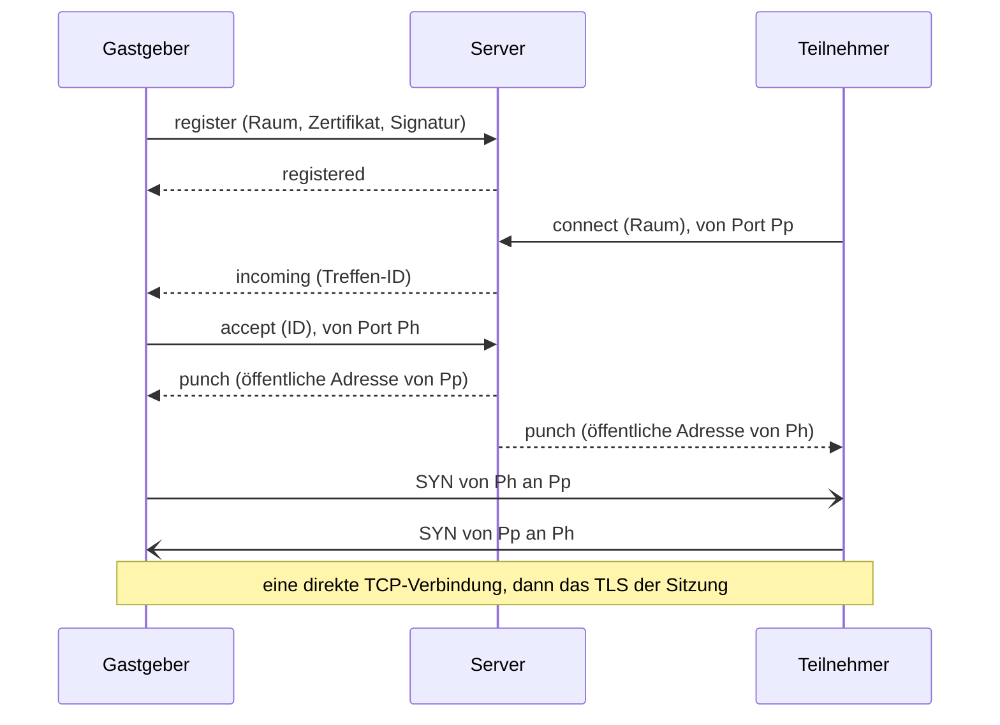

# Golether-Vermittlungsserver

`Golether.Web.Server` (die ausführbare Datei `golether-server`) ist ein kleiner Server, der Gastgeber und Teilnehmer
einander vorstellt, wenn beide hinter Routern ohne offenen Port sitzen: eine graue IP, das NAT des Anbieters, keine
Portweiterleitung. Der Server sagt jeder Seite, unter welcher öffentlichen Adresse sie gesehen wird und wo die andere zu
suchen ist; danach schlagen die Seiten selbst eine **direkte** TCP-Verbindung zueinander durch. Film, Synchronisation,
Chat, Kameras und Sprache gehen nicht über den Server.

Der Server braucht einen Rechner mit öffentlicher IP (oder mit einem am Router weitergeleiteten Port). Die Adresse des
Servers braucht nur der Gastgeber: Teilnehmer bekommen sie in der Einladung. Der Gastgeber bekommt sie auf einem von
zwei Wegen (der Schalter „Verbindungsart“ auf dem Startbildschirm):

- **Automatisch**: Die Anwendung liest die Adresse des Projektservers aus der Datei `config.json` der Projektseite
  (`Sources/Apps/Golether.Pages`). Die Adresse in der Datei ist versiegelt (`EndpointSeal`): eine Maske gegen Scanner,
  kein Geheimnis. Die letzte gute Antwort wird gespeichert und verwendet, wenn die Seite nicht erreichbar ist.
- **Eigener Server**: Der Gastgeber gibt die Adresse ein, zum Beispiel `203.0.113.7:47900`.

**Installation, Konfiguration und Betrieb des Servers** beschreibt das Administratorhandbuch
[`Sources/Apps/Golether.Web.Server/ADMIN-GUIDE.de.md`](../../Sources/Apps/Golether.Web.Server/ADMIN-GUIDE.de.md) für
Windows, Linux und macOS. Dieselbe Datei liegt in jedem Serverpaket neben dem Programm. Dieses Dokument handelt davon,
wie der Server gebaut ist.

- [So funktioniert es](#so-funktioniert-es)
- [Bauen und veröffentlichen](#bauen-und-veröffentlichen)
- [Sicherheit](#sicherheit)
- [Protokoll (Version 1)](#protokoll-version-1)
- [Einschränkungen](#einschränkungen)

## So funktioniert es

Ein Router ohne Portweiterleitung lässt keine Verbindung herein, auf die drinnen niemand gewartet hat. Wenn aber ein
Gerät selbst nach außen geht, merkt sich der Router, welchen externen Port er dem lokalen Port des Geräts gegeben hat,
und lässt die Antworten durch. Darauf beruht NAT hole punching:

1. **Der Gastgeber belegt einen Raum.** Beim Erstellen einer Sitzung denkt sich Golether einen zufälligen Raumnamen aus
   (128 Bit), hält eine dauerhafte Verbindung zum Server und signiert die Registrierung mit dem Geräteschlüssel. Der
   Raum gehört diesem Schlüssel: Ein anderes Gerät kann ihn nicht belegen.
2. **Die Einladung trägt die Serveradresse und den Raum** zusammen mit den üblichen Adressen des Gastgebers.
3. **Der Teilnehmer** versucht zuerst die Adressen der Einladung direkt. Hat innerhalb von 4 Sekunden nichts geantwortet
   (oder ist jede Adresse bereits gescheitert), verbindet er sich mit dem Server **von dem Port aus, von dem er
   durchschlagen will,** und bittet, mit dem Gastgeber des Raums zusammengebracht zu werden.
4. **Der Server** sagt dem Gastgeber, dass jemand wartet. Der Gastgeber öffnet eine neue Verbindung zum Server, ebenfalls
   von dem Port aus, von dem er durchschlagen will. Nun sieht der Server die öffentlichen Adressen beider Ports und
   schickt jeder Seite im selben Moment die Adresse der anderen.
5. **Beide Seiten zugleich** verbinden sich von denselben Ports aus miteinander. Die ersten Pakete verwirft womöglich
   der Router der anderen Seite, aber jedes öffnet ein „Loch“ im eigenen, und der nächste Versuch der anderen Seite
   kommt durch. Zwei aufeinander zulaufende SYN verschmelzen zu einer TCP-Verbindung (TCP simultaneous open). Die
   Versuche werden bis zu 15 Sekunden wiederholt.
6. **Ab hier ist alles wie bei einer direkten Verbindung:** gegenseitiges TLS mit dem fixierten Schlüssel des
   Gastgebers, Einlass, der Prüfcode. Der Server fällt aus der Kette heraus.

Jeder Stream einer Sitzung (Control und bis zu vier Dateistreams) trifft sich auf diese Weise separat; jedes Treffen ist
ein Paar kurzer Austausche mit dem Server.



**Kameras und Sprache.** Derselbe Server beantwortet STUN-Anfragen auf derselben Portnummer über UDP. `webrtcbin` jedes
Teilnehmers erfährt darüber seine öffentliche UDP-Adresse, nimmt sie unter die ICE-Kandidaten auf und schlägt ebenfalls
einen direkten Weg durch. Der Server hat kein eigenes TURN-Relay: Medien gehen nie über ihn.

## Bauen und veröffentlichen

Die fertigen Pakete bauen die Skripte in `Scripts/`, wie bei der Anwendung. Alles landet in `artifacts/publish`:

| Skript | Ergebnis |
|---|---|
| `Scripts/Server/publish-server-win.ps1` | der Ordner `win-x64/GoletherServer` und das Archiv `GoletherServer-<version>-win-x64.zip` |
| `Scripts/Server/build-server-installer.ps1` | dasselbe plus das Installationsprogramm `GoletherServer-<version>-setup.exe` (braucht [Inno Setup](https://jrsoftware.org/isdl.php)); `-SkipPublish` nimmt den bereits vorhandenen Ordner |
| `Scripts/Server/publish-server-linux.ps1 [-Runtime linux-x64\|linux-arm64]` | unter Windows: das Linux-Paket unten, gebaut in Git Bash |
| `Scripts/Server/publish-server-macos.ps1 [-Runtime osx-arm64\|osx-x64]` | unter Windows: das macOS-Paket unten, gebaut in Git Bash |
| `Scripts/Server/publish-server.sh [linux-x64\|linux-arm64\|osx-x64\|osx-arm64]` | der Ordner `<rid>/GoletherServer`, ein `.tar.gz`-Archiv und, wenn das Werkzeug `zip` vorhanden ist, ein `.zip` |

```powershell
./Scripts/Server/build-server-installer.ps1              # Windows: Ordner, zip und Installationsprogramm
./Scripts/Server/publish-server-win.ps1 -Runtime win-arm64
```

```bash
./Scripts/Server/publish-server-linux.ps1                 # Windows: das Linux-x64-Paket (Git Bash ist nötig)
./Scripts/Server/publish-server-macos.ps1                 # Windows: das macOS-Paket für Apple Silicon
./Scripts/Server/publish-server.sh                        # Linux x64 (läuft auch unter Windows in Git Bash)
./Scripts/Server/publish-server.sh linux-arm64            # zum Beispiel für einen Raspberry Pi oder einen ARM-VPS
```

Die Builds sind eigenständig: Der Serverrechner braucht weder .NET noch sonst etwas. Die Paketstruktur legt das Projekt
selbst an (das Target `GoletherServerPackageLayout` in `Golether.Web.Server.csproj`, eingeschaltet mit der Eigenschaft
`GoletherServerPackageRoot`); die Skripte fügen die Notiz, die Dienstdateien und das Archiv hinzu:

```
GoletherServer/
  golether-server(.exe)   der Starter: derselbe .NET-Host mit dem Server-Symbol, der auf bin/ zeigt (wie Golether.exe)
  bin/                    das Programm, die .NET-Laufzeit und die Bibliotheken
  config/appsettings.json die Einstellungen; das Programm in bin/ findet sie selbst (PackageLayout); config/monitor.json die Einstellungen des Monitors
  docs/                   ADMIN-GUIDE.md und README.txt auf Englisch, ADMIN-GUIDE.<code>.md und README.<code>.txt auf
                          Deutsch, Spanisch, Französisch, Portugiesisch und Russisch (de, es, fr, pt, ru)
  service/                Linux und macOS: install-service.sh und golether-server.service / org.golether.server.plist
  golether-server-monitor(.exe)  der Starter des Monitors: der Anwendungs-Host, der auf monitor/ zeigt
  monitor/                Golether Server Monitor (Golether.Web.Server.UI), eigenständig wie der Server
```

Beim Start aus den Quellen (`dotnet run`) gibt es keine Struktur, und `appsettings.json` liegt neben dem Programm. Die
Archive für Linux und macOS lassen sich auch unter Windows (Git Bash) bauen: Das Skript setzt die Ausführungsrechte
selbst, und die lokale Signatur für macOS setzt `install-service.sh` bei der Installation.

Das Windows-Installationsprogramm spricht Englisch, Deutsch, Spanisch, Französisch, Portugiesisch und Russisch (die
Sprache von Windows ist vorausgewählt, Englisch, wenn der Assistent sie nicht spricht); nach der Installation zeigt es
die Notiz und öffnet das Administratorhandbuch in der gewählten Sprache.

Das Server-Symbol ist das Anwendungssymbol mit einem Serverschrank-Abzeichen: `Assets/golether-server.svg` im
Serverprojekt; die Rasterversionen zeichnet `Scripts/Assets/generate-icon.ps1 -Server`.

Zum Debuggen läuft der Server direkt aus den Quellen: `dotnet run --project Sources/Apps/Golether.Web.Server` oder das
Profil „Rendezvous server“ in VS Code.

## Der Monitor

`Golether.Web.Server.UI` (die ausführbare Datei `golether-server-monitor`) ist ein Fenster für den Administrator: der
Zustand des Servers, sein Ereignisjournal in Spalten, Starten und Stoppen des Dienstes, Export des Journals und
Bearbeiten der Einstellungen. Was Server und Monitor teilen (die Einstellungen und ihre Prüfungen, die Namen des
Dienstes auf jedem System, der Zustandsbericht, das Journal), liegt in `Golether.Web.Server.Contracts`, das weder
ASP.NET noch Avalonia braucht.

- **Das Ereignisjournal.** Der Server zeichnet auf, was geschieht (`ServerJournal`): den Start, die Abhöradressen, einen
  Gastgeber, der einen Raum belegt und verlässt, angefragte, vermittelte und gescheiterte Treffen (mit dem Grund),
  abgelehnte Verbindungen, ungültige Anfragen. Jedes Ereignis hat eine Nummer, die Zeit, die IP-Adresse des Geräts, die
  kurze Kennung des Gastgebers und eine Raummarke: die ersten 8 hexadezimalen Ziffern des SHA-256 seines Namens, sodass
  zwei Ereignisse zu einem Raum von anderen unterschieden werden können, die Marke aber niemandem erlaubt, nach dem
  Gastgeber zu fragen. Das Journal hält die letzten 5000 Ereignisse nur im Speicher und beginnt bei jedem Lauf leer.
- **`GET /journal?after=N`** auf der Statusadresse liefert die Ereignisse nach Nummer N (höchstens 1000) und die
  Startzeit des Laufs; eine andere Startzeit sagt dem Monitor, dass der Server neu gestartet wurde. Es antwortet nur
  Anfragen von diesem Computer (sonst `403`), welche Adresse `Urls` auch hat. Ereignisse und Gründe gehen als Namen
  (`ServerContract.Json`), und der Monitor formuliert sie in seiner eigenen Sprache (`Monitor.Event.*`,
  `Monitor.Reason.*`): beim ersten Start die Sprache des Systems, danach die in seiner Sprachauswahl (mit Flaggen)
  gewählte.
- **Der Dienst** wird mit den Werkzeugen des Systems gesteuert: `sc query` und PowerShell als Administrator unter
  Windows, `systemctl` und `pkexec` unter Linux, `launchctl` und `osascript ... with administrator privileges` unter
  macOS. Der Zustand wird ohne besondere Rechte gelesen; jede Änderung fragt im Moment der Aktion danach. Das Speichern
  der Einstellungen legt die neue Datei an ihren Platz und startet einen laufenden Dienst als eine Aktion neu, sodass
  der Benutzer einmal gefragt wird.
- **Wo die Einstellungen liegen.** Der Monitor liegt in `monitor/` des Serverordners und findet
  `config/appsettings.json` eine Ebene höher; sonst nimmt er den üblichen Installationsordner des Systems. Beim
  Schreiben bleibt jeder Teil der Datei erhalten, den er nicht bearbeitet.

## Sicherheit

**Was der Server sieht:** die IP-Adressen und Ports der Geräte, die Raumnamen, die Zertifikate (öffentlichen Schlüssel)
der Gastgeber und die Zeit der Treffen. **Was er nicht sieht:** irgendetwas von der Sitzung: weder den Film noch den
Chat, noch die Kameras, nicht einmal die Namen der Teilnehmer. Eine Sitzung ist mit gegenseitigem TLS zwischen den
Geräten verschlüsselt, Kameras und Sprache mit DTLS-SRTP.

- **Der Server kann sich nicht als Gastgeber ausgeben.** Der Teilnehmer fixiert den Schlüssel des Gastgebers aus der
  Einladung und prüft ihn während des TLS-Handshakes über die durchgeschlagene Verbindung. Ein böswilliger Server kann
  höchstens die Seiten nicht zusammenbringen.
- **Ein Raum lässt sich nicht übernehmen.** Die Registrierung wird mit dem Geräteschlüssel des Gastgebers (ECDSA P-256)
  über einen zufälligen Einmalwert des Servers und den Raumnamen signiert: Eine aufgezeichnete fremde Registrierung
  lässt sich nicht wiederholen, und ein Raum, den ein Schlüssel hält, wird keinem anderen gegeben. Derselbe Schlüssel
  darf den Raum erneut belegen; so kommt der Gastgeber nach einer Unterbrechung zurück.
- **Ein Raum lässt sich nicht über den Schlüssel finden.** Der Raumname sind 128 zufällige Bits, neu für jede Sitzung;
  nur die Empfänger der Einladung kennen ihn. Wer den Raum kennt, erreicht den Gastgeber trotzdem nur zum gewöhnlichen
  Einlass mit dem Prüfcode.
- **Eingehende Daten sind nicht vertrauenswürdig.** Rahmen haben höchstens 16 KiB, das JSON wird geprüft, ein Zertifikat
  hat höchstens 8 KiB, eine Signatur höchstens 256 Bytes, höchstens 8 Adressen pro Nachricht, nur IPv4 mit Port (keine
  Hostnamen). Jedes Warten hat eine Grenze; die Zahlen der Verbindungen, Räume und wartenden Treffen haben Obergrenzen;
  die Rate der Verbindungen und von STUN ist pro IP begrenzt. Die Adresstabelle dieses Begrenzers ist selbst begrenzt
  (200.000 Adressen): Ein UDP-Absender kann seine Adresse fälschen, und eine Flut von Fälschungen darf nicht den ganzen
  Speicher nehmen; über der Grenze werden neue Adressen abgelehnt, bis alte ablaufen.
- **Lokale Adressen** einer Seite werden nur an die andere weitergegeben, wenn beide dieselbe öffentliche Adresse haben
  (derselbe Router): Sonst sind sie nutzlos und würden nur etwas über ein fremdes Netz verraten.
- **STUN taugt nicht für Verstärkungsangriffe:** Die Antwort ist nur wenig größer als die Anfrage, geht nur dorthin,
  woher die Anfrage kam, und ist in der Rate begrenzt. Der Server beantwortet nur Binding.
- **Der Kanal zum Server ist nicht verschlüsselt.** Alles, was darin läuft, sieht der Server ohnehin, es enthält keine
  Geheimnisse, und die Echtheit des Gastgebers wird Ende-zu-Ende geprüft. Wer den Kanal abhört, erfährt die Adressen und
  den Raumnamen: dasselbe, was er beim Blick auf den Verkehr der Sitzung selbst sähe.

## Protokoll (Version 1)

TCP, IPv4. Ein Rahmen sind 4 Bytes Länge (Big-Endian) und UTF-8-JSON (1 Byte – 16 KiB). Der Nachrichtentyp steht im Feld
`$t`; Feldnamen sind in camelCase. Adressen sind Zeichenketten `a.b.c.d:port`. S ist der Server, G der Gastgeber, T ein
Teilnehmer, D ein beliebiges Gerät.

| `$t` | Richtung | Felder | Bedeutung |
|---|---|---|---|
| `server-hello` | S → D | `version`, `nonce` | die erste Nachricht des Servers auf jeder Verbindung; `nonce` sind 16 zufällige Bytes in base64url |
| `register` | G → S | `room`, `certificate` (DER, base64), `signature` (base64) | der Gastgeber belegt einen Raum; die Verbindung bleibt offen |
| `registered` | S → G | `observed` | der Raum ist belegt; `observed` ist die Adresse des Gastgebers, wie der Server sie sieht |
| `ping` / `pong` | G ↔ S | — | Aufrechterhalten der Registrierung (der Gastgeber: alle 20 s) |
| `connect` | T → S | `room`, `locals[]` | ein Teilnehmer bittet um ein Treffen; die Verbindung wird vom Durchschlag-Port geöffnet |
| `incoming` | S → G | `punch` | über die Registrierung: ein Teilnehmer wartet; `punch` sind 16 zufällige Bytes in base64url |
| `accept` | G → S | `punch`, `locals[]` | der Gastgeber beantwortet ein Treffen mit einer neuen Verbindung vom Durchschlag-Port |
| `punch` | S → beide | `peer`, `peerLocals[]` | die öffentliche Adresse der anderen Seite und ihre lokalen Adressen (nur bei gemeinsamer öffentlicher IP) |
| `error` | S → D | `error` | Ablehnung; danach wird die Verbindung geschlossen |

Die Signatur der Registrierung ist ECDSA P-256 / SHA-256 der UTF-8-Zeichenkette
`golether-rendezvous-v1\n<nonce>\n<room>`. Der Eigentümer eines Raums ist das SHA-256 der SubjectPublicKeyInfo des
Schlüssels (dieselbe `PeerId` wie in einer Sitzung).

Die Gründe einer Ablehnung (`error`) gehen als Namen; das Gerät wählt den Text für einen Menschen in seiner eigenen
Sprache:

| Wert | Wann |
|---|---|
| `UnsupportedVersion` | verschiedene Protokollversionen |
| `BadRequest` | eine fehlerhafte oder unerwartete Nachricht |
| `BadSignature` | die Signatur der Registrierung passt nicht zum Zertifikat |
| `RoomTaken` | der Raum gehört einem anderen Schlüssel |
| `RoomNotFound` | niemand hält den Raum (die Sitzung ist beendet oder der Gastgeber hat den Server verloren) |
| `Busy` | zu viele wartende Treffen für diesen Gastgeber |
| `Timeout` | der Gastgeber hat nicht rechtzeitig geantwortet; das Treffen ist unbekannt oder bereits beantwortet |
| `ServerFull` | alle Räume sind belegt |
| `Unreachable`, `PunchFailed` | nur auf dem Gerät: der Server ist nicht erreichbar / die Router haben die Verbindung nicht durchgelassen |

Der Server hält die Treffen-Verbindungen (`connect`, `accept`), bis die Geräte sie schließen (nicht länger als
`AnswerTimeout` nach `punch`): Solange eine offen ist, vergisst der Router die Portzuordnung nicht.

Wer die Verbindung wählt. Es können sich mehrere Verbindungen öffnen (über die öffentlichen und die lokalen Adressen),
und die Seiten könnten verschiedene wählen. Deshalb wählt nur der Teilnehmer: die erste, die sich geöffnet hat, und der
Teilnehmer spricht auch zuerst (TLS ClientHello). Der Gastgeber hält alle, die sich geöffnet haben, und nimmt die, in
der der Teilnehmer gesprochen hat; die übrigen werden geschlossen.

## Einschränkungen

- **Ein symmetrisches NAT** (der Router gibt jedem Ziel einen neuen externen Port) auf einer der Seiten macht das
  Durchschlagen unmöglich: Die Adresse, die der Server gesehen hat, nützt der anderen Seite nichts. Manche
  Mobilfunkanbieter und Firmennetze arbeiten so. Der Teilnehmer bekommt einen Fehler, dass die Router die direkte
  Verbindung nicht durchgelassen haben; es bleiben ein AmneziaWG-Tunnel oder ein weitergeleiteter Port zumindest auf
  der Seite des Gastgebers.
- **Nur IPv4.** Ein Server auf `::` nimmt auch IPv6 an, aber Geräte verbinden sich immer über IPv4 und schlagen IPv4
  durch.
- **Es gibt kein TURN-Relay**, mit Absicht: Haben die Kameras keinen direkten Weg, gehen sie nicht über den Server. Dann
  trägt sie das in die Anwendung eingebaute Relay des Gastgebers: Sein Verkehr läuft über die Streams der Sitzung
  selbst, also funktioniert es überall, wo die Sitzung funktioniert.
- Jeder Stream einer Sitzung braucht ein eigenes Treffen, daher dauert das Verbinden über den Server einige Sekunden
  länger als das direkte Verbinden.
