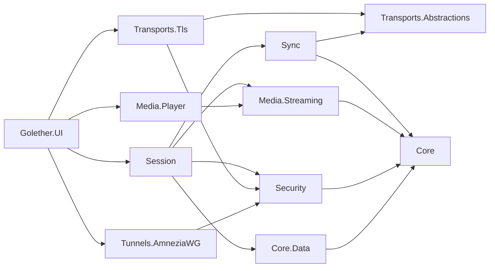

# Golether architecture

## Goal

Watching a video together, with the participants' cameras:

- the video takes most of the window, the participant tiles are on the right (up to 5 people including the host);
- the video runs in sync for everybody; pause, seek and start from any participant apply to all;
- at the start everybody begins from the same position at the same moment;
- the file is not stored on a server: the host serves it in its original quality;
- a ping above 1000 ms is acceptable, a slight desynchronization is tolerable;
- an outsider cannot connect; when the direct path is blocked, AmneziaWG is used.

## Decisions

| Question | Decision | Why |
|---|---|---|
| How the video travels | The original file is sent in 256 KiB pieces, not a broadcast stream | No quality is lost, the ping affects only the synchronization time |
| Player | libmpv (P/Invoke), its own `golether://` protocol | The FFmpeg decoder, as in MPC, but it works on every OS and is controlled precisely |
| Transport | Mutual TLS over TCP, pinned keys | `System.Net.Quic` does not work on Windows 10 and macOS; QUIC is a future optimization |
| Synchronization | The state is defined by time, the host decides, clocks in the spirit of NTP | Delivery delay does not affect the result |
| Security | ECDSA P-256 device key, short-lived invitations, admission by the host, verification code | No certificate authority and no server |
| Tunnels | AmneziaWG "everyone with the host", the "offer / answer" packages are passed by people themselves | No VPS of our own |
| Grey IPs without port forwarding | Our own rendezvous server: it introduces the sides and answers STUN, the connection is punched directly (TCP simultaneous open) | The server relays nothing and sees nothing of the session; one machine with a public IP is enough |
| Cameras and voice | GStreamer `webrtcbin` | LGPL, WebRTC, capture and echo cancellation in one framework; SIPSorcery is incompatible with the GPL |
| Data | SQLite, schema through FluentMigrator, access through EF Core | A project requirement |
| Languages | Texts live in JSON files, one per language; the code takes a text by key from the pack of the chosen language | A new language is a new file, the code has no branches by language |

## Modules

```
Sources/
  Core/Golether.Core                       PeerId, PlaybackState, DriftCorrector, MediaDescriptor, PeerEndpoint, AppDataPaths
  Core/Golether.Localization               languages: JSON files with texts, language choice, Localizer and Texts
  Core/Golether.Core.Data                  EF Core: contacts, tunnels, settings
  Core/Golether.Core.Data.Migrations       FluentMigrator: migrations on SQL scripts and the runner
  Core/Golether.Core.Data.Migrations.SQLite SQL scripts and versions for SQLite
  Database/Golether.Dbs.SQLite.DbMigrator  the console migrator
  Security/Golether.Security               device key, secret protection, invitations, verification code, admission,
                                           the sealed address of the rendezvous server
  Components/Golether.Components          catalog of native components (libmpv, GStreamer, AmneziaWG), lookup and installation
  Tools/Golether.Tools.Components          the golether-components utility: prepares the components for a package build
  Transports/Golether.Transports.Abstractions  PeerStream, connector and listener, FrameChannel
  Transports/Golether.Transports.Tls       mTLS over TCP with a pinned key
  Transports/Golether.Transports.PortMapping  port forwarding on the router: NAT-PMP and UPnP IGD, lease renewal
  Transports/Golether.Transports.Relay     the host's TURN relay for cameras and voice (RFC 5766 over TCP)
  Transports/Golether.Transports.Rendezvous  rendezvous server protocol, host and participant client, TCP hole punching
  Sync/Golether.Sync                       protocol, clock offset estimation, PlaybackAuthority, PlaybackFollower
  Media/Golether.Media.Streaming           chunk server, parallel client, cache, read-ahead, stream for the player
  Media/Golether.Media.Player              libmpv (P/Invoke, embedding, golether://), a simulated player
  Media/Golether.Media.Conference          contract of cameras and voice, a stub
  Media/Golether.Media.Conference.GStreamer  cameras and voice: capture, VP8/Opus, webrtcbin, mixer, echo cancellation
  Tunnels/Golether.Tunnels.AmneziaWG       X25519 keys, obfuscation, .conf, signed packages, control through the CLI
  Session/Golether.Session                 HostSession and ParticipantSession
  Apps/Golether.UI                         Avalonia: window, dialogs, composition of dependencies
  Apps/Golether.Web.Server                 the rendezvous server (a separate application, see RendezvousServer.md)
  Apps/Golether.Web.Server.Contracts       what the server and its monitor share: settings, service names, health, journal
  Apps/Golether.Web.Server.UI              Golether Server Monitor: the state, the journal, the service and the settings
  Apps/Golether.Pages                      the project page on GitHub Pages: landing page, invitations by link, the
                                           files with the latest version and the rendezvous server address (static files)
```

Dependencies point inwards: Core depends on nothing; the UI puts everything together in `AppServices`.



## Channels between the nodes

Every stream is a separate TLS connection with the `GLTH` preamble, a version and a purpose:

- **Control**: JSON messages of the session (welcome, state, clocks, statuses), one connection per participant.
- **MediaData**: binary requests for pieces of the file. A participant opens up to 4 parallel connections so that on
  links with a large RTT the speed is not limited by one TCP stream.
- **Relay**: the TURN traffic of cameras and voice to the host's relay travels in a TLS stream of the session, by
  the same route as the other streams (a direct address or a meeting through the rendezvous server). On the
  participant's side `webrtcbin` points at the local port of `RelayTunnel` (`127.0.0.1`); all connections made to
  it share one `RelayShared` stream as channels of `RelayMultiplexer` (with a host of an earlier version, each gets
  a `Relay` stream of its own); the host hands every channel of an admitted participant to `TurnServer`. That is why
  cameras and voice work wherever the session works, even when UDP is blocked and the relay port is closed from
  outside. ICE still offers direct UDP as well and takes it when it gets through.
  The shared stream may come up only after the first WebRTC connection gave up looking for the relay (a meeting
  through the rendezvous server takes seconds). So a connection that fails (ICE or DTLS) or is not made within
  20 seconds is made again by the offering side after 3, 6, 12, 24 and then every 30 seconds; its new offer carries
  another session identifier on the `o=` line (the DTLS certificate is one per process) and replaces the connection
  of the answering side.
- **TURN** (session port + 1): the `Golether.Transports.Relay` relay for WebRTC (RFC 5766 over TCP, relaying over
  UDP). A port of its own is needed only by participants of earlier versions. The relay credentials are created for
  one session and reach a participant only in the welcome after admission; the relay forwards packets only to
  addresses the client created a permission for. No permission is given for the addresses of the host's own computer
  (loopback) or for broadcast and multicast addresses: every participant knows the relay password, and it must not
  open a way to the host's services. An allocation the client did not refresh before its lifetime ended is closed
  together with the connection, so vanished clients do not hold a place. The media stays encrypted with DTLS-SRTP;
  the host cannot see it.
- **Meeting through the rendezvous server**: if no address of the invitation answered within 4 seconds, the
  participant meets the host through the server named in the invitation: both connect to the server from the ports
  they are going to punch from, learn each other's public addresses and connect to each other directly at the same
  moment. The punched connection carries the same TLS with the pinned key; the host hands such connections to its
  `TlsPeerListener` (`Adopt`). The chosen route is used for every stream of the session. Details:
  [RendezvousServer.md](RendezvousServer.md).
- **Moderation**: the `moderate` message from the host switches a participant's microphone and/or camera off; the
  protocol has no command to switch them on. Participants report the state of their devices in statuses
  (`MicrophoneOff`, `CameraOff`).

Formats in detail: [Protocol.md](Protocol.md).

## Synchronization

The session state (`PlaybackState`): "at the moment `ReferenceTime` by the host's clock the position was `Position`
and the rate `Rate`". Every node computes the needed position itself: `Position + (now − ReferenceTime) × Rate`.

- **Clocks.** A participant sends `ping/pong` probes (6 quick ones, then one every 2 s). The offset
  `((t1 − t0) + (t2 − t3)) / 2` is taken from the probe with the smallest RTT in a window of 16. Until the offset is
  known, the state is not applied to the player.
- **Decisions.** `PlaybackAuthority` on the host takes the requests of all participants in the order they arrive
  (the last one wins) and assigns versions. Nodes apply only newer versions.
- **Start.** Play is scheduled for `now + max(RTT) + 1.5 s` (8 s at most); the interface shows a countdown.
- **Pause.** The initiator pauses at once and sends its frame; the others move to it.
- **No command echo.** The user's intentions come only from interface commands; mpv events are not forwarded. So an
  action applied on somebody else's command is never sent out again.
- **Correction** (`DriftCorrector`):

| Drift | Action |
|---|---|
| < 150 ms | nothing (if a correction is already running, down to 50 ms: hysteresis) |
| 150 ms – 2 s | rate ± up to 5 % for 8 s, the pitch is kept |
| > 2 s | an exact seek; no correction for 1.5 s after a seek |

- **End of the film.** When the expected position reaches the duration, the host fixes a pause on the last frame
  (cause `Ended`). A follower never expects a position beyond the duration and at the end neither seeks nor starts
  the player (mpv with `keep-open` pauses by itself). "Play" at the end starts the film from the beginning.
- **Buffering.** The `WaitForAll` policy: if a participant is buffering and more than 2 s behind, the host pauses
  everybody and continues when each one has ≥ 5 s of data. The alternative is `LetLaggardsCatchUp`.
- **Readiness before the start.** Under `WaitForAll`, "play" first puts everybody into a pause at the needed position
  (cause `WaitingForParticipants`) until every participant has the file open and ≥ 5 s loaded at that position (near
  the end of the film: whatever is left). Then the show starts by itself (`ParticipantsReady`). The host may skip the
  wait (`PlayNow`), and after 45 seconds the wait ends by itself; both give the cause `StartedWithoutWaiting`.

## Chat, reactions, the pen and coming back

- Chat messages, reactions and pen strokes travel over the same TLS channel of the session as the synchronization:
  the host checks the content, limits the rate, puts in the verified sender and sends it to everybody. Nothing is
  written to disk.
- Reactions live for 3 seconds and are drawn in a separate transparent window over the video (the mpv window would
  cover them otherwise). On Windows that window answers `HTTRANSPARENT` to hit testing, so clicks on the video pass
  through it. The window stays open for the whole session: the bindings of a closed popup are inactive, and a reaction
  that had gone would come back the next time it opened.
- The same window covers the whole video area and carries `StrokeCanvas`, the canvas of the pen. While the pen is
  off, the window stays transparent to the mouse; when the button is pressed, `ClickThroughWindow.SetClickThrough`
  stops answering `HTTRANSPARENT` and the canvas receives the pointer events itself. `DrawingViewModel` collects
  points and sends them in batches (~60 ms), and draws only what the host returned, its own strokes included, so the
  order is the same for everybody.
- The coordinates of a stroke are fractions of the *picture*, not of the window: `StrokeCanvas` computes the frame
  rectangle from the aspect ratio reported by mpv (`video-params/aspect`), so the circled place matches whatever the
  shapes of the windows are. The colour of a stroke is the participant's colour from `ParticipantColors`, the same as
  the avatar's.
- On admission a participant receives a ticket (`reconnectTicket`) valid until the session ends. After a break
  `SessionService` tries to come back eight times with pauses of 2, 3, 5, 10, 20 and 30 seconds; the host confirms
  the entry every time.

## Showing a folder

- `GalleryFolder` (Media.Streaming) walks the chosen folder without following links: the files of a folder first, in
  natural order, then its nested folders one after another, at most 16 levels deep and 100,000 files looked at. It
  sorts files into pictures, pictures to decode (HEIC, AVIF, TIFF), videos and RAW files that are left out.
- `GalleryCatalog` prepares the files in parallel. `PictureLayout` reads only the headers and builds the bytes the
  participants receive from pieces of the file, leaving out EXIF/XMP and comments, the data after the end of a JPEG and
  the metadata blocks of PNG, WebP and GIF; the orientation is put back as a minimal EXIF block. Pictures to decode go
  through `IFrameExtractor`: `MpvFrameExtractor` runs a separate windowless libmpv with the `image` video output
  and writes a JPEG into `data/gallery/<showing>`; a frame of a video becomes its small picture the same way. Keys
  are random for every showing, and the folder of a showing is deleted when it ends.
- `ChunkServer` serves the film and, through `ISharedFileSet`, the pictures of the current showing by their keys,
  in the same pieces with SHA-256; the hashes of pictures are not cached.
- `HostSession` is the authority of the common screen: it numbers every choice (`show`), carries them out one at a
  time and turns a video into the film (`media` + `state`) before announcing it; a picture pauses the film. It
  makes the small pictures once per showing, two at a time, through `IThumbnailRenderer` (SkiaSharp in the UI).
- In the interface `GalleryViewModel` keeps the strip and the grid (rows of a virtualized list, so two thousand
  items stay light), decodes pictures for the screen through `IPictureDecoder`, keeps the last six, fetches the
  neighbours ahead and asks again for a small picture that did not arrive (after 5, 15 and 45 seconds).
  `FolderBrowserViewModel` is the folder browser of the host: the folder picker of the system shows no files.
- A picture is drawn by Avalonia (`ZoomableImage`), not by mpv, so while one is shown a second layer of reactions and
  strokes lies in the picture itself (a control cannot move between windows), and there the pointer reaches the
  picture on every system. Zoom is personal: `StrokeCanvas` places the strokes by the same `PictureFrame` rule, so a
  line stays on its place.

## Serving the file

- `MediaDescriptor`: name, size, piece size, a quick identifier (SHA-256 of the size and three 1 MiB samples).
- `ChunkServer` gives out pieces with their SHA-256; the client checks the hash and the length.
- `RemoteChunkSource` removes duplicate requests and re-creates failed streams (3 attempts).
- `CachedMediaReader` keeps pieces in memory (LRU, 1 GiB) and reads 32 pieces ahead in batches of 4.
- `MediaReadStream` is given to libmpv through `mpv_stream_cb_add_ro`; a read is cancelled through `cancel_fn`.
- A participant with the same file (the quick identifier matches) plays it from disk.
- **Loaded indicator.** The player reports which ranges are already in the cache (`demuxer-cache-state` of mpv), and
  the timeline shows them with a light fill: you can see where a seek needs no waiting. For the host and for a
  participant with their own copy of the file the whole timeline is marked.
- **Sharing between viewers** (`Media.Streaming.Sharing`): participants announce to each other which pieces they have
  (the cache in memory or a whole local copy) and pass them over a WebRTC data channel. `SwarmChunkSource` takes a
  piece from a participant, checks its SHA-256 against the hash the host gives without the data (the GetHash
  operation), and on any error downloads the piece from the host. So the host gives every piece once, not to every
  viewer.

## Security

- **Device:** ECDSA P-256 and a self-signed certificate; `PeerId` = SHA-256 of the SubjectPublicKeyInfo. The key is
  kept in `identity/device.key` under DPAPI (Windows) or with mode 600 (Linux/macOS, until the move to
  libsecret/Keychain).
- **Invitation:** `golether://join/v1/<base64url JSON>` with the host's fingerprint, addresses, a 128-bit token and
  an expiry time; the host keeps only the hash of the token. The token and the expiry time are written first in the
  JSON: everything else is the same in every invitation of a session, so a new invitation differs from its first
  characters.
  - *Two spellings.* The **key** (`golether://…`) is pasted into the application, the **link**
    (`https://depthrel.github.io/Golether/join/#…`) is clickable in any messenger; the content is the same. The
    invitation window issues them as two invitations with tokens of their own: the link lives 15 minutes, the key
    15 minutes or an hour. `InviteRegistry` issues nothing longer than an hour.
  - *One for the whole company.* Everybody the host called joins with one invitation until it expires or has brought
    16 requests (`InviteRegistry.MaxUses`, the limit for a leaked link). It is not the invitation that lets people in
    but the host, who approves each one.
  - *The lifetime is checked only on entry* (the participant before connecting, the host in
    `InviteRegistry.TryUse`): an admitted participant stays in the session and comes back after a break with the
    ticket, not the invitation.
  - *Removed and declined.* The host remembers the device together with the number of the last invitation issued by
    that moment (`HostSession._turnedAway`). Those invitations no longer let that device in, though they still work
    for the others; an invitation made later does. This is not a ban, and a host who simply did not answer in time
    has refused nobody. The device gets the reason at once, without the host being asked. An admitted participant
    whom the host removed, or whose session the host ended, is shown the reason in a message of its own
    (`ISessionService.ClosedByHost`): the event feed disappears together with the session.
- **Connection:** the participant pins the host's key during the TLS handshake. The host accepts any certificate,
  computes the `PeerId`, checks the token (trusted contacts do not need one) and asks the user.
- **Verification code:** three words and a number from both `PeerId`s and the context; the sides compare it by voice.
  The words are shown in the language of each side (see "Interface languages").
- **The file** is given only to admitted participants; when a participant leaves, is removed or connects again, their
  data streams are closed.
- **Cameras and voice** are encrypted with DTLS-SRTP. `webrtcbin` does not check the peer's certificate against the
  fingerprint from the SDP, so `WebRtcPeer` does it itself: the SDP arrives only over the protected channel of the
  session, no frames or sound are sent (`valve`) or accepted until the certificate matches, and on a mismatch the
  connection is dropped. Foreign STUN/TURN servers are not used; when the invitation names a rendezvous server, its
  UDP port serves as the STUN server of the session (`IConferenceMedia.SetStunServer`), and the cameras also go
  directly through NAT.
- **A camera or microphone that is switched off** is released: the device is stopped, not merely silenced.
- **Incoming data** (JSON, packages, configurations, file names) is validated and limited in size.

## AmneziaWG tunnels

- The host keeps one interface `golether0` with the subnet `10.64–127.x.0/24`; every participant is a `/32` peer.
- An offer: the AWG public key, addresses, the assigned address, the shared parameters `S1/S2/H1–H4`, an ephemeral
  P-256 key, an expiry time, the device certificate, a signature. An answer: the same from the participant's side.
- PSK = SHA-256(ECDH(ephemeral P-256 keys)); it never travels over the network.
- Private keys do not leave the device; secrets in the database are protected by `ISecretProtector`.
- A tunnel is brought up with `amneziawg.exe /installtunnelservice` (Windows) or `awg-quick up` (Linux/macOS). The
  configuration is exported in a format compatible with AmneziaVPN.
- **Its own engine.** On Windows the application has its own AmneziaWG: it is not part of the application package but
  is downloaded on demand as the `Tunnel` component (the "Install" button in the tunnel window). It is the official
  package `amneziawg-<arch>-3.1.0.msi`, pinned by SHA-256 and size, from which `msiexec /a` extracts `amneziawg.exe`,
  `awg.exe` and `wintun.dll` into `data/components/tunnel/<version>/amneziawg`. Nothing is installed into the system
  and unpacking needs no administrator rights. `ComponentLocator` deliberately does **not** look for an AmneziaWG
  installed by the user: Golether calls only its own copy, so the system client and its tunnels are not touched.
  Without the component, `AwgCliOptions.WindowsExecutable` falls back to the path in Program Files. The elevated
  helper `--tunnel-helper` computes the same path, so both sides call the same program. The path is looked up
  **before every call** (`AwgCliOptions.FindCarriedExecutable`), not once at start: the component can be installed
  without restarting the application. It is installed from the tunnel window, which shows the component card; without
  the engine `UpAsync` and `DownAsync` give a clear error at once instead of a failed process start.
- The tunnel address range `10.64–127.x.0/24` is chosen not to overlap typical home networks (`192.168.x`,
  `10.0.0.x`) and tunnels the user brought up themselves.
- **Public address and NAT traversal** (`NatTraversal`). Before creating an offer and before accepting an answer, a
  side opens a UDP socket on the port of the future tunnel and asks public STUN servers how that port looks from
  outside. The address goes into the package only when two servers named **the same** port: different ones mean a
  symmetric NAT, and such an address is useless. Then each side sends a few packets to the other's addresses from the
  same port: the first packet is dropped by the other router but opens a hole in its own, and the handshake gets
  through. The socket is closed right before the tunnel starts: the router's mapping lives noticeably longer.
- The list of STUN servers is given in the constructor of `TunnelWorkflow`; an empty list switches every outside
  request off (the tests work this way, and it can be done for privacy).
- **A tunnel lives as long as the application.** The names of the raised interfaces are written to
  `data/tunnels/raised.txt`; on exit `AppServices.DisposeAsync` brings them down (for two minutes at most; refusing
  the administrator prompt does not hold the exit back). The file survives a crash, so a forgotten tunnel is removed
  by the next start, and the tunnel window has a "Bring the tunnel down" button for not waiting until exit. Tunnels
  that were not raised by Golether are left alone: the file lists only its own.
- The interface port is chosen from 40000–60000 **with a check that it is free**: the range overlaps the ports
  Windows hands out to any program, and a busy port would mean both a failed tunnel and no way to learn the public
  address.

## Interface languages

Everything the user reads (screens, dialogs, error messages, session events, the diagnostic report) comes from the
language packs `Sources/Core/Golether.Localization/Languages/<code>.json`: a flat "key → text" object in which
`Language.Code` and `Language.Name` name the language (`en` is "English", `de` is "Deutsch", `ru` is "Русский"). The
application carries English, German, Spanish, French, Portuguese and Russian. The packs are embedded in the assembly;
`LanguageCatalog` finds them by itself. English is the default language and the source of the texts another language
lacks.

How it is built:

- `ILanguagePack` is a strategy: the texts of one language. `Localizer` looks a key up in the pack of the current
  language, then in the English one, then returns the key itself (the gap is visible, the screen does not break). It
  never asks which language is on.
- `Texts` (`Texts.Get(key)`, `Texts.Format(key, values)`) is the access for code without a view model: exceptions,
  session events, hints. `Texts.Scope(...)` gives a flow of work its own language (the tests need it).
- XAML: `Text="{loc:Loc Main.Title}"`, with a value: `{loc:Loc Key=Main.Device, Arg={Binding Fingerprint}}`. The
  binding goes through `LocalizationSource`, so every text changes at once when the language changes, with no
  restart. Texts that view models compose themselves are re-read in `MainWindowViewModel.RefreshTexts`.
- Keys that depend on an enumeration are built from its values: `Session.Reject.<RejectReason>`,
  `Session.Playback.<PlaybackCause>`, `Component.Source.<ComponentSource>`, `Component.Stage.<InstallStage>`,
  `Log.Level.<LogLevel>`. Tests make sure every value has a text in every language.

Choosing the language (`LanguageService`, the `ui.language` setting in the `Settings` table):

1. First start: the database has no language, so the language of the operating system
   (`CultureInfo.CurrentUICulture`) is taken when there is a pack for it, whatever the region (`de-CH` gets German,
   `pt-BR` Portuguese), otherwise English. The result is stored and shown at once in the list of languages.
2. Later starts: the language is read from the database; the system is not asked any more.
3. The user chooses the language in the settings window (the flag `Assets/Flags/<code>.png` and the name of the
   language in that language); the choice is applied with the "Apply" button, at once for every text, and stored.

The server monitor uses the same packs (the `Monitor.*` keys) and the same flags; it keeps its choice in
`config/monitor.json` of the server folder.

The words of the verification code are translated: `VerificationCode` holds three word numbers (0–63) and a number,
and every pack names the same 64 things in the same order (`Verification.Word.00` … `Verification.Word.63`). The code
is therefore the same on both sides whatever their languages, and two people with different interface languages see
translations of each other's words.

What does not depend on the interface language:

- reasons travel over the network, not texts: `rejected` carries a `RejectReason`, `bye` has no text; the reader
  words the reason in their own language (the host and a participant may use different languages);
- the tunnel and firewall helper (a separate process with administrator rights) knows no language: it reports facts
  (program, exit code, output), and the application makes words of them (`TunnelHelper.DescribeFailure`);
- messages of the OS and .NET (`Win32Exception`, `HttpRequestException`) and the output of external programs are
  shown as they are; developer log messages (`ILogger`) stay English, only the level label in a log line is
  translated.

## Project page, joining by link and the single instance

The page `Sources/Apps/Golether.Pages` (GitHub Pages, the addresses are in `ProjectSite`) is a convenience, not a
dependency: a key works without it, the rendezvous server can be typed by hand, the update source can be replaced.

- **Invitation link.** `join/` reads the invitation after the `#` (the browser does not send that part to the
  server), shows the session name and the host name and goes to `golether://join/v1/…`. The page loads nothing from
  other servers and sends nothing anywhere (`Content-Security-Policy`), and it removes the invitation from the address
  bar at once. A second link opened in the same tab makes the page load again, so it never hands out the previous
  invitation.
- **The `golether://` scheme** is registered on installation: Windows uses `Software\Classes\golether` (Inno Setup,
  `HKA`), macOS `CFBundleURLTypes` in `Info.plist`, Linux `MimeType=x-scheme-handler/golether` in the `.desktop` file.
- **Single instance** (`SingleInstance`): a named mutex per user and data folder decides who is first; a second start
  hands its arguments to the first one over a named pipe open to the current user only, and ends. The message is
  limited in size and parsed as a short list of strings. On macOS a link arrives as an event
  (`IActivatableLifetime`).
- **Joining is never silent.** Any page can open `golether://`, so `MainWindowViewModel.OfferInviteAsync` first parses
  the invitation and then asks: "join the session?" or, when a session is running, "switch to another one?". The names
  in the question come from the invitation, that is, they were written by its author; who the host really is, is
  confirmed by the pinned key and the verification code.
- **Rendezvous server address** (`RendezvousMode`): "Automatically" means `RendezvousDirectory` reads `config.json`
  of the page (up to 5 seconds, up to 4 KiB), otherwise takes the last good answer from the
  `network.rendezvousDirectory` setting, otherwise the session runs without a server and the host sees an event about
  it; "Directly" means no server; "My own server" means the address from the `network.rendezvousServer` setting. The
  address in the file is covered by `EndpointSeal` (AES-256-GCM, the key is built into the application): this is a
  mask against scanners, not a secret, since the key is in the open source and the address is part of every
  invitation. A forged file could show a foreign server who meets whom and spoil the meeting, but could not read a
  session or pose as the host: the participant pins the host's key from the invitation. The text for the file is made
  by the owner's utility `Golether.AdminSettings` (a separate repository) with its own copy of the algorithm;
  `EndpointSealTests` keeps a sample of its output.

## Updates and reports

- `UpdateService` reads the manifest from the project page (`updates.json`) or from the address in the settings
  (`updates.url`, only `https://` or a local address) and compares the version. The application tells about a new
  version with a bar whose button opens the download page (the `page` field of the release, otherwise `url`); the
  "Ignore this version" tick stores the version in `updates.ignoredVersion`, and the check is switched off with the
  `updates.check` setting. Nothing is downloaded or installed by itself. Downloading with a SHA-256 check
  (`DownloadAsync`) is still in the service, but the interface does not call it; without a hash in the manifest it
  refuses.
- `FileLogProvider` writes the log to `data/logs/golether-<date>.log` (7 days, up to 8 MiB a day), cutting out long
  hexadecimal strings, keys and relay passwords.
- An unhandled exception the application stopped on, and failures of background tasks nobody waited for, also reach
  the log (`App.LogCrashes`): after a crash there is something to attach to a report.
- `DiagnosticReport` builds the report from that: version, system, components, the session state (without the file
  name) and the tail of the log.
- The installer (`Scripts/App/golether.iss`, Inno Setup) asks whom to install for: "only for me" (the default) goes to
  `%LOCALAPPDATA%\Programs\Golether` without administrator rights, with the data in `data` inside the installation;
  "for everyone" goes to `C:\Program Files\Golether`, puts `golether.shared` next to `golether.install`, and each
  user's data lies in `%LOCALAPPDATA%\Golether`. The choice is a page of the wizard: Inno Setup cannot change its
  rights half way, so "for everyone" starts the setup again with administrator rights (`/ALLUSERS`). The wizard
  speaks English, German, Spanish, French, Portuguese and Russian: the language of Windows is preselected, English
  when the wizard does not speak it. The pictures with the logo are drawn by `Scripts/Assets/generate-installer-art.ps1`.
  Personal data is never overwritten and is removed only with separate consent. The installer of the rendezvous server
  (`Scripts/Server/golether-server.iss`) is built the same way but always installs for all users.

## Data

The application is self-contained: `AppDataPaths` looks for the `golether.install` marker in the program folder and
up to three parent folders (packages put it in the root of `Golether/`, next to `app/` or `Golether.app`) and keeps
everything in `data` next to it; without the marker (a build from `bin`) in `data` next to the executable. The user
profile is not used, except for an installation "for all users" (the `golether.shared` marker), where an ordinary
user cannot write; the data of early builds from `%LOCALAPPDATA%\Golether` is moved once. `GOLETHER_DATA_DIR`
overrides the path for development and tests.

| Table | Content |
|---|---|
| `Contacts` | known devices: name, trust flag, last address, time |
| `HostTunnelInterfaces` | protected keys and parameters of the host's interface |
| `Tunnels` | offers and tunnels: role, status, address, peer, protected secrets |
| `Settings` | settings (user name, interface language `ui.language`, volume, devices) |

The schema is created by migrations when the application starts or through `Golether.Dbs.SQLite.DbMigrator`.

## Stages

| Stage | State |
|---|---|
| Foundation: solution, core, data, security, transport, synchronization, file serving, player, UI, tests, packaging | **done** |
| One-click automatic installation of components (libmpv, GStreamer) | **done** |
| Cameras and voice: GStreamer `webrtcbin`, "everyone with everyone", `webrtcdsp` echo cancellation | **done** |
| Tunnels without running the program as administrator (UAC helper, pkexec, osascript), choice of camera and microphone, DTLS certificate check | **done** |
| Automatic forwarding of the host's port (NAT-PMP, UPnP IGD) | **done** |
| Relaying cameras and voice through the host (own TURN over TCP), the host switching a participant's devices off, volume and clicks on the video | **done** |
| Sharing pieces between viewers over WebRTC data channels, checked against the host's hashes | **done** |
| Own tracks and subtitles for everyone, continuing where one stopped, waiting for readiness before the start | **done** |
| Chat and reactions over the session channel, per-participant volume, loaded indicator on the timeline | **done** |
| Adaptive camera quality by connection statistics, automatic reconnection, diagnostic report | **done** |
| Windows installer (Inno Setup) and update check at a configurable address | **done** |
| Splash screen at start and the pen: drawing over the video, visible to all participants | **done** |
| Windows firewall rule for incoming connections (a single administrator confirmation) | **done** |
| Own AmneziaWG engine as part of the application (the `Tunnel` component), leaving the system client alone | **done** |
| Public address through STUN in tunnel packages and NAT traversal from the tunnel port | **done** |
| A tunnel lives while the application runs: tracking the raised ones and removing them on exit | **done** |
| Rendezvous server: host and participant meet without open ports, TCP hole punching, STUN for cameras | **done** |
| Project page, invitation link that opens the application, single instance, automatic lookup of the rendezvous server | **done** |
| One invitation for the whole company, removal of a participant by the host | **done** |
| Six languages (English, German, Spanish, French, Portuguese, Russian) in the application, the monitor, the installers, the page and the documentation; translated words of the verification code | **done** |
| Showing a folder: pictures and videos with nested folders, looking alone, zoom, metadata left out | **done** |
| libmpv render API for macOS and Wayland, QUIC for Windows 11/Linux | planned |
| Keychain / libsecret secret storage, signed installers | planned |

## Known limitations of the current build

- Cameras and voice go directly, and when there is no direct path, through the host's TURN relay over the session
  streams (`Relay`). Sound and video then travel inside TCP: with losses on the line, delays are possible. Between
  two participants without a direct path the traffic goes through the host's computer (encrypted with DTLS-SRTP).
  The path is chosen at connection time: if UDP disappears in the middle of a meeting, the pair moves to the relay
  only after the cameras reconnect.
- The ICE states of every connection are written to the log (`ICE to …: checking / connected / failed`): they show
  whether a network path for the cameras was found.
- Switching a participant's devices off is carried out by the participant's program; a modified client can ignore it.
- Who is speaking is determined by each participant themselves from the sound level (`VoiceActivityDetector`:
  −42 dBFS, 60 ms to start, 450 ms hold): their own voice from a separate branch of the microphone pipeline, the
  others' from the received sound.
- On Windows mpv creates its window disabled (`WS_DISABLED`), so clicks on the video are caught by the container
  window `VideoHost` (a replaced window procedure); on Linux and macOS clicks arrive through mpv input bindings.
- Camera quality adapts to every participant: with losses ≥ 5 % or a round trip ≥ 0.5 s (two probes in a row,
  `webrtcbin` statistics) a participant gets an economy stream of 320×180 at 10 frames/s, and after five good probes
  the usual 640×360 returns. The economy encoder works only while somebody needs it; the switch happens on a key
  frame.
- On macOS libmpv opens a window of its own (no embedding without the render API).
- Avalonia elements cannot be drawn over the video area (airspace), so hints are shown instead of the video, and
  reactions and pen strokes in a separate transparent window that also lets clicks through (except while the pen is
  on).
- While the application prepares its data and keys, the `SplashWindow` splash screen is shown; the main window is
  created ready, so an empty frame with a transparent area is no longer visible.
- The Windows firewall treats a new adapter (a tunnel one included) as a public network and drops incoming
  connections, so `WindowsFirewall` reads the rules through the COM object `HNetCfg.FwPolicy2` (no rights needed) and,
  when there is no rule for this copy, offers to add one with a short run of `Golether.exe --firewall-helper allow`
  through UAC. There is one rule, tied to the program, not to a port.
- Tunnels are changed with administrator rights only for the duration of the operation: Windows runs
  `Golether.exe --tunnel-helper` through UAC, Linux uses `pkexec`, macOS `osascript … with administrator privileges`.
  There is no permanent service, so every change of a tunnel needs a confirmation.
- A folder shows JPEG, PNG, WebP, GIF and BMP as they are, HEIC, AVIF and TIFF through the video component of the
  host; camera RAW files are not shown. Zooming a picture changes one screen only.
