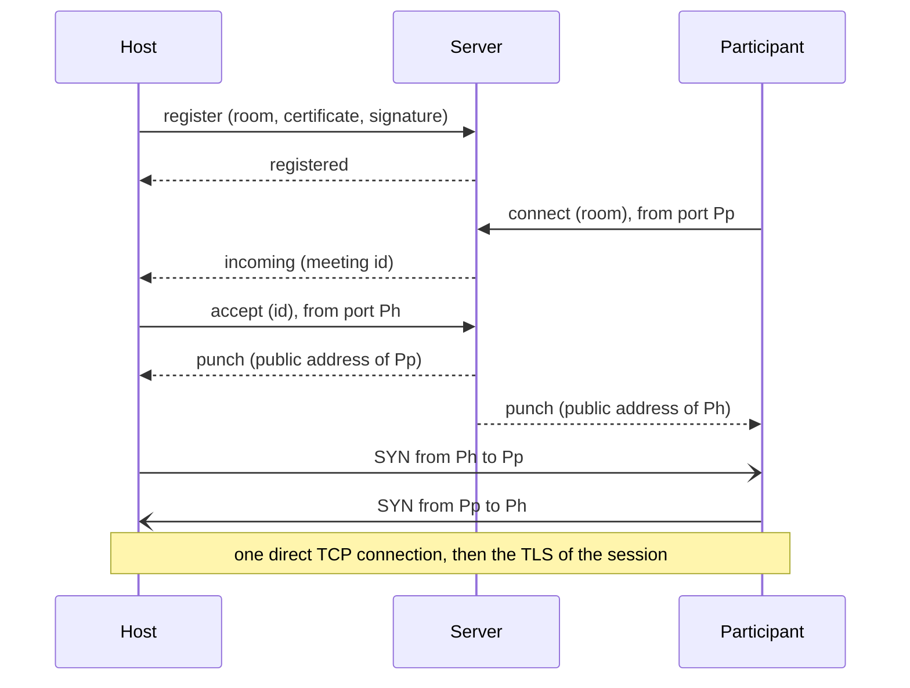

# Golether rendezvous server

`Golether.Web.Server` (the executable `golether-server`) is a small server that introduces the host and a
participant when both sit behind routers without an open port: a grey IP, the provider's NAT, no port forwarding.
The server tells each side at which public address it is seen and where to look for the other, after which the sides
punch a **direct** TCP connection to each other by themselves. The film, the synchronization, the chat, the cameras
and the voice do not pass through the server.

The server needs one machine with a public IP (or with a port forwarded on the router). Only the host needs the
server's address: participants get it in the invitation. The host gets it in one of two ways (the "Connection method"
switch on the start screen):

- **Automatically**: the application reads the address of the project's server from the `config.json` file on the
  project page (`Sources/Apps/Golether.Pages`). The address in the file is sealed (`EndpointSeal`): a mask against
  scanners, not a secret. The last good answer is remembered and used when the page is unreachable.
- **My own server**: the host types the address, for example `203.0.113.7:47900`.

**Installing, configuring and maintaining the server** is described in the administrator guide
[`Sources/Apps/Golether.Web.Server/ADMIN-GUIDE.md`](../../Sources/Apps/Golether.Web.Server/ADMIN-GUIDE.md) for
Windows, Linux and macOS. The same file lies next to the program in every server package. This document
is about how the server is built.

- [How it works](#how-it-works)
- [Building and publishing](#building-and-publishing)
- [Security](#security)
- [Protocol (version 1)](#protocol-version-1)
- [Limitations](#limitations)

## How it works

A router without port forwarding does not let in a connection nobody inside was waiting for. But when a device
reaches out by itself, the router remembers which external port it gave to the device's local port, and lets the
answers through. NAT hole punching is built on this:

1. **The host takes a room.** When a session is created, Golether makes up a random room name (128 bits), keeps a
   permanent connection with the server and signs the registration with the device key. The room belongs to that key:
   another device cannot take it.
2. **The invitation carries the server address and the room** together with the usual addresses of the host.
3. **The participant** first tries the addresses of the invitation directly. If nothing answered within 4 seconds
   (or every address has already failed), it connects to the server **from the port it is going to punch from** and
   asks to be brought together with the host of the room.
4. **The server** tells the host that somebody is waiting. The host opens a new connection to the server, also from
   the port it is going to punch from. Now the server sees the public addresses of both ports and sends each side the
   address of the other at the same moment.
5. **Both sides at once** connect to each other from the same ports. The first packets may be dropped by the other
   side's router, but each opens a "hole" in its own, and the other side's next attempt gets through. Two SYNs going
   towards each other merge into one TCP connection (TCP simultaneous open). The attempts are repeated for up to
   15 seconds.
6. **From here everything is as with a direct connection:** mutual TLS with the pinned key of the host, admission,
   the verification code. The server drops out of the chain.

Every stream of a session (control and up to four file streams) meets this way separately; each meeting is a pair of
short exchanges with the server.



**Cameras and voice.** The same server answers STUN requests on the same port number over UDP. `webrtcbin` of every
participant learns its public UDP address through it, puts it among the ICE candidates and punches a direct path as
well. The server has no TURN relay of its own: media never passes through it.

## Building and publishing

The ready packages are built by the scripts in `Scripts/`, as for the application. Everything goes to
`artifacts/publish`:

| Script | Result |
|---|---|
| `Scripts/Server/publish-server-win.ps1` | the folder `win-x64/GoletherServer` and the archive `GoletherServer-<version>-win-x64.zip` |
| `Scripts/Server/build-server-installer.ps1` | the same plus the installer `GoletherServer-<version>-setup.exe` (needs [Inno Setup](https://jrsoftware.org/isdl.php)); `-SkipPublish` takes the folder that is already there |
| `Scripts/Server/publish-server-linux.ps1 [-Runtime linux-x64\|linux-arm64]` | from Windows: the Linux package below, built in Git Bash |
| `Scripts/Server/publish-server-macos.ps1 [-Runtime osx-arm64\|osx-x64]` | from Windows: the macOS package below, built in Git Bash |
| `Scripts/Server/publish-server.sh [linux-x64\|linux-arm64\|osx-x64\|osx-arm64]` | the folder `<rid>/GoletherServer`, a `.tar.gz` archive and, when the `zip` tool is available, a `.zip` |

```powershell
./Scripts/Server/build-server-installer.ps1              # Windows: folder, zip and installer
./Scripts/Server/publish-server-win.ps1 -Runtime win-arm64
```

```bash
./Scripts/Server/publish-server-linux.ps1                 # Windows: the Linux x64 package (Git Bash is needed)
./Scripts/Server/publish-server-macos.ps1                 # Windows: the macOS Apple silicon package
./Scripts/Server/publish-server.sh                        # Linux x64 (also runs on Windows from Git Bash)
./Scripts/Server/publish-server.sh linux-arm64            # for a Raspberry Pi or an ARM VPS, for example
```

The builds are self-contained: the server machine needs neither .NET nor anything else. The package layout is made
by the project itself (the `GoletherServerPackageLayout` target in `Golether.Web.Server.csproj`, switched on with the
`GoletherServerPackageRoot` property); the scripts add the note, the service files and the archive:

```
GoletherServer/
  golether-server(.exe)   the launcher: the same .NET host with the server icon, pointing at bin/ (like Golether.exe)
  bin/                    the program, the .NET runtime and the libraries
  config/appsettings.json the settings; the program in bin/ finds them by itself (PackageLayout); config/monitor.json the settings of the monitor
  docs/                   ADMIN-GUIDE.md and README.txt in English, ADMIN-GUIDE.ru.md and README.ru.txt in Russian
  service/                Linux and macOS: install-service.sh and golether-server.service / org.golether.server.plist
  golether-server-monitor(.exe)  the launcher of the monitor: the application host pointing at monitor/
  monitor/                Golether Server Monitor (Golether.Web.Server.UI), self-contained like the server
```

When started from the sources (`dotnet run`) there is no layout, and `appsettings.json` lies next to the program.
The archives for Linux and macOS can be built on Windows as well (Git Bash): the script sets the executable
permissions itself, and the local signature for macOS is put on by `install-service.sh` during installation.

The Windows installer speaks English and Russian (English is offered first) and shows the note in the chosen
language after the installation.

The server icon is the application icon with a server rack badge: `Assets/golether-server.svg` in the server
project; the raster versions are drawn by `Scripts/Assets/generate-icon.ps1 -Server`.

For debugging the server runs straight from the sources: `dotnet run --project Sources/Apps/Golether.Web.Server` or
the "Сервер рукопожатий" profile in VS Code.

## The monitor

`Golether.Web.Server.UI` (the executable `golether-server-monitor`) is a window for the administrator: the state of
the server, its journal of events in columns, starting and stopping the service, exporting the journal and editing
the settings. What the server and the monitor share (the settings and their checks, the names of the service on
every system, the health report, the journal) lives in `Golether.Web.Server.Contracts`, which needs neither ASP.NET
nor Avalonia.

- **The journal of events.** The server records what happens (`ServerJournal`): the start, the listening addresses,
  a host taking and leaving a room, the meetings asked for, introduced and failed (with the reason), refused
  connections, invalid requests. Each event has a number, the time, the IP address of the device, the short
  identifier of the host and a tag of the room: the first 8 hexadecimal digits of SHA-256 of its name, so two events
  about one room can be told apart from others, but the tag does not let anybody ask for the host. The journal holds
  the last 5000 events in memory only and starts empty with every run.
- **`GET /journal?after=N`** on the status address answers the events after number N (at most 1000) and the start
  time of the run; a different start time tells the monitor that the server was restarted. It answers only
  requests from this computer (`403` otherwise), whatever address `Urls` has. Events and reasons travel by name
  (`ServerContract.Json`), and the monitor words them in the language of the system (`Monitor.Event.*`,
  `Monitor.Reason.*`).
- **The service** is controlled with the tools of the system: `sc query` and PowerShell run as administrator on
  Windows, `systemctl` and `pkexec` on Linux, `launchctl` and `osascript ... with administrator privileges` on macOS.
  The state is read without special rights; every change asks for them at the moment of the action. Saving the
  settings puts the new file in place and restarts a running service as one action, so the user is asked once.
- **Where the settings are.** The monitor lies in `monitor/` of the server folder and finds `config/appsettings.json`
  one level up; otherwise it takes the usual installation folder of the system. Writing keeps every part of the
  file it does not edit.

## Security

**What the server sees:** the IP addresses and ports of the devices, the room names, the certificates (public keys)
of the hosts and the time of the meetings. **What it does not see:** anything of the session: neither the film, nor
the chat, nor the cameras, nor even the names of the participants. A session is encrypted with mutual TLS between
the devices, cameras and voice with DTLS-SRTP.

- **The server cannot pose as the host.** The participant pins the host's key from the invitation and checks it
  during the TLS handshake over the punched connection. A malicious server can at most fail to bring the sides
  together.
- **A room cannot be taken over.** The registration is signed with the host's device key (ECDSA P-256) over a random
  single-use value from the server and the room name: a recorded registration of somebody else cannot be replayed,
  and a room held by one key is not given to another. The same key may take the room again; that is how the host
  comes back after a break.
- **A room cannot be found by the key.** The room name is 128 random bits, new for every session; only the receivers
  of the invitation know it. Whoever knows the room still reaches the host only for the ordinary admission with the
  verification code.
- **Incoming data is untrusted.** Frames are at most 16 KiB, the JSON is validated, a certificate is at most 8 KiB,
  a signature at most 256 bytes, at most 8 addresses in a message, IPv4 with a port only (no host names). Every wait
  has a limit; the numbers of connections, rooms and pending meetings have caps; the rate of connections and of STUN
  is limited per IP. The address table of that limiter is itself bounded (200,000 addresses): a UDP sender can forge
  its address, and a flood of forgeries must not take all the memory; beyond the bound new addresses are refused
  until old ones expire.
- **Local addresses** of one side are forwarded to the other only when both have the same public address (the same
  router): otherwise they are useless and would only tell about somebody else's network.
- **STUN is no good for amplification attacks:** the answer is only slightly larger than the request, goes only where
  the request came from, and is rate-limited. The server answers Binding only.
- **The channel with the server is not encrypted.** Everything that travels in it is visible to the server anyway,
  there are no secrets in it, and the authenticity of the host is checked end to end. Whoever listens to the channel
  learns the addresses and the room name: the same they would see by looking at the traffic of the session itself.

## Protocol (version 1)

TCP, IPv4. A frame is 4 bytes of length (big-endian) and UTF-8 JSON (1 byte – 16 KiB). The message type is given by
the `$t` field; field names are in camelCase. Addresses are strings `a.b.c.d:port`. S is the server, H the host,
P a participant, D any device.

| `$t` | Direction | Fields | Meaning |
|---|---|---|---|
| `server-hello` | S → D | `version`, `nonce` | the first message of the server on every connection; `nonce` is 16 random bytes in base64url |
| `register` | H → S | `room`, `certificate` (DER, base64), `signature` (base64) | the host takes a room; the connection stays open |
| `registered` | S → H | `observed` | the room is taken; `observed` is the host's address as the server sees it |
| `ping` / `pong` | H ↔ S | — | keeping the registration alive (the host: every 20 s) |
| `connect` | P → S | `room`, `locals[]` | a participant asks for a meeting; the connection is opened from the punching port |
| `incoming` | S → H | `punch` | over the registration: a participant is waiting; `punch` is 16 random bytes in base64url |
| `accept` | H → S | `punch`, `locals[]` | the host answers a meeting with a new connection from the punching port |
| `punch` | S → both | `peer`, `peerLocals[]` | the public address of the other side and its local addresses (only with a shared public IP) |
| `error` | S → D | `error` | refusal; the connection is closed after it |

The registration signature is ECDSA P-256 / SHA-256 of the UTF-8 string `golether-rendezvous-v1\n<nonce>\n<room>`.
The owner of a room is the SHA-256 of the key's SubjectPublicKeyInfo (the same `PeerId` as in a session).

The reasons of a refusal (`error`) travel as names; the device picks the text for a person in its own language:

| Value | When |
|---|---|
| `UnsupportedVersion` | different protocol versions |
| `BadRequest` | a malformed or unexpected message |
| `BadSignature` | the registration signature does not match the certificate |
| `RoomTaken` | the room is held by another key |
| `RoomNotFound` | nobody holds the room (the session ended or the host lost the server) |
| `Busy` | too many pending meetings for this host |
| `Timeout` | the host did not answer in time; the meeting is unknown or already answered |
| `ServerFull` | all rooms are taken |
| `Unreachable`, `PunchFailed` | on the device only: the server is unreachable / the routers did not let the connection through |

The server keeps the meeting connections (`connect`, `accept`) until the devices close them (no longer than
`AnswerTimeout` after `punch`): while one is open, the router does not forget the port mapping.

Who chooses the connection. Several connections may open (by the public and by the local addresses), and the sides
could choose different ones. So only the participant chooses: the first connection that opened, and the participant
is also the first to speak (TLS ClientHello). The host keeps all that opened and takes the one in which the
participant spoke; the rest are closed.

## Limitations

- **A symmetric NAT** (the router gives a new external port to every destination) on either side makes punching
  impossible: the address the server saw is no good for the other side. Some mobile operators and corporate networks
  work this way. The participant gets an error saying that the routers did not let the direct connection through;
  what remains is an AmneziaWG tunnel or a forwarded port at least on the host's side.
- **IPv4 only.** A server on `::` accepts IPv6 too, but devices always connect to it over IPv4 and punch IPv4.
- **There is no TURN relaying**, on purpose: when the cameras have no direct path, they do not go through the server.
  They are then carried by the host's relay built into the application: its traffic travels over the streams of the
  session itself, so it works wherever the session works.
- Every stream of a session needs a meeting of its own, so connecting through the server takes a few seconds longer
  than connecting directly.
