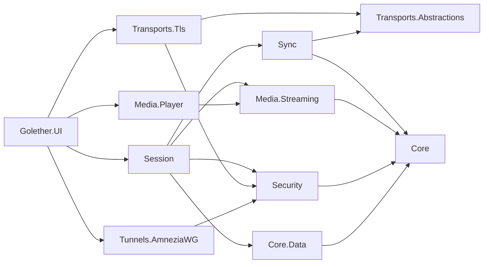

# Arquitectura de Golether

## Objetivo

Ver un vídeo juntos, con las cámaras de los participantes:

- el vídeo ocupa la mayor parte de la ventana, los recuadros de los participantes están a la derecha (hasta 5 personas
  incluido el anfitrión);
- el vídeo va sincronizado para todos; la pausa, los saltos y el inicio desde cualquier participante se aplican a todos;
- al empezar, todos arrancan desde la misma posición en el mismo momento;
- el archivo no se guarda en un servidor: el anfitrión lo sirve en su calidad original;
- un ping de más de 1000 ms es aceptable, un ligero desfase es tolerable;
- un extraño no puede conectarse; cuando el camino directo está bloqueado, se usa AmneziaWG.

## Decisiones

| Cuestión | Decisión | Por qué |
|---|---|---|
| Cómo viaja el vídeo | Se envía el archivo original en piezas de 256 KiB, no una emisión | No se pierde calidad, el ping solo afecta al tiempo de sincronización |
| Reproductor | libmpv (P/Invoke), su propio protocolo `golether://` | El decodificador de FFmpeg, como en MPC, pero funciona en todos los sistemas y se controla con precisión |
| Transporte | TLS mutuo sobre TCP, claves fijadas | `System.Net.Quic` no funciona en Windows 10 ni en macOS; QUIC es una optimización futura |
| Sincronización | El estado lo define el tiempo, decide el anfitrión, relojes al estilo de NTP | El retardo de entrega no afecta al resultado |
| Seguridad | Clave de dispositivo ECDSA P-256, invitaciones de vida corta, admisión por el anfitrión, código de verificación | Sin autoridad de certificación y sin servidor |
| Túneles | AmneziaWG «cada uno con el anfitrión», los paquetes «oferta / respuesta» los pasan las propias personas | Sin VPS propio |
| IP grises sin redirección de puertos | Servidor de encuentro propio: presenta a los lados y responde STUN, la conexión se abre directamente (TCP simultaneous open) | El servidor no retransmite nada y no ve nada de la sesión; basta una máquina con IP pública |
| Cámaras y voz | GStreamer `webrtcbin` | LGPL, WebRTC, captura y cancelación de eco en un solo framework; SIPSorcery es incompatible con la GPL |
| Datos | SQLite, esquema mediante FluentMigrator, acceso mediante EF Core | Un requisito del proyecto |
| Idiomas | Los textos están en archivos JSON, uno por idioma; el código toma un texto por clave del paquete del idioma elegido | Un idioma nuevo es un archivo nuevo, el código no tiene ramas según el idioma |

## Módulos

```
Sources/
  Core/Golether.Core                       PeerId, PlaybackState, DriftCorrector, MediaDescriptor, PeerEndpoint, AppDataPaths
  Core/Golether.Localization               idiomas: archivos JSON con textos, elección del idioma, Localizer y Texts
  Core/Golether.Core.Data                  EF Core: contactos, túneles, ajustes
  Core/Golether.Core.Data.Migrations       FluentMigrator: migraciones con scripts SQL y el ejecutor
  Core/Golether.Core.Data.Migrations.SQLite scripts SQL y versiones para SQLite
  Database/Golether.Dbs.SQLite.DbMigrator  el migrador de consola
  Security/Golether.Security               clave del dispositivo, protección de secretos, invitaciones, código de
                                           verificación, admisión, la dirección sellada del servidor de encuentro
  Components/Golether.Components          catálogo de componentes nativos (libmpv, GStreamer, AmneziaWG), búsqueda e instalación
  Tools/Golether.Tools.Components          la utilidad golether-components: prepara los componentes para compilar un paquete
  Transports/Golether.Transports.Abstractions  PeerStream, conector y escucha, FrameChannel
  Transports/Golether.Transports.Tls       mTLS sobre TCP con clave fijada
  Transports/Golether.Transports.PortMapping  redirección de puertos en el router: NAT-PMP y UPnP IGD, renovación de la concesión
  Transports/Golether.Transports.Relay     el relé TURN del anfitrión para cámaras y voz (RFC 5766 sobre TCP)
  Transports/Golether.Transports.Rendezvous  protocolo del servidor de encuentro, cliente del anfitrión y del participante, TCP hole punching
  Sync/Golether.Sync                       protocolo, estimación del desfase de relojes, PlaybackAuthority, PlaybackFollower
  Media/Golether.Media.Streaming           servidor de piezas, cliente paralelo, caché, lectura anticipada, flujo para el reproductor
  Media/Golether.Media.Player              libmpv (P/Invoke, incrustación, golether://), un reproductor simulado
  Media/Golether.Media.Conference          contrato de cámaras y voz, un sustituto
  Media/Golether.Media.Conference.GStreamer  cámaras y voz: captura, VP8/Opus, webrtcbin, mezclador, cancelación de eco
  Tunnels/Golether.Tunnels.AmneziaWG       claves X25519, ofuscación, .conf, paquetes firmados, control mediante la CLI
  Session/Golether.Session                 HostSession y ParticipantSession
  Apps/Golether.UI                         Avalonia: ventana, diálogos, composición de dependencias
  Apps/Golether.Web.Server                 el servidor de encuentro (una aplicación aparte, ver RendezvousServer.md)
  Apps/Golether.Web.Server.Contracts       lo que comparten el servidor y su monitor: ajustes, nombres del servicio, salud, registro
  Apps/Golether.Web.Server.UI              Golether Server Monitor: el estado, el registro, el servicio y los ajustes
  Apps/Golether.Pages                      la página del proyecto en GitHub Pages: portada, invitaciones por enlace, los
                                           archivos con la última versión y la dirección del servidor de encuentro (estáticos)
```

Las dependencias apuntan hacia dentro: Core no depende de nada; la interfaz lo une todo en `AppServices`.



## Canales entre los nodos

Cada flujo es una conexión TLS aparte con el preámbulo `GLTH`, una versión y un propósito:

- **Control**: mensajes JSON de la sesión (bienvenida, estado, relojes, estados), una conexión por participante.
- **MediaData**: peticiones binarias de piezas del archivo. Un participante abre hasta 4 conexiones paralelas para que en
  enlaces con RTT grande la velocidad no la limite un solo flujo TCP.
- **Relay**: el tráfico TURN de cámaras y voz hacia el relé del anfitrión viaja en un flujo TLS de la sesión, por la
  misma ruta que los demás flujos (una dirección directa o un encuentro a través del servidor de encuentro). En el lado
  del participante, `webrtcbin` apunta al puerto local de `RelayTunnel` (`127.0.0.1`); todas las conexiones hechas a él
  comparten un flujo `RelayShared` como canales de `RelayMultiplexer` (con un anfitrión de una versión anterior, cada una
  recibe un flujo `Relay` propio); el anfitrión entrega cada canal de un participante admitido a `TurnServer`. Por eso
  las cámaras y la voz funcionan dondequiera que funcione la sesión, incluso con UDP bloqueado y el puerto del relé
  cerrado desde fuera. ICE sigue ofreciendo también UDP directo y lo usa cuando pasa.
  El flujo compartido puede abrirse solo después de que la primera conexión WebRTC haya dejado de buscar el relé
  (un encuentro a través del servidor de encuentro tarda segundos). Por eso el lado que ofrece rehace la conexión que
  falla (ICE o DTLS) o no se establece en 20 segundos tras 3, 6, 12, 24 y luego cada 30 segundos; su nueva oferta
  lleva otro identificador de sesión en la línea `o=` (el certificado DTLS es uno por proceso) y sustituye la
  conexión del lado que responde.
- **TURN** (puerto de la sesión + 1): el relé `Golether.Transports.Relay` para WebRTC (RFC 5766 sobre TCP, retransmisión
  sobre UDP). Solo los participantes de versiones anteriores necesitan un puerto propio. Las credenciales del relé se
  crean para una sesión y llegan a un participante solo en la bienvenida tras la admisión; el relé reenvía paquetes solo
  a direcciones para las que el cliente creó un permiso. No se da permiso para las direcciones del propio equipo del
  anfitrión (loopback) ni para direcciones de difusión y multidifusión: todos los participantes conocen la contraseña del
  relé, y no debe abrir un camino a los servicios del anfitrión. Una asignación que el cliente no renovó antes de
  caducar se cierra junto con la conexión, para que los clientes desaparecidos no ocupen sitio. Los medios siguen
  cifrados con DTLS-SRTP; el anfitrión no puede verlos.
- **Encuentro a través del servidor de encuentro**: si ninguna dirección de la invitación respondió en 4 segundos, el
  participante se encuentra con el anfitrión a través del servidor indicado en la invitación: ambos se conectan al
  servidor desde los puertos desde los que van a perforar, conocen las direcciones públicas del otro y se conectan entre
  sí directamente en el mismo momento. La conexión perforada lleva el mismo TLS con la clave fijada; el anfitrión entrega
  esas conexiones a su `TlsPeerListener` (`Adopt`). La ruta elegida se usa para todos los flujos de la sesión.
  Detalles: [RendezvousServer.md](RendezvousServer.md).
- **Moderación**: el mensaje `moderate` del anfitrión apaga el micrófono y/o la cámara de un participante; el protocolo
  no tiene un comando para encenderlos. Los participantes informan del estado de sus dispositivos en los estados
  (`MicrophoneOff`, `CameraOff`).

Formatos en detalle: [Protocol.md](Protocol.md).

## Sincronización

El estado de la sesión (`PlaybackState`): «en el momento `ReferenceTime` según el reloj del anfitrión la posición era
`Position` y la velocidad `Rate`». Cada nodo calcula por sí mismo la posición necesaria:
`Position + (now − ReferenceTime) × Rate`.

- **Relojes.** Un participante envía sondas `ping/pong` (6 rápidas, luego una cada 2 s). El desfase
  `((t1 − t0) + (t2 − t3)) / 2` se toma de la sonda con la RTT más pequeña en una ventana de 16. Mientras el desfase no se
  conoce, el estado no se aplica al reproductor.
- **Decisiones.** `PlaybackAuthority` en el anfitrión acepta las peticiones de todos los participantes en el orden en que
  llegan (gana la última) y asigna versiones. Los nodos solo aplican versiones más nuevas.
- **Inicio.** La reproducción se programa para `now + max(RTT) + 1,5 s` (8 s como máximo); la interfaz muestra una
  cuenta atrás.
- **Pausa.** Quien la inicia pausa al momento y envía su fotograma; los demás se mueven a él.
- **Sin eco de comandos.** Las intenciones del usuario vienen solo de los comandos de la interfaz; los eventos de mpv no
  se reenvían. Así, una acción aplicada por orden de otro nunca se vuelve a enviar.
- **Corrección** (`DriftCorrector`):

| Desfase | Acción |
|---|---|
| < 150 ms | nada (si ya hay una corrección en marcha, hasta 50 ms: histéresis) |
| 150 ms – 2 s | velocidad ± hasta un 5 % durante 8 s, se conserva el tono |
| > 2 s | un salto exacto; sin corrección durante 1,5 s tras un salto |

- **Final de la película.** Cuando la posición esperada alcanza la duración, el anfitrión fija una pausa en el último
  fotograma (causa `Ended`). Un seguidor nunca espera una posición más allá de la duración y al final ni salta ni inicia
  el reproductor (mpv con `keep-open` se pausa solo). «Reproducir» al final empieza la película desde el principio.
- **Carga.** La política `WaitForAll`: si un participante está cargando y va más de 2 s por detrás, el anfitrión pausa a
  todos y sigue cuando cada uno tiene ≥ 5 s de datos. La alternativa es `LetLaggardsCatchUp`.
- **Preparación antes del inicio.** Con `WaitForAll`, «reproducir» primero pone a todos en pausa en la posición
  necesaria (causa `WaitingForParticipants`) hasta que cada participante tiene el archivo abierto y ≥ 5 s cargados en
  esa posición (cerca del final de la película: lo que quede). Entonces la proyección empieza sola (`ParticipantsReady`).
  El anfitrión puede saltarse la espera (`PlayNow`), y a los 45 segundos la espera termina sola; ambos dan la causa
  `StartedWithoutWaiting`.

## Chat, reacciones, el lápiz y el regreso

- Los mensajes del chat, las reacciones y los trazos del lápiz viajan por el mismo canal TLS de la sesión que la
  sincronización: el anfitrión comprueba el contenido, limita la frecuencia, pone el remitente verificado y lo envía a
  todos. No se escribe nada en disco.
- Las reacciones viven 3 segundos y se dibujan en una ventana transparente aparte sobre el vídeo (si no, la ventana de
  mpv las taparía). En Windows esa ventana responde `HTTRANSPARENT` a la comprobación de impacto, así que los clics en
  el vídeo la atraviesan. La ventana queda abierta toda la sesión: los enlaces de datos de un popup cerrado están
  inactivos, y una reacción que ya se fue volvería la próxima vez que se abriera.
- La misma ventana cubre toda la zona del vídeo y lleva `StrokeCanvas`, el lienzo del lápiz. Mientras el lápiz está
  apagado, la ventana sigue siendo transparente para el ratón; cuando se pulsa el botón,
  `ClickThroughWindow.SetClickThrough` deja de responder `HTTRANSPARENT` y el lienzo recibe los eventos del puntero.
  `DrawingViewModel` reúne puntos y los envía en lotes (~60 ms), y dibuja solo lo que devolvió el anfitrión, incluidos
  sus propios trazos, para que el orden sea el mismo para todos.
- Las coordenadas de un trazo son fracciones de la *imagen*, no de la ventana: `StrokeCanvas` calcula el rectángulo del
  fotograma a partir de la relación de aspecto que informa mpv (`video-params/aspect`), así el lugar rodeado coincide
  sea cual sea la forma de las ventanas. El color de un trazo es el color del participante en `ParticipantColors`, el
  mismo que el del avatar.
- Al ser admitido, un participante recibe un billete (`reconnectTicket`) válido hasta que termina la sesión. Tras un
  corte, `SessionService` intenta volver ocho veces con pausas de 2, 3, 5, 10, 20 y 30 segundos; el anfitrión confirma
  la entrada cada vez.

## Mostrar una carpeta

- `GalleryFolder` (Media.Streaming) recorre la carpeta elegida sin seguir enlaces: primero los archivos de la carpeta
  en orden natural, después sus subcarpetas una tras otra, como mucho 16 niveles de profundidad y 100 000 archivos
  vistos. Reparte los archivos en imágenes, imágenes que decodificar (HEIC, AVIF, TIFF), vídeos y archivos RAW que se
  omiten.
- `GalleryCatalog` prepara los archivos en paralelo. `PictureLayout` lee solo las cabeceras y compone los bytes que
  reciben los participantes con trozos del archivo, sin EXIF/XMP ni comentarios, sin los datos tras el final de un JPEG
  y sin los bloques de metadatos de PNG, WebP y GIF; la orientación vuelve como un bloque EXIF mínimo. Las imágenes que
  decodificar pasan por `IFrameExtractor`: `MpvFrameExtractor` lanza un libmpv aparte, sin ventana, con la salida
  de vídeo `image` y escribe un JPEG en `data/gallery/<muestra>`; del mismo modo un fotograma de un vídeo se
  convierte en su miniatura. Las claves son aleatorias en cada muestra, y la carpeta de una muestra se borra al
  terminar.
- `ChunkServer` sirve la película y, mediante `ISharedFileSet`, las imágenes de la muestra actual por sus claves, en
  las mismas piezas con SHA-256; los hashes de las imágenes no se guardan en caché.
- `HostSession` es la autoridad sobre la pantalla común: numera cada elección (`show`), las ejecuta de una en una y
  convierte un vídeo en la película (`media` + `state`) antes de anunciarlo; una imagen pausa la película. Las
  miniaturas se hacen una vez por muestra, dos a la vez, mediante `IThumbnailRenderer` (SkiaSharp en la interfaz).
- En la interfaz `GalleryViewModel` mantiene la tira y la cuadrícula (filas de una lista virtualizada, así que dos mil
  elementos siguen siendo ligeros), decodifica imágenes para la pantalla mediante `IPictureDecoder`, guarda las seis
  últimas, trae por adelantado las vecinas y vuelve a pedir una miniatura que no llegó (a los 5, 15 y 45 segundos).
  `FolderBrowserViewModel` es el explorador de carpetas del anfitrión: el selector de carpetas del sistema no muestra
  archivos.
- Una imagen la dibuja Avalonia (`ZoomableImage`), no mpv, así que, mientras se muestra una, se usa una segunda capa
  de reacciones y trazos dentro de la propia imagen (un control no puede pasar de una ventana a otra), y allí el
  puntero llega a la imagen en cualquier sistema. El zoom es personal: `StrokeCanvas` coloca los trazos con la misma
  regla `PictureFrame`, así que un trazo se queda en su sitio.

## Servir el archivo

- `MediaDescriptor`: nombre, tamaño, tamaño de pieza, un identificador rápido (SHA-256 del tamaño y de tres muestras de
  1 MiB).
- `ChunkServer` entrega piezas con su SHA-256; el cliente comprueba el hash y la longitud.
- `RemoteChunkSource` quita peticiones duplicadas y recrea los flujos fallidos (3 intentos).
- `CachedMediaReader` guarda piezas en memoria (LRU, 1 GiB) y lee 32 piezas por adelantado en lotes de 4.
- `MediaReadStream` se entrega a libmpv mediante `mpv_stream_cb_add_ro`; una lectura se cancela mediante `cancel_fn`.
- Un participante con el mismo archivo (el identificador rápido coincide) lo reproduce desde el disco.
- **Indicador de carga.** El reproductor informa de qué rangos ya están en la caché (`demuxer-cache-state` de mpv), y la
  línea de tiempo los muestra con un relleno claro: se ve dónde un salto no requiere esperar. Para el anfitrión y para un
  participante con su propia copia del archivo, toda la línea de tiempo está marcada.
- **Compartir entre espectadores** (`Media.Streaming.Sharing`): los participantes se anuncian qué piezas tienen (la
  caché en memoria o una copia local completa) y se las pasan por un canal de datos WebRTC. `SwarmChunkSource` toma una
  pieza de un participante, comprueba su SHA-256 con el hash que da el anfitrión sin los datos (la operación GetHash) y,
  ante cualquier error, descarga la pieza del anfitrión. Así el anfitrión entrega cada pieza una vez, no a cada
  espectador.

## Seguridad

- **Dispositivo:** ECDSA P-256 y un certificado autofirmado; `PeerId` = SHA-256 del SubjectPublicKeyInfo. La clave se
  guarda en `identity/device.key` bajo DPAPI (Windows) o con modo 600 (Linux/macOS, hasta el paso a
  libsecret/Keychain).
- **Invitación:** `golether://join/v1/<base64url JSON>` con la huella del anfitrión, direcciones, un token de 128 bits y
  una hora de caducidad; el anfitrión guarda solo el hash del token. El token y la hora de caducidad van primero en el
  JSON: todo lo demás es igual en cada invitación de una sesión, así una invitación nueva se diferencia desde sus
  primeros caracteres.
  - *Dos formas.* La **clave** (`golether://…`) se pega en la aplicación, el **enlace**
    (`https://depthrel.github.io/Golether/join/#…`) se puede pulsar en cualquier mensajería; el contenido es el mismo.
    La ventana de invitación las emite como dos invitaciones con tokens propios: el enlace vive 15 minutos, la clave
    15 minutos o una hora. `InviteRegistry` no emite nada que dure más de una hora.
  - *Una para todo el grupo.* Todos a quienes llamó el anfitrión se unen con una invitación hasta que caduca o ha traído
    16 peticiones (`InviteRegistry.MaxUses`, el límite para un enlace filtrado). No es la invitación la que deja entrar a
    la gente, sino el anfitrión, que aprueba a cada uno.
  - *La validez solo se comprueba al entrar* (el participante antes de conectar, el anfitrión en
    `InviteRegistry.TryUse`): un participante admitido se queda en la sesión y vuelve tras un corte con el billete, no
    con la invitación.
  - *Expulsado y rechazado.* El anfitrión recuerda el dispositivo junto con el número de la última invitación emitida
    hasta ese momento (`HostSession._turnedAway`). Esas invitaciones ya no dejan entrar a ese dispositivo, aunque siguen
    sirviendo para los demás; una invitación creada después, sí. No es un bloqueo, y un anfitrión que simplemente no
    respondió a tiempo no ha rechazado a nadie. El dispositivo recibe el motivo al momento, sin preguntar al anfitrión. A
    un participante admitido al que el anfitrión expulsó, o cuya sesión terminó el anfitrión, se le muestra el motivo en
    un mensaje propio (`ISessionService.ClosedByHost`): la lista de eventos desaparece junto con la sesión.
- **Conexión:** el participante fija la clave del anfitrión durante el saludo TLS. El anfitrión acepta cualquier
  certificado, calcula el `PeerId`, comprueba el token (los contactos de confianza no lo necesitan) y pregunta al
  usuario.
- **Código de verificación:** tres palabras y un número a partir de ambos `PeerId` y el contexto; los lados lo comparan
  de viva voz. Las palabras se muestran en el idioma de cada lado (ver «Idiomas de la interfaz»).
- **El archivo** solo se entrega a participantes admitidos; cuando un participante sale, es expulsado o vuelve a
  conectarse, sus flujos de datos se cierran.
- **Las cámaras y la voz** se cifran con DTLS-SRTP. `webrtcbin` no comprueba el certificado del otro lado frente a la
  huella del SDP, así que `WebRtcPeer` lo hace él mismo: el SDP llega solo por el canal protegido de la sesión, no se
  envían (`valve`) ni se aceptan fotogramas ni sonido hasta que el certificado coincide, y si no coincide se corta la
  conexión. No se usan servidores STUN/TURN ajenos; cuando la invitación indica un servidor de encuentro, su puerto UDP
  sirve como servidor STUN de la sesión (`IConferenceMedia.SetStunServer`), y las cámaras también atraviesan el NAT
  directamente.
- **Una cámara o un micrófono apagados** se liberan: el dispositivo se detiene, no solo se silencia.
- **Los datos entrantes** (JSON, paquetes, configuraciones, nombres de archivo) se validan y se limitan en tamaño.

## Túneles AmneziaWG

- El anfitrión mantiene una interfaz `golether0` con la subred `10.64–127.x.0/24`; cada participante es un par `/32`.
- Una oferta: la clave pública AWG, direcciones, la dirección asignada, los parámetros comunes `S1/S2/H1–H4`, una clave
  P-256 efímera, una hora de caducidad, el certificado del dispositivo, una firma. Una respuesta: lo mismo desde el lado
  del participante.
- PSK = SHA-256(ECDH(claves P-256 efímeras)); nunca viaja por la red.
- Las claves privadas no salen del dispositivo; los secretos en la base de datos los protege `ISecretProtector`.
- Un túnel se levanta con `amneziawg.exe /installtunnelservice` (Windows) o `awg-quick up` (Linux/macOS). La
  configuración se exporta en un formato compatible con AmneziaVPN.
- **Motor propio.** En Windows la aplicación tiene su propio AmneziaWG: no forma parte del paquete de la aplicación, sino
  que se descarga bajo demanda como el componente `Tunnel` (el botón «Instalar» de la ventana de túneles). Es el paquete
  oficial `amneziawg-<arch>-3.1.0.msi`, fijado por SHA-256 y tamaño, del que `msiexec /a` extrae `amneziawg.exe`,
  `awg.exe` y `wintun.dll` a `data/components/tunnel/<version>/amneziawg`. No se instala nada en el sistema y
  descomprimir no requiere permisos de administrador. `ComponentLocator` deliberadamente **no** busca un AmneziaWG
  instalado por el usuario: Golether solo llama a su propia copia, así el cliente del sistema y sus túneles no se tocan.
  Sin el componente, `AwgCliOptions.WindowsExecutable` recurre a la ruta de Program Files. El asistente elevado
  `--tunnel-helper` calcula la misma ruta, así ambos lados llaman al mismo programa. La ruta se busca **antes de cada
  llamada** (`AwgCliOptions.FindCarriedExecutable`), no una vez al inicio: el componente se puede instalar sin reiniciar
  la aplicación. Se instala desde la ventana de túneles, que muestra la tarjeta del componente; sin el motor, `UpAsync`
  y `DownAsync` dan al momento un error claro en lugar de un inicio de proceso fallido.
- El rango de direcciones de los túneles `10.64–127.x.0/24` se eligió para no solaparse con redes domésticas típicas
  (`192.168.x`, `10.0.0.x`) ni con túneles que el usuario levantó por su cuenta.
- **Dirección pública y travesía de NAT** (`NatTraversal`). Antes de crear una oferta y antes de aceptar una respuesta,
  un lado abre un socket UDP en el puerto del futuro túnel y pregunta a servidores STUN públicos cómo se ve ese puerto
  desde fuera. La dirección entra en el paquete solo cuando dos servidores indicaron **el mismo** puerto: puertos
  distintos significan un NAT simétrico, y esa dirección no sirve. Después cada lado envía unos paquetes a las
  direcciones del otro desde el mismo puerto: el primer paquete lo descarta el router del otro, pero abre un agujero en
  el propio, y el saludo pasa. El socket se cierra justo antes de que empiece el túnel: la asignación del router dura
  bastante más.
- La lista de servidores STUN se da en el constructor de `TunnelWorkflow`; una lista vacía desactiva toda petición al
  exterior (las pruebas funcionan así, y se puede hacer por privacidad).
- **Un túnel vive tanto como la aplicación.** Los nombres de las interfaces levantadas se escriben en
  `data/tunnels/raised.txt`; al salir, `AppServices.DisposeAsync` las baja (durante dos minutos como máximo; rechazar la
  solicitud de administrador no retiene la salida). El archivo sobrevive a un fallo, así que un túnel olvidado se quita
  en el siguiente inicio, y la ventana de túneles tiene un botón «Bajar el túnel» para no esperar a la salida. Los
  túneles que no levantó Golether no se tocan: el archivo solo lista los propios.
- El puerto de la interfaz se elige entre 40000–60000 **comprobando que está libre**: el rango se solapa con los puertos
  que Windows asigna a cualquier programa, y un puerto ocupado supondría tanto un túnel fallido como no poder conocer la
  dirección pública.

## Idiomas de la interfaz

Todo lo que lee el usuario (pantallas, diálogos, mensajes de error, eventos de la sesión, el informe de diagnóstico) sale
de los paquetes de idioma `Sources/Core/Golether.Localization/Languages/<code>.json`: un objeto plano «clave → texto» en
el que `Language.Code` y `Language.Name` nombran el idioma (`en` es «English», `de` es «Deutsch», `ru` es «Русский»). La
aplicación incluye inglés, alemán, español, francés, portugués y ruso. Los paquetes están incrustados en el ensamblado;
`LanguageCatalog` los encuentra solo. El inglés es el idioma por defecto y la fuente de los textos que le falten a otro
idioma.

Cómo está construido:

- `ILanguagePack` es una estrategia: los textos de un idioma. `Localizer` busca una clave en el paquete del idioma
  actual, después en el inglés y después devuelve la propia clave (el hueco se ve, la pantalla no se rompe). Nunca
  pregunta qué idioma está activo.
- `Texts` (`Texts.Get(key)`, `Texts.Format(key, values)`) es el acceso para el código sin modelo de vista: excepciones,
  eventos de la sesión, pistas. `Texts.Scope(...)` da a un flujo de trabajo su propio idioma (lo necesitan las pruebas).
- XAML: `Text="{loc:Loc Main.Title}"`, con un valor: `{loc:Loc Key=Main.Device, Arg={Binding Fingerprint}}`. El enlace
  pasa por `LocalizationSource`, así todos los textos cambian a la vez al cambiar el idioma, sin reiniciar. Los textos
  que componen los propios modelos de vista se vuelven a leer en `MainWindowViewModel.RefreshTexts`.
- Las claves que dependen de una enumeración se construyen a partir de sus valores: `Session.Reject.<RejectReason>`,
  `Session.Playback.<PlaybackCause>`, `Component.Source.<ComponentSource>`, `Component.Stage.<InstallStage>`,
  `Log.Level.<LogLevel>`. Las pruebas se aseguran de que cada valor tiene texto en cada idioma.

La elección del idioma (`LanguageService`, el ajuste `ui.language` en la tabla `Settings`):

1. Primer inicio: la base de datos no tiene idioma, así que se toma el idioma del sistema operativo
   (`CultureInfo.CurrentUICulture`) cuando hay un paquete para él, sea cual sea la región (`de-CH` recibe alemán,
   `pt-BR` portugués), y si no, inglés. El resultado se guarda y se muestra al momento en la lista de idiomas.
2. Inicios siguientes: el idioma se lee de la base de datos; ya no se pregunta al sistema.
3. El usuario elige el idioma en la ventana de ajustes (la bandera `Assets/Flags/<code>.png` y el nombre del idioma en
   ese idioma); la elección se aplica con el botón «Aplicar», a la vez para todos los textos, y se guarda.

El monitor del servidor usa los mismos paquetes (las claves `Monitor.*`) y las mismas banderas; guarda su elección en
`config/monitor.json` de la carpeta del servidor.

Las palabras del código de verificación se traducen: `VerificationCode` guarda tres números de palabra (0–63) y un
número, y cada paquete nombra las mismas 64 cosas en el mismo orden (`Verification.Word.00` … `Verification.Word.63`).
Por eso el código es el mismo en ambos lados sean cuales sean sus idiomas, y dos personas con distintos idiomas de
interfaz ven traducciones de las palabras del otro.

Lo que no depende del idioma de la interfaz:

- por la red viajan motivos, no textos: `rejected` lleva un `RejectReason`, `bye` no lleva texto; el lector formula el
  motivo en su propio idioma (el anfitrión y un participante pueden usar idiomas distintos);
- el asistente de túneles y firewall (un proceso aparte con permisos de administrador) no conoce ningún idioma: informa
  de hechos (programa, código de salida, salida), y la aplicación los convierte en palabras
  (`TunnelHelper.DescribeFailure`);
- los mensajes del sistema operativo y de .NET (`Win32Exception`, `HttpRequestException`) y la salida de programas
  externos se muestran tal cual; los mensajes del registro para desarrolladores (`ILogger`) siguen en inglés, solo se
  traduce la etiqueta del nivel en una línea del registro.

## Página del proyecto, unirse por enlace y una sola instancia

La página `Sources/Apps/Golether.Pages` (GitHub Pages, las direcciones están en `ProjectSite`) es una comodidad, no una
dependencia: una clave funciona sin ella, el servidor de encuentro se puede escribir a mano, el origen de las
actualizaciones se puede sustituir.

- **Enlace de invitación.** `join/` lee la invitación tras el `#` (el navegador no envía esa parte al servidor), muestra
  el nombre de la sesión y el del anfitrión y va a `golether://join/v1/…`. La página no carga nada de otros servidores y
  no envía nada a ningún sitio (`Content-Security-Policy`), y quita la invitación de la barra de direcciones al momento.
  Un segundo enlace abierto en la misma pestaña hace que la página se recargue, así nunca entrega la invitación
  anterior.
- **El esquema `golether://`** se registra al instalar: Windows usa `Software\Classes\golether` (Inno Setup, `HKA`),
  macOS `CFBundleURLTypes` en `Info.plist`, Linux `MimeType=x-scheme-handler/golether` en el archivo `.desktop`.
- **Una sola instancia** (`SingleInstance`): un mutex con nombre por usuario y carpeta de datos decide quién es el
  primero; un segundo inicio entrega sus argumentos al primero por una tubería con nombre abierta solo al usuario actual,
  y termina. El mensaje está limitado en tamaño y se interpreta como una lista corta de cadenas. En macOS un enlace
  llega como evento (`IActivatableLifetime`).
- **Unirse nunca es silencioso.** Cualquier página puede abrir `golether://`, así que
  `MainWindowViewModel.OfferInviteAsync` primero interpreta la invitación y luego pregunta: «¿unirte a la sesión?» o,
  cuando hay una sesión en marcha, «¿cambiar a otra sesión?». Los nombres de la pregunta vienen de la invitación, es
  decir, los escribió su autor; quién es de verdad el anfitrión lo confirman la clave fijada y el código de
  verificación.
- **Dirección del servidor de encuentro** (`RendezvousMode`): «Automáticamente» significa que `RendezvousDirectory` lee
  el `config.json` de la página (hasta 5 segundos, hasta 4 KiB), si no, toma la última respuesta buena del ajuste
  `network.rendezvousDirectory`, y si no, la sesión va sin servidor y el anfitrión ve un evento al respecto;
  «Directamente» significa sin servidor; «Mi propio servidor» significa la dirección del ajuste
  `network.rendezvousServer`. La dirección del archivo está sellada con `EndpointSeal` (AES-256-GCM, la clave va
  incorporada en la aplicación): es una máscara contra escáneres, no un secreto, ya que la clave está en el código
  abierto y la dirección forma parte de cada invitación. Un archivo falsificado podría mostrar a un servidor ajeno quién
  se encuentra con quién y estropear el encuentro, pero no podría leer una sesión ni hacerse pasar por el anfitrión: el
  participante fija la clave del anfitrión de la invitación. El texto del archivo lo crea la utilidad del propietario
  `Golether.AdminSettings` (un repositorio aparte) con su propia copia del algoritmo; `EndpointSealTests` guarda una
  muestra de su salida.

## Actualizaciones e informes

- `UpdateService` lee el manifiesto de la página del proyecto (`updates.json`) o de la dirección de los ajustes
  (`updates.url`, solo `https://` o una dirección local) y compara la versión. La aplicación avisa de una versión nueva
  con una barra cuyo botón abre la página de descarga (el campo `page` de la versión, si no, `url`); la casilla «Ignorar
  esta versión» guarda la versión en `updates.ignoredVersion`, y la comprobación se desactiva con el ajuste
  `updates.check`. No se descarga ni se instala nada solo. La descarga con comprobación SHA-256 (`DownloadAsync`) sigue
  en el servicio, pero la interfaz no la llama; sin un hash en el manifiesto, se niega.
- `FileLogProvider` escribe el registro en `data/logs/golether-<date>.log` (7 días, hasta 8 MiB al día), quitando
  cadenas hexadecimales largas, claves y contraseñas del relé.
- Una excepción no controlada en la que se detuvo la aplicación, y los fallos de tareas en segundo plano que nadie
  esperaba, también llegan al registro (`App.LogCrashes`): tras un fallo hay algo que adjuntar a un informe.
- `DiagnosticReport` construye con ello el informe: versión, sistema, componentes, el estado de la sesión (sin el nombre
  del archivo) y el final del registro.
- El instalador (`Scripts/App/golether.iss`, Inno Setup) pregunta para quién instalar: «solo para mí» (por defecto)
  instala en `%LOCALAPPDATA%\Programs\Golether` sin permisos de administrador, con los datos en `data` dentro de la
  instalación; «para todos» instala en `C:\Program Files\Golether`, pone `golether.shared` junto a `golether.install`, y
  los datos de cada usuario están en `%LOCALAPPDATA%\Golether`. La elección es una página del asistente: Inno Setup no
  puede cambiar sus permisos a mitad de camino, así que «para todos» vuelve a lanzar la instalación con permisos de
  administrador (`/ALLUSERS`). El asistente habla inglés, alemán, español, francés, portugués y ruso: está preseleccionado
  el idioma de Windows, y el inglés cuando el asistente no lo habla. Las imágenes con el logotipo las dibuja
  `Scripts/Assets/generate-installer-art.ps1`. Los datos personales nunca se sobrescriben y solo se borran con un
  consentimiento aparte. El instalador del servidor de encuentro (`Scripts/Server/golether-server.iss`) está hecho igual,
  pero siempre instala para todos los usuarios.

## Datos

La aplicación es autónoma: `AppDataPaths` busca la marca `golether.install` en la carpeta del programa y hasta en tres
carpetas superiores (los paquetes la ponen en la raíz de `Golether/`, junto a `app/` o `Golether.app`) y lo guarda todo
en `data` a su lado; sin la marca (una compilación desde `bin`), en `data` junto al ejecutable. No se usa el perfil del
usuario, salvo en una instalación «para todos los usuarios» (la marca `golether.shared`), donde un usuario normal no
puede escribir; los datos de compilaciones antiguas de `%LOCALAPPDATA%\Golether` se mueven una vez.
`GOLETHER_DATA_DIR` sustituye la ruta para desarrollo y pruebas.

| Tabla | Contenido |
|---|---|
| `Contacts` | dispositivos conocidos: nombre, marca de confianza, última dirección, hora |
| `HostTunnelInterfaces` | claves protegidas y parámetros de la interfaz del anfitrión |
| `Tunnels` | ofertas y túneles: rol, estado, dirección, par, secretos protegidos |
| `Settings` | ajustes (nombre de usuario, idioma de la interfaz `ui.language`, volumen, dispositivos) |

El esquema lo crean las migraciones al iniciarse la aplicación o mediante `Golether.Dbs.SQLite.DbMigrator`.

## Etapas

| Etapa | Estado |
|---|---|
| Base: solución, núcleo, datos, seguridad, transporte, sincronización, servir el archivo, reproductor, interfaz, pruebas, paquetes | **hecho** |
| Instalación automática de componentes con un clic (libmpv, GStreamer) | **hecho** |
| Cámaras y voz: GStreamer `webrtcbin`, «todos con todos», cancelación de eco `webrtcdsp` | **hecho** |
| Túneles sin ejecutar el programa como administrador (asistente UAC, pkexec, osascript), elección de cámara y micrófono, comprobación del certificado DTLS | **hecho** |
| Redirección automática del puerto del anfitrión (NAT-PMP, UPnP IGD) | **hecho** |
| Retransmisión de cámaras y voz a través del anfitrión (TURN propio sobre TCP), el anfitrión apaga los dispositivos de un participante, volumen y clics en el vídeo | **hecho** |
| Compartir piezas entre espectadores por canales de datos WebRTC, comprobadas con los hashes del anfitrión | **hecho** |
| Pistas y subtítulos propios para cada uno, seguir donde se dejó, esperar a que todos estén listos antes del inicio | **hecho** |
| Chat y reacciones por el canal de la sesión, volumen por participante, indicador de carga en la línea de tiempo | **hecho** |
| Calidad de cámara adaptativa según las estadísticas de conexión, reconexión automática, informe de diagnóstico | **hecho** |
| Instalador de Windows (Inno Setup) y comprobación de actualizaciones en una dirección configurable | **hecho** |
| Pantalla de bienvenida al iniciar y el lápiz: dibujar sobre el vídeo, visible para todos los participantes | **hecho** |
| Regla del firewall de Windows para conexiones entrantes (una sola confirmación de administrador) | **hecho** |
| Motor AmneziaWG propio como parte de la aplicación (el componente `Tunnel`), sin tocar el cliente del sistema | **hecho** |
| Dirección pública mediante STUN en los paquetes del túnel y travesía de NAT desde el puerto del túnel | **hecho** |
| Un túnel vive mientras la aplicación está en marcha: seguimiento de los levantados y retirada al salir | **hecho** |
| Servidor de encuentro: anfitrión y participante se encuentran sin puertos abiertos, TCP hole punching, STUN para cámaras | **hecho** |
| Página del proyecto, enlace de invitación que abre la aplicación, una sola instancia, búsqueda automática del servidor de encuentro | **hecho** |
| Una invitación para todo el grupo, expulsión de un participante por el anfitrión | **hecho** |
| Seis idiomas (inglés, alemán, español, francés, portugués, ruso) en la aplicación, el monitor, los instaladores, la página y la documentación; palabras traducidas del código de verificación | **hecho** |
| Mostrar una carpeta: imágenes y vídeos con subcarpetas, mirar aparte, zoom, sin metadatos | **hecho** |
| API de renderizado de libmpv para macOS y Wayland, QUIC para Windows 11/Linux | previsto |
| Almacén de secretos Keychain / libsecret, instaladores firmados | previsto |

## Limitaciones conocidas de la compilación actual

- Las cámaras y la voz van directamente y, cuando no hay camino directo, a través del relé TURN del anfitrión sobre los
  flujos de la sesión (`Relay`). El sonido y el vídeo viajan entonces dentro de TCP: con pérdidas en la línea, puede
  haber retrasos. Entre dos participantes sin camino directo el tráfico pasa por el equipo del anfitrión (cifrado con
  DTLS-SRTP). La ruta se elige al conectar: si el UDP desaparece a mitad de un encuentro, la pareja pasa al relé solo
  tras reconectar las cámaras.
- Los estados ICE de cada conexión se escriben en el registro (`ICE to …: checking / connected / failed`): muestran si se
  encontró un camino de red para las cámaras.
- Apagar los dispositivos de un participante lo ejecuta el programa del participante; un cliente modificado puede
  ignorarlo.
- Quién habla lo determina cada participante por sí mismo a partir del nivel de sonido (`VoiceActivityDetector`:
  −42 dBFS, 60 ms para empezar, 450 ms de mantenimiento): su propia voz desde una rama aparte de la cadena del micrófono,
  la de los demás desde el sonido recibido.
- En Windows, mpv crea su ventana deshabilitada (`WS_DISABLED`), así que los clics en el vídeo los captura la ventana
  contenedora `VideoHost` (un procedimiento de ventana sustituido); en Linux y macOS los clics llegan mediante los
  enlaces de entrada de mpv.
- La calidad de la cámara se adapta a cada participante: con pérdidas ≥ 5 % o un tiempo de ida y vuelta ≥ 0,5 s (dos
  sondas seguidas, estadísticas de `webrtcbin`) un participante recibe un flujo económico de 320×180 a 10 fotogramas/s,
  y tras cinco sondas buenas vuelve el habitual de 640×360. El codificador económico solo trabaja mientras alguien lo
  necesita; el cambio ocurre en un fotograma clave.
- En macOS libmpv abre una ventana propia (sin incrustación sin la API de renderizado).
- Los elementos de Avalonia no se pueden dibujar sobre la zona del vídeo (airspace), así que las indicaciones se
  muestran en lugar del vídeo, y las reacciones y los trazos del lápiz en una ventana transparente aparte que también
  deja pasar los clics (salvo con el lápiz activo).
- Mientras la aplicación prepara sus datos y claves, se muestra la pantalla de bienvenida `SplashWindow`; la ventana
  principal se crea ya lista, así que ya no se ve un marco vacío con una zona transparente.
- El firewall de Windows trata un adaptador nuevo (incluido uno de túnel) como red pública y descarta las conexiones
  entrantes, así que `WindowsFirewall` lee las reglas mediante el objeto COM `HNetCfg.FwPolicy2` (sin permisos) y,
  cuando no hay regla para esta copia, ofrece añadir una con una breve ejecución de
  `Golether.exe --firewall-helper allow` mediante UAC. Hay una sola regla, ligada al programa, no a un puerto.
- Los túneles se cambian con permisos de administrador solo durante la operación: Windows ejecuta
  `Golether.exe --tunnel-helper` mediante UAC, Linux usa `pkexec`, macOS `osascript … with administrator privileges`.
  No hay un servicio permanente, así que cada cambio de un túnel necesita una confirmación.
- Una carpeta muestra JPEG, PNG, WebP, GIF y BMP tal cual, y HEIC, AVIF y TIFF mediante el componente de vídeo del
  anfitrión; los archivos RAW de cámaras no se muestran. El zoom de una imagen cambia una sola pantalla.
