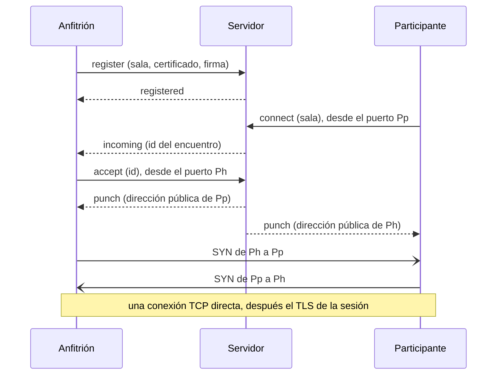

# Servidor de encuentro de Golether

`Golether.Web.Server` (el ejecutable `golether-server`) es un servidor pequeño que presenta al anfitrión y a un
participante cuando ambos están detrás de routers sin un puerto abierto: una IP gris, el NAT del proveedor, sin
redirección de puertos. El servidor dice a cada lado con qué dirección pública se le ve y dónde buscar al otro, tras lo
cual los lados abren por sí mismos una conexión TCP **directa** entre ellos. La película, la sincronización, el chat, las
cámaras y la voz no pasan por el servidor.

El servidor necesita una máquina con IP pública (o con un puerto redirigido en el router). Solo el anfitrión necesita la
dirección del servidor: los participantes la reciben en la invitación. El anfitrión la obtiene de una de dos formas (el
selector «Modo de conexión» de la pantalla de inicio):

- **Automáticamente**: la aplicación lee la dirección del servidor del proyecto en el archivo `config.json` de la página
  del proyecto (`Sources/Apps/Golether.Pages`). La dirección del archivo está sellada (`EndpointSeal`): una máscara
  contra escáneres, no un secreto. La última respuesta buena se recuerda y se usa cuando la página no está disponible.
- **Mi propio servidor**: el anfitrión escribe la dirección, por ejemplo `203.0.113.7:47900`.

**La instalación, configuración y mantenimiento del servidor** se describen en la guía del administrador
[`Sources/Apps/Golether.Web.Server/ADMIN-GUIDE.es.md`](../../Sources/Apps/Golether.Web.Server/ADMIN-GUIDE.es.md) para
Windows, Linux y macOS. El mismo archivo está junto al programa en cada paquete del servidor. Este documento trata de
cómo está construido el servidor.

- [Cómo funciona](#cómo-funciona)
- [Compilar y publicar](#compilar-y-publicar)
- [Seguridad](#seguridad)
- [Protocolo (versión 1)](#protocolo-versión-1)
- [Limitaciones](#limitaciones)

## Cómo funciona

Un router sin redirección de puertos no deja entrar una conexión que nadie de dentro esperaba. Pero cuando un
dispositivo sale por sí mismo, el router recuerda qué puerto externo dio al puerto local del dispositivo y deja pasar
las respuestas. En esto se basa el NAT hole punching:

1. **El anfitrión ocupa una sala.** Al crear una sesión, Golether inventa un nombre de sala aleatorio (128 bits),
   mantiene una conexión permanente con el servidor y firma el registro con la clave del dispositivo. La sala pertenece
   a esa clave: otro dispositivo no puede ocuparla.
2. **La invitación lleva la dirección del servidor y la sala** junto con las direcciones habituales del anfitrión.
3. **El participante** prueba primero directamente las direcciones de la invitación. Si nada responde en 4 segundos (o
   todas las direcciones ya han fallado), se conecta al servidor **desde el puerto desde el que va a perforar** y pide
   que lo junten con el anfitrión de la sala.
4. **El servidor** avisa al anfitrión de que alguien espera. El anfitrión abre una conexión nueva con el servidor,
   también desde el puerto desde el que va a perforar. Ahora el servidor ve las direcciones públicas de ambos puertos y
   envía a cada lado la dirección del otro en el mismo momento.
5. **Ambos lados a la vez** se conectan entre sí desde los mismos puertos. Los primeros paquetes puede descartarlos el
   router del otro lado, pero cada uno abre un «agujero» en el propio, y el siguiente intento del otro lado pasa. Dos SYN
   que van uno hacia el otro se funden en una sola conexión TCP (TCP simultaneous open). Los intentos se repiten durante
   hasta 15 segundos.
6. **A partir de aquí todo es como en una conexión directa:** TLS mutuo con la clave fijada del anfitrión, admisión, el
   código de verificación. El servidor sale de la cadena.

Cada flujo de una sesión (el de control y hasta cuatro de archivo) se encuentra así por separado; cada encuentro es un
par de intercambios breves con el servidor.



**Cámaras y voz.** El mismo servidor responde a peticiones STUN en el mismo número de puerto por UDP. El `webrtcbin` de
cada participante conoce por él su dirección UDP pública, la pone entre los candidatos ICE y abre también un camino
directo. El servidor no tiene relé TURN propio: los medios nunca pasan por él.

## Compilar y publicar

Los paquetes listos los compilan los scripts de `Scripts/`, como para la aplicación. Todo va a `artifacts/publish`:

| Script | Resultado |
|---|---|
| `Scripts/Server/publish-server-win.ps1` | la carpeta `win-x64/GoletherServer` y el archivo `GoletherServer-<version>-win-x64.zip` |
| `Scripts/Server/build-server-installer.ps1` | lo mismo más el instalador `GoletherServer-<version>-setup.exe` (necesita [Inno Setup](https://jrsoftware.org/isdl.php)); `-SkipPublish` usa la carpeta que ya existe |
| `Scripts/Server/publish-server-linux.ps1 [-Runtime linux-x64\|linux-arm64]` | desde Windows: el paquete de Linux de abajo, compilado en Git Bash |
| `Scripts/Server/publish-server-macos.ps1 [-Runtime osx-arm64\|osx-x64]` | desde Windows: el paquete de macOS de abajo, compilado en Git Bash |
| `Scripts/Server/publish-server.sh [linux-x64\|linux-arm64\|osx-x64\|osx-arm64]` | la carpeta `<rid>/GoletherServer`, un archivo `.tar.gz` y, si está la herramienta `zip`, un `.zip` |

```powershell
./Scripts/Server/build-server-installer.ps1              # Windows: carpeta, zip e instalador
./Scripts/Server/publish-server-win.ps1 -Runtime win-arm64
```

```bash
./Scripts/Server/publish-server-linux.ps1                 # Windows: el paquete de Linux x64 (hace falta Git Bash)
./Scripts/Server/publish-server-macos.ps1                 # Windows: el paquete de macOS para Apple silicon
./Scripts/Server/publish-server.sh                        # Linux x64 (también funciona en Windows desde Git Bash)
./Scripts/Server/publish-server.sh linux-arm64            # para una Raspberry Pi o un VPS ARM, por ejemplo
```

Las compilaciones son autónomas: la máquina del servidor no necesita ni .NET ni nada más. La estructura del paquete la
crea el propio proyecto (el target `GoletherServerPackageLayout` de `Golether.Web.Server.csproj`, activado con la
propiedad `GoletherServerPackageRoot`); los scripts añaden la nota, los archivos del servicio y el archivo comprimido:

```
GoletherServer/
  golether-server(.exe)   el lanzador: el mismo host .NET con el icono del servidor, que apunta a bin/ (como Golether.exe)
  bin/                    el programa, el runtime de .NET y las bibliotecas
  config/appsettings.json los ajustes; el programa de bin/ los encuentra solo (PackageLayout); config/monitor.json los ajustes del monitor
  docs/                   ADMIN-GUIDE.md y README.txt en inglés, ADMIN-GUIDE.<code>.md y README.<code>.txt en
                          alemán, español, francés, portugués y ruso (de, es, fr, pt, ru)
  service/                Linux y macOS: install-service.sh y golether-server.service / org.golether.server.plist
  golether-server-monitor(.exe)  el lanzador del monitor: el host de la aplicación que apunta a monitor/
  monitor/                Golether Server Monitor (Golether.Web.Server.UI), autónomo como el servidor
```

Al ejecutarlo desde el código fuente (`dotnet run`) no hay estructura, y `appsettings.json` está junto al programa. Los
archivos para Linux y macOS también se pueden compilar en Windows (Git Bash): el script pone él mismo los permisos de
ejecución, y la firma local para macOS la pone `install-service.sh` durante la instalación.

El instalador de Windows habla inglés, alemán, español, francés, portugués y ruso (está preseleccionado el idioma de
Windows, y el inglés cuando el asistente no lo habla); tras la instalación muestra la nota y abre la guía del
administrador en el idioma elegido.

El icono del servidor es el icono de la aplicación con una insignia de bastidor de servidores: `Assets/golether-server.svg`
en el proyecto del servidor; las versiones rasterizadas las dibuja `Scripts/Assets/generate-icon.ps1 -Server`.

Para depurar, el servidor se ejecuta directamente desde el código fuente:
`dotnet run --project Sources/Apps/Golether.Web.Server` o el perfil «Rendezvous server» de VS Code.

## El monitor

`Golether.Web.Server.UI` (el ejecutable `golether-server-monitor`) es una ventana para el administrador: el estado del
servidor, su registro de eventos en columnas, iniciar y detener el servicio, exportar el registro y editar los ajustes.
Lo que comparten el servidor y el monitor (los ajustes y sus comprobaciones, los nombres del servicio en cada sistema, el
informe de salud, el registro) está en `Golether.Web.Server.Contracts`, que no necesita ni ASP.NET ni Avalonia.

- **El registro de eventos.** El servidor anota lo que pasa (`ServerJournal`): el inicio, las direcciones de escucha, un
  anfitrión que ocupa y deja una sala, los encuentros pedidos, presentados y fallidos (con el motivo), las conexiones
  rechazadas, las peticiones no válidas. Cada evento tiene un número, la hora, la dirección IP del dispositivo, el
  identificador corto del anfitrión y una etiqueta de la sala: los primeros 8 dígitos hexadecimales del SHA-256 de su
  nombre, así dos eventos sobre una sala se distinguen de los demás, pero la etiqueta no permite a nadie preguntar por el
  anfitrión. El registro guarda los últimos 5000 eventos solo en memoria y empieza vacío en cada ejecución.
- **`GET /journal?after=N`** en la dirección de estado responde con los eventos posteriores al número N (como máximo
  1000) y la hora de inicio de la ejecución; una hora de inicio distinta indica al monitor que el servidor se reinició.
  Solo responde a peticiones de este equipo (si no, `403`), sea cual sea la dirección de `Urls`. Los eventos y los
  motivos viajan por nombre (`ServerContract.Json`), y el monitor los formula en su propio idioma (`Monitor.Event.*`,
  `Monitor.Reason.*`): el idioma del sistema en el primer inicio y después el elegido en su selector de idioma (con
  banderas).
- **El servicio** se controla con las herramientas del sistema: `sc query` y PowerShell como administrador en Windows,
  `systemctl` y `pkexec` en Linux, `launchctl` y `osascript ... with administrator privileges` en macOS. El estado se lee
  sin permisos especiales; cada cambio los pide en el momento de la acción. Guardar los ajustes pone el archivo nuevo en
  su sitio y reinicia un servicio en marcha como una sola acción, así al usuario se le pregunta una vez.
- **Dónde están los ajustes.** El monitor está en `monitor/` de la carpeta del servidor y encuentra
  `config/appsettings.json` un nivel más arriba; si no, toma la carpeta de instalación habitual del sistema. Al escribir
  conserva todas las partes del archivo que no edita.

## Seguridad

**Lo que ve el servidor:** las direcciones IP y los puertos de los dispositivos, los nombres de las salas, los
certificados (claves públicas) de los anfitriones y la hora de los encuentros. **Lo que no ve:** nada de la sesión: ni la
película, ni el chat, ni las cámaras, ni siquiera los nombres de los participantes. Una sesión se cifra con TLS mutuo
entre los dispositivos, y las cámaras y la voz con DTLS-SRTP.

- **El servidor no puede hacerse pasar por el anfitrión.** El participante fija la clave del anfitrión de la invitación
  y la comprueba durante el saludo TLS sobre la conexión perforada. Un servidor malicioso, como mucho, puede no juntar a
  los lados.
- **Una sala no se puede usurpar.** El registro se firma con la clave del dispositivo del anfitrión (ECDSA P-256) sobre
  un valor aleatorio de un solo uso del servidor y el nombre de la sala: un registro ajeno grabado no se puede
  reproducir, y una sala que tiene una clave no se da a otra. La misma clave puede volver a ocupar la sala; así vuelve
  el anfitrión tras un corte.
- **Una sala no se puede encontrar por la clave.** El nombre de la sala son 128 bits aleatorios, nuevos en cada sesión;
  solo lo conocen los receptores de la invitación. Quien conoce la sala sigue llegando al anfitrión solo para la
  admisión normal con el código de verificación.
- **Los datos entrantes no son de confianza.** Las tramas tienen como máximo 16 KiB, el JSON se valida, un certificado
  tiene como máximo 8 KiB, una firma como máximo 256 bytes, como máximo 8 direcciones por mensaje, solo IPv4 con puerto
  (sin nombres de host). Cada espera tiene un límite; el número de conexiones, salas y encuentros pendientes tiene tope;
  la frecuencia de conexiones y de STUN está limitada por IP. La tabla de direcciones de ese limitador también está
  acotada (200 000 direcciones): un remitente UDP puede falsificar su dirección, y una avalancha de falsificaciones no
  debe ocupar toda la memoria; por encima del tope, las direcciones nuevas se rechazan hasta que caducan las antiguas.
- **Las direcciones locales** de un lado se pasan al otro solo cuando ambos tienen la misma dirección pública (el mismo
  router): si no, no sirven y solo revelarían algo de una red ajena.
- **STUN no sirve para ataques de amplificación:** la respuesta es solo algo mayor que la petición, va solo de donde
  vino la petición y tiene la frecuencia limitada. El servidor solo responde a Binding.
- **El canal con el servidor no va cifrado.** Todo lo que viaja por él lo ve el servidor de todos modos, no contiene
  secretos, y la autenticidad del anfitrión se comprueba de extremo a extremo. Quien escuche el canal conoce las
  direcciones y el nombre de la sala: lo mismo que vería mirando el tráfico de la propia sesión.

## Protocolo (versión 1)

TCP, IPv4. Una trama son 4 bytes de longitud (big-endian) y JSON UTF-8 (de 1 byte a 16 KiB). El tipo de mensaje lo da el
campo `$t`; los nombres de los campos van en camelCase. Las direcciones son cadenas `a.b.c.d:puerto`. S es el servidor,
A el anfitrión, P un participante, D cualquier dispositivo.

| `$t` | Dirección | Campos | Significado |
|---|---|---|---|
| `server-hello` | S → D | `version`, `nonce` | el primer mensaje del servidor en cada conexión; `nonce` son 16 bytes aleatorios en base64url |
| `register` | A → S | `room`, `certificate` (DER, base64), `signature` (base64) | el anfitrión ocupa una sala; la conexión queda abierta |
| `registered` | S → A | `observed` | la sala está ocupada; `observed` es la dirección del anfitrión tal como la ve el servidor |
| `ping` / `pong` | A ↔ S | — | mantener vivo el registro (el anfitrión: cada 20 s) |
| `connect` | P → S | `room`, `locals[]` | un participante pide un encuentro; la conexión se abre desde el puerto de perforación |
| `incoming` | S → A | `punch` | por el registro: un participante espera; `punch` son 16 bytes aleatorios en base64url |
| `accept` | A → S | `punch`, `locals[]` | el anfitrión responde a un encuentro con una conexión nueva desde el puerto de perforación |
| `punch` | S → ambos | `peer`, `peerLocals[]` | la dirección pública del otro lado y sus direcciones locales (solo con una IP pública compartida) |
| `error` | S → D | `error` | rechazo; después se cierra la conexión |

La firma del registro es ECDSA P-256 / SHA-256 de la cadena UTF-8 `golether-rendezvous-v1\n<nonce>\n<room>`. El
propietario de una sala es el SHA-256 del SubjectPublicKeyInfo de la clave (el mismo `PeerId` que en una sesión).

Los motivos de un rechazo (`error`) viajan como nombres; el dispositivo elige el texto para una persona en su propio
idioma:

| Valor | Cuándo |
|---|---|
| `UnsupportedVersion` | versiones de protocolo distintas |
| `BadRequest` | un mensaje mal formado o inesperado |
| `BadSignature` | la firma del registro no coincide con el certificado |
| `RoomTaken` | la sala la tiene otra clave |
| `RoomNotFound` | nadie tiene la sala (la sesión terminó o el anfitrión perdió el servidor) |
| `Busy` | demasiados encuentros pendientes para este anfitrión |
| `Timeout` | el anfitrión no respondió a tiempo; el encuentro es desconocido o ya respondido |
| `ServerFull` | todas las salas están ocupadas |
| `Unreachable`, `PunchFailed` | solo en el dispositivo: no se llega al servidor / los routers no dejaron pasar la conexión |

El servidor mantiene las conexiones de encuentro (`connect`, `accept`) hasta que los dispositivos las cierran (no más de
`AnswerTimeout` tras `punch`): mientras una está abierta, el router no olvida la asignación del puerto.

Quién elige la conexión. Pueden abrirse varias conexiones (por las direcciones públicas y por las locales), y los lados
podrían elegir distintas. Por eso solo elige el participante: la primera que se abrió, y el participante es también el
primero en hablar (TLS ClientHello). El anfitrión mantiene todas las que se abrieron y toma aquella en la que habló el
participante; las demás se cierran.

## Limitaciones

- **Un NAT simétrico** (el router da un puerto externo nuevo a cada destino) en cualquiera de los lados hace imposible la
  perforación: la dirección que vio el servidor no le sirve al otro lado. Algunos operadores móviles y redes de empresa
  funcionan así. El participante recibe un error indicando que los routers no dejaron pasar la conexión directa; queda
  un túnel AmneziaWG o un puerto redirigido al menos en el lado del anfitrión.
- **Solo IPv4.** Un servidor en `::` acepta también IPv6, pero los dispositivos siempre se conectan a él por IPv4 y
  perforan IPv4.
- **No hay retransmisión TURN**, a propósito: cuando las cámaras no tienen camino directo, no pasan por el servidor.
  Entonces las lleva el relé del anfitrión incorporado en la aplicación: su tráfico va por los propios flujos de la
  sesión, así que funciona dondequiera que funcione la sesión.
- Cada flujo de una sesión necesita su propio encuentro, así que conectarse a través del servidor tarda unos segundos
  más que conectarse directamente.
