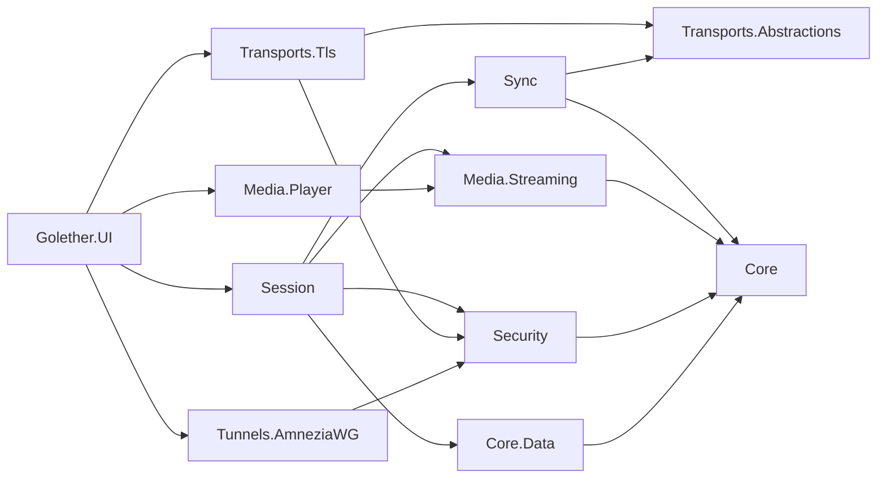

# Architecture de Golether

## Objectif

Regarder une vidéo ensemble, avec les caméras des participants :

- la vidéo occupe la majeure partie de la fenêtre, les vignettes des participants sont à droite (jusqu'à 5 personnes,
  l'hôte compris) ;
- la vidéo est synchronisée chez tout le monde ; pause, déplacement et départ par n'importe quel participant
  s'appliquent à tous ;
- au départ, tout le monde commence à la même position au même moment ;
- le fichier n'est pas stocké sur un serveur : l'hôte le sert dans sa qualité d'origine ;
- un ping supérieur à 1000 ms est acceptable, un léger décalage est tolérable ;
- un inconnu ne peut pas se connecter ; quand le chemin direct est bloqué, AmneziaWG est utilisé.

## Décisions

| Question | Décision | Pourquoi |
|---|---|---|
| Comment la vidéo circule | Le fichier d'origine est envoyé par morceaux de 256 Kio, pas sous forme de flux diffusé | Aucune qualité n'est perdue, le ping n'affecte que le temps de synchronisation |
| Lecteur | libmpv (P/Invoke), son propre protocole `golether://` | Le décodeur FFmpeg, comme dans MPC, mais il fonctionne sur tous les systèmes et se pilote précisément |
| Transport | TLS mutuel sur TCP, clés épinglées | `System.Net.Quic` ne fonctionne pas sous Windows 10 ni macOS ; QUIC est une optimisation future |
| Synchronisation | L'état est défini par le temps, l'hôte décide, des horloges dans l'esprit de NTP | Le délai d'acheminement n'affecte pas le résultat |
| Sécurité | Clé d'appareil ECDSA P-256, invitations de courte durée, admission par l'hôte, code de vérification | Sans autorité de certification et sans serveur |
| Tunnels | AmneziaWG « chacun avec l'hôte », les paquets « offre / réponse » sont transmis par les personnes elles-mêmes | Pas de VPS à soi |
| IP grises sans redirection de port | Un serveur de rendez-vous à soi : il présente les côtés et répond au STUN, la connexion est percée en direct (TCP simultaneous open) | Le serveur ne relaie rien et ne voit rien de la séance ; une machine avec une IP publique suffit |
| Caméras et voix | GStreamer `webrtcbin` | LGPL, WebRTC, capture et annulation d'écho dans un seul framework ; SIPSorcery est incompatible avec la GPL |
| Données | SQLite, schéma via FluentMigrator, accès via EF Core | Une exigence du projet |
| Langues | Les textes sont dans des fichiers JSON, un par langue ; le code prend un texte par clé dans le paquet de la langue choisie | Une nouvelle langue est un nouveau fichier, le code n'a pas de branches selon la langue |

## Modules

```
Sources/
  Core/Golether.Core                       PeerId, PlaybackState, DriftCorrector, MediaDescriptor, PeerEndpoint, AppDataPaths
  Core/Golether.Localization               langues : fichiers JSON de textes, choix de la langue, Localizer et Texts
  Core/Golether.Core.Data                  EF Core : contacts, tunnels, réglages
  Core/Golether.Core.Data.Migrations       FluentMigrator : migrations sur scripts SQL et l'exécuteur
  Core/Golether.Core.Data.Migrations.SQLite scripts SQL et versions pour SQLite
  Database/Golether.Dbs.SQLite.DbMigrator  le migrateur en console
  Security/Golether.Security               clé de l'appareil, protection des secrets, invitations, code de vérification,
                                           admission, l'adresse scellée du serveur de rendez-vous
  Components/Golether.Components          catalogue des composants natifs (libmpv, GStreamer, AmneziaWG), recherche et installation
  Tools/Golether.Tools.Components          l'utilitaire golether-components : prépare les composants pour la construction d'un paquet
  Transports/Golether.Transports.Abstractions  PeerStream, connecteur et écouteur, FrameChannel
  Transports/Golether.Transports.Tls       mTLS sur TCP avec une clé épinglée
  Transports/Golether.Transports.PortMapping  redirection de port sur le routeur : NAT-PMP et UPnP IGD, renouvellement du bail
  Transports/Golether.Transports.Relay     le relais TURN de l'hôte pour les caméras et la voix (RFC 5766 sur TCP)
  Transports/Golether.Transports.Rendezvous  protocole du serveur de rendez-vous, client de l'hôte et du participant, TCP hole punching
  Sync/Golether.Sync                       protocole, estimation du décalage des horloges, PlaybackAuthority, PlaybackFollower
  Media/Golether.Media.Streaming           serveur de morceaux, client parallèle, cache, lecture anticipée, flux pour le lecteur
  Media/Golether.Media.Player              libmpv (P/Invoke, intégration, golether://), un lecteur simulé
  Media/Golether.Media.Conference          contrat des caméras et de la voix, un bouchon
  Media/Golether.Media.Conference.GStreamer  caméras et voix : capture, VP8/Opus, webrtcbin, mixeur, annulation d'écho
  Tunnels/Golether.Tunnels.AmneziaWG       clés X25519, obfuscation, .conf, paquets signés, pilotage par la CLI
  Session/Golether.Session                 HostSession et ParticipantSession
  Apps/Golether.UI                         Avalonia : fenêtre, dialogues, composition des dépendances
  Apps/Golether.Web.Server                 le serveur de rendez-vous (une application séparée, voir RendezvousServer.md)
  Apps/Golether.Web.Server.Contracts       ce que partagent le serveur et son moniteur : réglages, noms du service, état, journal
  Apps/Golether.Web.Server.UI              Golether Server Monitor : l'état, le journal, le service et les réglages
  Apps/Golether.Pages                      la page du projet sur GitHub Pages : accueil, invitations par lien, les fichiers
                                           de la dernière version et de l'adresse du serveur de rendez-vous (statiques)
```

Les dépendances pointent vers l'intérieur : Core ne dépend de rien ; l'interface assemble tout dans `AppServices`.



## Canaux entre les nœuds

Chaque flux est une connexion TLS séparée avec le préambule `GLTH`, une version et un rôle :

- **Control** : les messages JSON de la séance (accueil, état, horloges, statuts), une connexion par participant.
- **MediaData** : des requêtes binaires de morceaux du fichier. Un participant ouvre jusqu'à 4 connexions parallèles pour
  que, sur des liaisons à forte RTT, le débit ne soit pas limité par un seul flux TCP.
- **Relay** : le trafic TURN des caméras et de la voix vers le relais de l'hôte passe dans un flux TLS de la séance, par
  le même chemin que les autres flux (une adresse directe ou une rencontre via le serveur de rendez-vous). Côté
  participant, `webrtcbin` pointe vers le port local de `RelayTunnel` (`127.0.0.1`) ; toutes les connexions faites vers
  lui partagent un flux `RelayShared` comme canaux de `RelayMultiplexer` (avec un hôte d'une version antérieure, chacune
  reçoit son propre flux `Relay`) ; l'hôte confie chaque canal d'un participant admis à `TurnServer`. C'est pourquoi les
  caméras et la voix fonctionnent partout où la séance fonctionne, même quand l'UDP est bloqué et que le port du relais
  est fermé de l'extérieur. ICE propose toujours aussi l'UDP direct et le prend quand il passe.
- **TURN** (port de la séance + 1) : le relais `Golether.Transports.Relay` pour WebRTC (RFC 5766 sur TCP, relais sur
  UDP). Seuls les participants de versions antérieures ont besoin d'un port à part. Les identifiants du relais sont créés
  pour une séance et n'atteignent un participant que dans l'accueil après l'admission ; le relais ne transmet les paquets
  qu'aux adresses pour lesquelles le client a créé une autorisation. Aucune autorisation n'est donnée pour les adresses
  de l'ordinateur de l'hôte lui-même (loopback) ni pour les adresses de diffusion et de multidiffusion : chaque
  participant connaît le mot de passe du relais, et il ne doit pas ouvrir un chemin vers les services de l'hôte. Une
  allocation que le client n'a pas renouvelée avant la fin de sa durée de vie est fermée avec la connexion, pour que les
  clients disparus n'occupent pas de place. Les médias restent chiffrés avec DTLS-SRTP ; l'hôte ne peut pas les voir.
- **Rencontre via le serveur de rendez-vous** : si aucune adresse de l'invitation n'a répondu en 4 secondes, le
  participant rencontre l'hôte via le serveur indiqué dans l'invitation : tous deux se connectent au serveur depuis les
  ports à partir desquels ils vont percer, apprennent les adresses publiques l'un de l'autre et se connectent directement
  l'un à l'autre au même moment. La connexion percée porte le même TLS avec la clé épinglée ; l'hôte confie ces connexions
  à son `TlsPeerListener` (`Adopt`). Le chemin choisi est utilisé pour chaque flux de la séance. Détails :
  [RendezvousServer.md](RendezvousServer.md).
- **Modération** : le message `moderate` de l'hôte coupe le micro et/ou la caméra d'un participant ; le protocole n'a pas
  de commande pour les rallumer. Les participants signalent l'état de leurs appareils dans les statuts (`MicrophoneOff`,
  `CameraOff`).

Les formats en détail : [Protocol.md](Protocol.md).

## Synchronisation

L'état de la séance (`PlaybackState`) : « à l'instant `ReferenceTime` selon l'horloge de l'hôte, la position était
`Position` et la vitesse `Rate` ». Chaque nœud calcule lui-même la position nécessaire :
`Position + (now − ReferenceTime) × Rate`.

- **Horloges.** Un participant envoie des sondes `ping/pong` (6 rapides, puis une toutes les 2 s). Le décalage
  `((t1 − t0) + (t2 − t3)) / 2` est pris dans la sonde à la plus petite RTT sur une fenêtre de 16. Tant que le décalage
  est inconnu, l'état n'est pas appliqué au lecteur.
- **Décisions.** `PlaybackAuthority` chez l'hôte prend les demandes de tous les participants dans leur ordre d'arrivée
  (la dernière gagne) et attribue des versions. Les nœuds n'appliquent que les versions plus récentes.
- **Départ.** La lecture est programmée pour `now + max(RTT) + 1,5 s` (8 s au maximum) ; l'interface affiche un compte à
  rebours.
- **Pause.** Celui qui la déclenche se met en pause aussitôt et envoie son image ; les autres s'y déplacent.
- **Pas d'écho des commandes.** Les intentions de l'utilisateur ne viennent que des commandes de l'interface ; les
  événements de mpv ne sont pas transmis. Ainsi, une action appliquée sur ordre de quelqu'un d'autre n'est jamais
  renvoyée.
- **Correction** (`DriftCorrector`) :

| Écart | Action |
|---|---|
| < 150 ms | rien (si une correction est déjà en cours, jusqu'à 50 ms : hystérésis) |
| 150 ms – 2 s | vitesse ± jusqu'à 5 % pendant 8 s, la hauteur du son est conservée |
| > 2 s | un déplacement exact ; pas de correction pendant 1,5 s après un déplacement |

- **Fin du film.** Quand la position attendue atteint la durée, l'hôte fixe une pause sur la dernière image (cause
  `Ended`). Un suiveur n'attend jamais une position au-delà de la durée et, à la fin, ni ne se déplace ni ne lance le
  lecteur (mpv avec `keep-open` se met en pause tout seul). « Lecture » à la fin relance le film depuis le début.
- **Mise en tampon.** La politique `WaitForAll` : si un participant met en tampon et a plus de 2 s de retard, l'hôte met
  tout le monde en pause et reprend quand chacun a ≥ 5 s de données. L'alternative est `LetLaggardsCatchUp`.
- **Préparation avant le départ.** Avec `WaitForAll`, « lecture » met d'abord tout le monde en pause à la position
  nécessaire (cause `WaitingForParticipants`) jusqu'à ce que chaque participant ait ouvert le fichier et chargé ≥ 5 s à
  cette position (près de la fin du film : ce qui reste). Ensuite la séance démarre toute seule (`ParticipantsReady`).
  L'hôte peut sauter l'attente (`PlayNow`), et au bout de 45 secondes l'attente se termine d'elle-même ; les deux donnent
  la cause `StartedWithoutWaiting`.

## Discussion, réactions, le stylo et le retour

- Les messages de discussion, les réactions et les traits du stylo passent par le même canal TLS de la séance que la
  synchronisation : l'hôte vérifie le contenu, limite la fréquence, met l'expéditeur vérifié et l'envoie à tous. Rien
  n'est écrit sur disque.
- Les réactions vivent 3 secondes et sont dessinées dans une fenêtre transparente séparée au-dessus de la vidéo (sinon
  la fenêtre de mpv les cacherait). Sous Windows, cette fenêtre répond `HTTRANSPARENT` au test d'atteinte, donc les clics
  sur la vidéo la traversent. La fenêtre reste ouverte toute la séance : les liaisons d'un popup fermé sont inactives, et
  une réaction déjà partie reviendrait à la prochaine ouverture.
- La même fenêtre couvre toute la zone vidéo et porte `StrokeCanvas`, le canevas du stylo. Tant que le stylo est
  désactivé, la fenêtre reste transparente pour la souris ; quand le bouton est enfoncé,
  `ClickThroughWindow.SetClickThrough` cesse de répondre `HTTRANSPARENT` et le canevas reçoit lui-même les événements du
  pointeur. `DrawingViewModel` rassemble les points et les envoie par lots (~60 ms), et ne dessine que ce que l'hôte a
  renvoyé, ses propres traits compris, pour que l'ordre soit le même pour tous.
- Les coordonnées d'un trait sont des fractions de l'*image*, pas de la fenêtre : `StrokeCanvas` calcule le rectangle de
  l'image à partir du rapport d'aspect signalé par mpv (`video-params/aspect`), pour que l'endroit entouré corresponde
  quelle que soit la forme des fenêtres. La couleur d'un trait est la couleur du participant dans `ParticipantColors`, la
  même que celle de l'avatar.
- À l'admission, un participant reçoit un ticket (`reconnectTicket`) valable jusqu'à la fin de la séance. Après une
  coupure, `SessionService` essaie de revenir huit fois avec des pauses de 2, 3, 5, 10, 20 et 30 secondes ; l'hôte
  confirme l'entrée à chaque fois.

## Servir le fichier

- `MediaDescriptor` : nom, taille, taille de morceau, un identifiant rapide (SHA-256 de la taille et de trois
  échantillons de 1 Mio).
- `ChunkServer` délivre des morceaux avec leur SHA-256 ; le client vérifie le hachage et la longueur.
- `RemoteChunkSource` supprime les requêtes en double et recrée les flux en échec (3 tentatives).
- `CachedMediaReader` garde les morceaux en mémoire (LRU, 1 Gio) et lit 32 morceaux d'avance par lots de 4.
- `MediaReadStream` est confié à libmpv via `mpv_stream_cb_add_ro` ; une lecture est annulée via `cancel_fn`.
- Un participant qui a le même fichier (l'identifiant rapide correspond) le lit depuis le disque.
- **Indicateur de chargement.** Le lecteur signale quelles plages sont déjà dans le cache (`demuxer-cache-state` de mpv),
  et la barre de lecture les montre par un remplissage clair : on voit où un déplacement ne demande pas d'attente. Pour
  l'hôte et pour un participant qui a sa propre copie du fichier, toute la barre est marquée.
- **Partage entre spectateurs** (`Media.Streaming.Sharing`) : les participants s'annoncent mutuellement quels morceaux
  ils ont (le cache en mémoire ou une copie locale entière) et se les passent par un canal de données WebRTC.
  `SwarmChunkSource` prend un morceau chez un participant, vérifie son SHA-256 avec le hachage que l'hôte donne sans les
  données (l'opération GetHash) et, en cas d'erreur, télécharge le morceau chez l'hôte. Ainsi l'hôte donne chaque
  morceau une fois, pas à chaque spectateur.

## Sécurité

- **Appareil :** ECDSA P-256 et un certificat auto-signé ; `PeerId` = SHA-256 du SubjectPublicKeyInfo. La clé est
  gardée dans `identity/device.key` sous DPAPI (Windows) ou en mode 600 (Linux/macOS, jusqu'au passage à
  libsecret/Keychain).
- **Invitation :** `golether://join/v1/<base64url JSON>` avec l'empreinte de l'hôte, des adresses, un jeton de 128 bits
  et une heure d'expiration ; l'hôte ne garde que le hachage du jeton. Le jeton et l'heure d'expiration sont écrits en
  premier dans le JSON : tout le reste est identique dans chaque invitation d'une séance, donc une nouvelle invitation se
  distingue dès ses premiers caractères.
  - *Deux formes.* La **clé** (`golether://…`) se colle dans l'application, le **lien**
    (`https://depthrel.github.io/Golether/join/#…`) est cliquable dans n'importe quelle messagerie ; le contenu est le
    même. La fenêtre d'invitation les émet comme deux invitations avec leurs propres jetons : le lien vit 15 minutes, la
    clé 15 minutes ou une heure. `InviteRegistry` n'émet rien qui vive plus d'une heure.
  - *Une pour toute la bande.* Tous ceux que l'hôte a appelés rejoignent avec une seule invitation jusqu'à son expiration
    ou jusqu'à ce qu'elle ait apporté 16 demandes (`InviteRegistry.MaxUses`, la limite pour un lien qui a fuité). Ce
    n'est pas l'invitation qui fait entrer les gens, mais l'hôte, qui approuve chacun.
  - *La durée de validité n'est vérifiée qu'à l'entrée* (par le participant avant de se connecter, par l'hôte dans
    `InviteRegistry.TryUse`) : un participant admis reste dans la séance et revient après une coupure avec le ticket, pas
    avec l'invitation.
  - *Retiré et refusé.* L'hôte retient l'appareil avec le numéro de la dernière invitation émise à ce moment
    (`HostSession._turnedAway`). Ces invitations ne laissent plus entrer cet appareil, tout en restant valables pour les
    autres ; une invitation créée plus tard, si. Ce n'est pas un bannissement, et un hôte qui n'a simplement pas répondu
    à temps n'a refusé personne. L'appareil reçoit le motif aussitôt, sans qu'on demande à l'hôte. Un participant admis
    que l'hôte a retiré, ou dont l'hôte a terminé la séance, voit le motif dans un message à part
    (`ISessionService.ClosedByHost`) : le fil des événements disparaît avec la séance.
- **Connexion :** le participant épingle la clé de l'hôte pendant la poignée de main TLS. L'hôte accepte n'importe quel
  certificat, calcule le `PeerId`, vérifie le jeton (les contacts de confiance n'en ont pas besoin) et demande à
  l'utilisateur.
- **Code de vérification :** trois mots et un nombre à partir des deux `PeerId` et du contexte ; les côtés le comparent
  à voix haute. Les mots s'affichent dans la langue de chaque côté (voir « Langues de l'interface »).
- **Le fichier** n'est donné qu'aux participants admis ; quand un participant part, est retiré ou se reconnecte, ses
  flux de données sont fermés.
- **Les caméras et la voix** sont chiffrées avec DTLS-SRTP. `webrtcbin` ne vérifie pas le certificat de l'autre côté
  avec l'empreinte du SDP, donc `WebRtcPeer` le fait lui-même : le SDP n'arrive que par le canal protégé de la séance,
  aucune image ni aucun son n'est envoyé (`valve`) ou accepté tant que le certificat ne correspond pas, et en cas de
  différence la connexion est coupée. Aucun serveur STUN/TURN tiers n'est utilisé ; quand l'invitation indique un
  serveur de rendez-vous, son port UDP sert de serveur STUN de la séance (`IConferenceMedia.SetStunServer`), et les
  caméras traversent elles aussi le NAT en direct.
- **Une caméra ou un micro coupé** est libéré : l'appareil est arrêté, pas seulement rendu muet.
- **Les données entrantes** (JSON, paquets, configurations, noms de fichiers) sont validées et limitées en taille.

## Tunnels AmneziaWG

- L'hôte garde une interface `golether0` avec le sous-réseau `10.64–127.x.0/24` ; chaque participant est un pair `/32`.
- Une offre : la clé publique AWG, des adresses, l'adresse attribuée, les paramètres communs `S1/S2/H1–H4`, une clé
  P-256 éphémère, une heure d'expiration, le certificat de l'appareil, une signature. Une réponse : la même chose côté
  participant.
- PSK = SHA-256(ECDH(clés P-256 éphémères)) ; il ne circule jamais sur le réseau.
- Les clés privées ne quittent pas l'appareil ; les secrets dans la base sont protégés par `ISecretProtector`.
- Un tunnel se monte avec `amneziawg.exe /installtunnelservice` (Windows) ou `awg-quick up` (Linux/macOS). La
  configuration s'exporte dans un format compatible avec AmneziaVPN.
- **Son propre moteur.** Sous Windows, l'application a son propre AmneziaWG : il ne fait pas partie du paquet de
  l'application, mais se télécharge à la demande comme composant `Tunnel` (le bouton « Installer » de la fenêtre des
  tunnels). C'est le paquet officiel `amneziawg-<arch>-3.1.0.msi`, épinglé par SHA-256 et taille, dont `msiexec /a`
  extrait `amneziawg.exe`, `awg.exe` et `wintun.dll` dans `data/components/tunnel/<version>/amneziawg`. Rien n'est
  installé dans le système et la décompression ne demande pas de droits d'administrateur. `ComponentLocator` ne cherche
  volontairement **pas** un AmneziaWG installé par l'utilisateur : Golether n'appelle que sa propre copie, ainsi le
  client du système et ses tunnels ne sont pas touchés. Sans le composant, `AwgCliOptions.WindowsExecutable` se replie
  sur le chemin dans Program Files. L'assistant élevé `--tunnel-helper` calcule le même chemin, donc les deux côtés
  appellent le même programme. Le chemin est recherché **avant chaque appel** (`AwgCliOptions.FindCarriedExecutable`),
  pas une fois au démarrage : le composant peut s'installer sans redémarrer l'application. Il s'installe depuis la
  fenêtre des tunnels, qui affiche la carte du composant ; sans le moteur, `UpAsync` et `DownAsync` donnent aussitôt une
  erreur claire au lieu d'un lancement de processus raté.
- La plage d'adresses des tunnels `10.64–127.x.0/24` est choisie pour ne pas chevaucher les réseaux domestiques typiques
  (`192.168.x`, `10.0.0.x`) ni les tunnels que l'utilisateur a montés lui-même.
- **Adresse publique et traversée du NAT** (`NatTraversal`). Avant de créer une offre et avant d'accepter une réponse, un
  côté ouvre une socket UDP sur le port du futur tunnel et demande à des serveurs STUN publics à quoi ressemble ce port
  de l'extérieur. L'adresse n'entre dans le paquet que lorsque deux serveurs ont indiqué **le même** port : des ports
  différents signifient un NAT symétrique, et une telle adresse est inutile. Ensuite, chaque côté envoie quelques paquets
  aux adresses de l'autre depuis le même port : le premier paquet est rejeté par le routeur d'en face mais ouvre un trou
  dans le sien, et la poignée de main passe. La socket est fermée juste avant le démarrage du tunnel : l'association du
  routeur vit nettement plus longtemps.
- La liste des serveurs STUN est donnée au constructeur de `TunnelWorkflow` ; une liste vide désactive toute requête vers
  l'extérieur (les tests fonctionnent ainsi, et on peut le faire par souci de confidentialité).
- **Un tunnel vit aussi longtemps que l'application.** Les noms des interfaces montées sont écrits dans
  `data/tunnels/raised.txt` ; à la fermeture, `AppServices.DisposeAsync` les descend (deux minutes au maximum ; refuser
  la demande d'administrateur ne retient pas la fermeture). Le fichier survit à un plantage, donc un tunnel oublié est
  retiré au lancement suivant, et la fenêtre des tunnels a un bouton « Descendre le tunnel » pour ne pas attendre la
  fermeture. Les tunnels qui n'ont pas été montés par Golether ne sont pas touchés : le fichier ne liste que les siens.
- Le port de l'interface est choisi entre 40000 et 60000 **en vérifiant qu'il est libre** : la plage chevauche les ports
  que Windows distribue à n'importe quel programme, et un port occupé signifierait à la fois un tunnel raté et aucun
  moyen de connaître l'adresse publique.

## Langues de l'interface

Tout ce que lit l'utilisateur (écrans, dialogues, messages d'erreur, événements de la séance, le rapport de diagnostic)
vient des paquets de langue `Sources/Core/Golether.Localization/Languages/<code>.json` : un objet plat « clé → texte »
dans lequel `Language.Code` et `Language.Name` nomment la langue (`en` est « English », `de` est « Deutsch », `ru` est
« Русский »). L'application embarque l'anglais, l'allemand, l'espagnol, le français, le portugais et le russe. Les
paquets sont intégrés à l'assembly ; `LanguageCatalog` les trouve tout seul. L'anglais est la langue par défaut et la
source des textes qui manquent à une autre langue.

Comment c'est construit :

- `ILanguagePack` est une stratégie : les textes d'une langue. `Localizer` cherche une clé dans le paquet de la langue
  courante, puis dans l'anglais, puis renvoie la clé elle-même (le trou se voit, l'écran ne casse pas). Il ne demande
  jamais quelle langue est active.
- `Texts` (`Texts.Get(key)`, `Texts.Format(key, values)`) est l'accès pour le code sans modèle de vue : exceptions,
  événements de la séance, indications. `Texts.Scope(...)` donne à un flux de travail sa propre langue (les tests en ont
  besoin).
- XAML : `Text="{loc:Loc Main.Title}"`, avec une valeur : `{loc:Loc Key=Main.Device, Arg={Binding Fingerprint}}`. La
  liaison passe par `LocalizationSource`, donc chaque texte change aussitôt avec la langue, sans redémarrage. Les textes
  que les modèles de vue composent eux-mêmes sont relus dans `MainWindowViewModel.RefreshTexts`.
- Les clés qui dépendent d'une énumération sont construites à partir de ses valeurs : `Session.Reject.<RejectReason>`,
  `Session.Playback.<PlaybackCause>`, `Component.Source.<ComponentSource>`, `Component.Stage.<InstallStage>`,
  `Log.Level.<LogLevel>`. Des tests s'assurent que chaque valeur a un texte dans chaque langue.

Le choix de la langue (`LanguageService`, le réglage `ui.language` dans la table `Settings`) :

1. Premier lancement : la base n'a pas de langue, donc la langue du système d'exploitation
   (`CultureInfo.CurrentUICulture`) est prise quand il existe un paquet pour elle, quelle que soit la région (`de-CH`
   reçoit l'allemand, `pt-BR` le portugais), sinon l'anglais. Le résultat est enregistré et apparaît aussitôt dans la
   liste des langues.
2. Lancements suivants : la langue est lue dans la base ; le système n'est plus interrogé.
3. L'utilisateur choisit la langue dans la fenêtre des réglages (le drapeau `Assets/Flags/<code>.png` et le nom de la
   langue dans cette langue) ; le choix est appliqué avec le bouton « Appliquer », aussitôt pour chaque texte, et
   enregistré.

Le moniteur du serveur utilise les mêmes paquets (les clés `Monitor.*`) et les mêmes drapeaux ; il garde son choix dans
`config/monitor.json` du dossier du serveur.

Les mots du code de vérification sont traduits : `VerificationCode` contient trois numéros de mots (0–63) et un nombre,
et chaque paquet nomme les mêmes 64 choses dans le même ordre (`Verification.Word.00` … `Verification.Word.63`). Le code
est donc le même des deux côtés, quelles que soient leurs langues, et deux personnes avec des langues d'interface
différentes voient des traductions des mots de l'autre.

Ce qui ne dépend pas de la langue de l'interface :

- sur le réseau circulent des motifs, pas des textes : `rejected` porte un `RejectReason`, `bye` n'a pas de texte ; le
  lecteur formule le motif dans sa propre langue (l'hôte et un participant peuvent utiliser des langues différentes) ;
- l'assistant des tunnels et du pare-feu (un processus séparé avec des droits d'administrateur) ne connaît aucune
  langue : il rapporte des faits (programme, code de sortie, sortie), et l'application en fait des mots
  (`TunnelHelper.DescribeFailure`) ;
- les messages du système et de .NET (`Win32Exception`, `HttpRequestException`) et la sortie des programmes externes
  s'affichent tels quels ; les messages du journal destinés aux développeurs (`ILogger`) restent en anglais, seule
  l'étiquette du niveau dans une ligne du journal est traduite.

## Page du projet, rejoindre par lien et instance unique

La page `Sources/Apps/Golether.Pages` (GitHub Pages, les adresses sont dans `ProjectSite`) est une commodité, pas une
dépendance : une clé fonctionne sans elle, le serveur de rendez-vous peut être saisi à la main, la source des mises à
jour peut être remplacée.

- **Lien d'invitation.** `join/` lit l'invitation après le `#` (le navigateur n'envoie pas cette partie au serveur),
  affiche le nom de la séance et celui de l'hôte et va vers `golether://join/v1/…`. La page ne charge rien depuis
  d'autres serveurs et n'envoie rien nulle part (`Content-Security-Policy`), et elle retire aussitôt l'invitation de la
  barre d'adresse. Un second lien ouvert dans le même onglet fait recharger la page, ainsi elle ne délivre jamais
  l'invitation précédente.
- **Le schéma `golether://`** est enregistré à l'installation : Windows utilise `Software\Classes\golether`
  (Inno Setup, `HKA`), macOS `CFBundleURLTypes` dans `Info.plist`, Linux `MimeType=x-scheme-handler/golether` dans le
  fichier `.desktop`.
- **Instance unique** (`SingleInstance`) : un mutex nommé par utilisateur et dossier de données décide qui est le
  premier ; un second lancement transmet ses arguments au premier par un tube nommé ouvert au seul utilisateur courant, et
  se termine. Le message est limité en taille et lu comme une courte liste de chaînes. Sous macOS, un lien arrive comme
  un événement (`IActivatableLifetime`).
- **Rejoindre n'est jamais silencieux.** N'importe quelle page peut ouvrir `golether://`, donc
  `MainWindowViewModel.OfferInviteAsync` lit d'abord l'invitation puis demande : « rejoindre la séance ? » ou, quand une
  séance est en cours, « passer à une autre séance ? ». Les noms de la question viennent de l'invitation, c'est-à-dire
  qu'ils ont été écrits par son auteur ; qui est vraiment l'hôte, c'est la clé épinglée et le code de vérification qui
  le confirment.
- **Adresse du serveur de rendez-vous** (`RendezvousMode`) : « Automatiquement » signifie que `RendezvousDirectory` lit
  le `config.json` de la page (jusqu'à 5 secondes, jusqu'à 4 Kio), sinon prend la dernière bonne réponse du réglage
  `network.rendezvousDirectory`, sinon la séance tourne sans serveur et l'hôte voit un événement à ce sujet ; « En
  direct » signifie sans serveur ; « Mon propre serveur » signifie l'adresse du réglage `network.rendezvousServer`.
  L'adresse dans le fichier est scellée par `EndpointSeal` (AES-256-GCM, la clé est intégrée à l'application) : c'est un
  masque contre les scanners, pas un secret, puisque la clé est dans le code ouvert et que l'adresse fait partie de
  chaque invitation. Un fichier falsifié pourrait montrer à un serveur tiers qui rencontre qui et gâcher la rencontre,
  mais ne pourrait ni lire une séance ni se faire passer pour l'hôte : le participant épingle la clé de l'hôte depuis
  l'invitation. Le texte du fichier est produit par l'utilitaire du propriétaire `Golether.AdminSettings` (un dépôt
  séparé) avec sa propre copie de l'algorithme ; `EndpointSealTests` garde un échantillon de sa sortie.

## Mises à jour et rapports

- `UpdateService` lit le manifeste sur la page du projet (`updates.json`) ou à l'adresse des réglages (`updates.url`,
  uniquement `https://` ou une adresse locale) et compare la version. L'application signale une nouvelle version par une
  barre dont le bouton ouvre la page de téléchargement (le champ `page` de la version, sinon `url`) ; la case « Ignorer
  cette version » enregistre la version dans `updates.ignoredVersion`, et la vérification se désactive avec le réglage
  `updates.check`. Rien n'est téléchargé ni installé tout seul. Le téléchargement avec vérification SHA-256
  (`DownloadAsync`) est toujours dans le service, mais l'interface ne l'appelle pas ; sans hachage dans le manifeste, il
  refuse.
- `FileLogProvider` écrit le journal dans `data/logs/golether-<date>.log` (7 jours, jusqu'à 8 Mio par jour), en retirant
  les longues chaînes hexadécimales, les clés et les mots de passe du relais.
- Une exception non gérée sur laquelle l'application s'est arrêtée, et les échecs des tâches d'arrière-plan que personne
  n'attendait, arrivent aussi dans le journal (`App.LogCrashes`) : après un plantage, il y a de quoi joindre à un
  rapport.
- `DiagnosticReport` en fait le rapport : version, système, composants, l'état de la séance (sans le nom du fichier) et
  la fin du journal.
- Le programme d'installation (`Scripts/App/golether.iss`, Inno Setup) demande pour qui installer : « seulement pour
  moi » (par défaut) installe dans `%LOCALAPPDATA%\Programs\Golether` sans droits d'administrateur, avec les données
  dans `data` à l'intérieur de l'installation ; « pour tout le monde » installe dans `C:\Program Files\Golether`, place
  `golether.shared` à côté de `golether.install`, et les données de chaque utilisateur se trouvent dans
  `%LOCALAPPDATA%\Golether`. Le choix est une page de l'assistant : Inno Setup ne peut pas changer ses droits en cours de
  route, donc « pour tout le monde » relance l'installation avec des droits d'administrateur (`/ALLUSERS`). L'assistant
  parle anglais, allemand, espagnol, français, portugais et russe : la langue de Windows est présélectionnée, l'anglais
  quand l'assistant ne la parle pas. Les images avec le logo sont dessinées par
  `Scripts/Assets/generate-installer-art.ps1`. Les données personnelles ne sont jamais écrasées et ne sont supprimées
  qu'avec un accord séparé. Le programme d'installation du serveur de rendez-vous (`Scripts/Server/golether-server.iss`)
  est construit de la même façon, mais installe toujours pour tous les utilisateurs.

## Données

L'application est autonome : `AppDataPaths` cherche le marqueur `golether.install` dans le dossier du programme et
jusqu'à trois dossiers parents (les paquets le placent à la racine de `Golether/`, à côté de `app/` ou de `Golether.app`)
et garde tout dans `data` à côté ; sans le marqueur (une construction depuis `bin`), dans `data` à côté de l'exécutable.
Le profil utilisateur n'est pas utilisé, sauf pour une installation « pour tous les utilisateurs » (le marqueur
`golether.shared`), où un utilisateur ordinaire ne peut pas écrire ; les données des premières versions dans
`%LOCALAPPDATA%\Golether` sont déplacées une fois. `GOLETHER_DATA_DIR` remplace le chemin pour le développement et les
tests.

| Table | Contenu |
|---|---|
| `Contacts` | appareils connus : nom, indicateur de confiance, dernière adresse, heure |
| `HostTunnelInterfaces` | clés protégées et paramètres de l'interface de l'hôte |
| `Tunnels` | offres et tunnels : rôle, statut, adresse, pair, secrets protégés |
| `Settings` | réglages (nom d'utilisateur, langue de l'interface `ui.language`, volume, appareils) |

Le schéma est créé par les migrations au lancement de l'application ou via `Golether.Dbs.SQLite.DbMigrator`.

## Étapes

| Étape | État |
|---|---|
| Fondations : solution, noyau, données, sécurité, transport, synchronisation, service du fichier, lecteur, interface, tests, paquets | **fait** |
| Installation automatique des composants en un clic (libmpv, GStreamer) | **fait** |
| Caméras et voix : GStreamer `webrtcbin`, « chacun avec chacun », annulation d'écho `webrtcdsp` | **fait** |
| Tunnels sans lancer le programme en administrateur (assistant UAC, pkexec, osascript), choix de la caméra et du micro, vérification du certificat DTLS | **fait** |
| Redirection automatique du port de l'hôte (NAT-PMP, UPnP IGD) | **fait** |
| Relais des caméras et de la voix par l'hôte (TURN à soi sur TCP), coupure des appareils d'un participant par l'hôte, volume et clics sur la vidéo | **fait** |
| Partage des morceaux entre spectateurs par des canaux de données WebRTC, vérifiés avec les hachages de l'hôte | **fait** |
| Pistes et sous-titres propres à chacun, reprise là où on s'est arrêté, attente que tous soient prêts avant le départ | **fait** |
| Discussion et réactions par le canal de la séance, volume par participant, indicateur de chargement sur la barre de lecture | **fait** |
| Qualité de caméra adaptative selon les statistiques de connexion, reconnexion automatique, rapport de diagnostic | **fait** |
| Programme d'installation Windows (Inno Setup) et vérification des mises à jour à une adresse configurable | **fait** |
| Écran de démarrage et le stylo : dessiner sur la vidéo, visible par tous les participants | **fait** |
| Règle du pare-feu Windows pour les connexions entrantes (une seule confirmation d'administrateur) | **fait** |
| Moteur AmneziaWG propre intégré à l'application (le composant `Tunnel`), sans toucher au client du système | **fait** |
| Adresse publique via STUN dans les paquets de tunnel et traversée du NAT depuis le port du tunnel | **fait** |
| Un tunnel vit tant que l'application tourne : suivi des tunnels montés et retrait à la fermeture | **fait** |
| Serveur de rendez-vous : l'hôte et le participant se rencontrent sans ports ouverts, TCP hole punching, STUN pour les caméras | **fait** |
| Page du projet, lien d'invitation qui ouvre l'application, instance unique, recherche automatique du serveur de rendez-vous | **fait** |
| Une invitation pour toute la bande, retrait d'un participant par l'hôte | **fait** |
| Six langues (anglais, allemand, espagnol, français, portugais, russe) dans l'application, le moniteur, les programmes d'installation, la page et la documentation ; mots traduits du code de vérification | **fait** |
| API de rendu de libmpv pour macOS et Wayland, QUIC pour Windows 11/Linux | prévu |
| Stockage des secrets Keychain / libsecret, programmes d'installation signés | prévu |

## Limitations connues de la version actuelle

- Les caméras et la voix passent en direct et, quand il n'y a pas de chemin direct, par le relais TURN de l'hôte sur les
  flux de la séance (`Relay`). Le son et la vidéo circulent alors dans TCP : avec des pertes sur la ligne, des retards
  sont possibles. Entre deux participants sans chemin direct, le trafic passe par l'ordinateur de l'hôte (chiffré avec
  DTLS-SRTP). Le chemin est choisi à la connexion : si l'UDP disparaît au milieu d'une rencontre, la paire ne passe au
  relais qu'après la reconnexion des caméras.
- Les états ICE de chaque connexion sont écrits dans le journal (`ICE to …: checking / connected / failed`) : ils
  montrent si un chemin réseau a été trouvé pour les caméras.
- La coupure des appareils d'un participant est exécutée par le programme du participant ; un client modifié peut
  l'ignorer.
- Qui parle, chaque participant le détermine lui-même d'après le niveau sonore (`VoiceActivityDetector` : −42 dBFS,
  60 ms pour démarrer, 450 ms de maintien) : sa propre voix d'après une branche séparée de la chaîne du micro, celle des
  autres d'après le son reçu.
- Sous Windows, mpv crée sa fenêtre désactivée (`WS_DISABLED`), donc les clics sur la vidéo sont captés par la fenêtre
  conteneur `VideoHost` (une procédure de fenêtre remplacée) ; sous Linux et macOS, les clics arrivent par les liaisons
  d'entrée de mpv.
- La qualité de la caméra s'adapte à chaque participant : avec des pertes ≥ 5 % ou un aller-retour ≥ 0,5 s (deux sondes
  de suite, statistiques de `webrtcbin`), un participant reçoit un flux économique de 320×180 à 10 images/s, et après
  cinq bonnes sondes le 640×360 habituel revient. L'encodeur économique ne travaille que tant que quelqu'un en a besoin ;
  le basculement se fait sur une image clé.
- Sous macOS, libmpv ouvre sa propre fenêtre (pas d'intégration sans l'API de rendu).
- Les éléments Avalonia ne peuvent pas être dessinés par-dessus la zone vidéo (airspace), donc les indications
  s'affichent à la place de la vidéo, et les réactions et traits du stylo dans une fenêtre transparente séparée qui
  laisse aussi passer les clics (sauf quand le stylo est actif).
- Pendant que l'application prépare ses données et ses clés, l'écran de démarrage `SplashWindow` est affiché ; la
  fenêtre principale est créée prête, donc on ne voit plus de cadre vide avec une zone transparente.
- Le pare-feu Windows considère un nouvel adaptateur (y compris de tunnel) comme un réseau public et rejette les
  connexions entrantes, donc `WindowsFirewall` lit les règles via l'objet COM `HNetCfg.FwPolicy2` (sans droits) et,
  quand il n'y a pas de règle pour cette copie, propose d'en ajouter une par une courte exécution de
  `Golether.exe --firewall-helper allow` via l'UAC. Il y a une seule règle, liée au programme, pas à un port.
- Les tunnels ne sont modifiés avec des droits d'administrateur que pendant l'opération : Windows lance
  `Golether.exe --tunnel-helper` via l'UAC, Linux utilise `pkexec`, macOS `osascript … with administrator privileges`.
  Il n'y a pas de service permanent, donc chaque modification d'un tunnel demande une confirmation.
