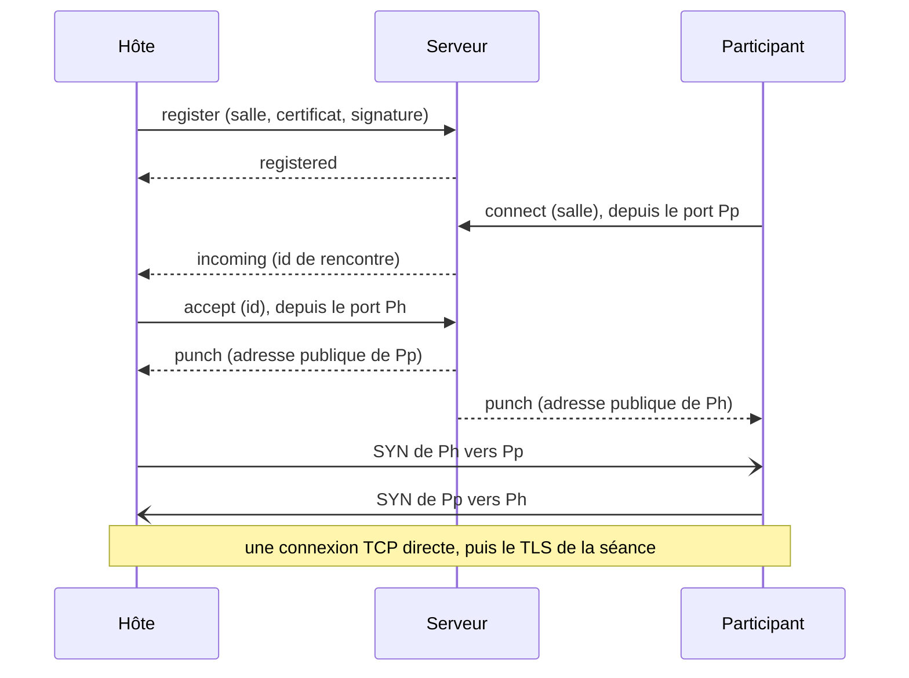

# Serveur de rendez-vous de Golether

`Golether.Web.Server` (l'exécutable `golether-server`) est un petit serveur qui présente l'hôte et un participant l'un à
l'autre quand tous deux sont derrière des routeurs sans port ouvert : une IP grise, le NAT du fournisseur, pas de
redirection de port. Le serveur indique à chaque côté sous quelle adresse publique il est vu et où chercher l'autre,
après quoi les côtés percent eux-mêmes une connexion TCP **directe** l'un vers l'autre. Le film, la synchronisation, la
discussion, les caméras et la voix ne passent pas par le serveur.

Le serveur a besoin d'une machine avec une IP publique (ou avec un port redirigé sur le routeur). Seul l'hôte a besoin
de l'adresse du serveur : les participants la reçoivent dans l'invitation. L'hôte l'obtient de l'une de deux façons (le
sélecteur « Mode de connexion » de l'écran d'accueil) :

- **Automatiquement** : l'application lit l'adresse du serveur du projet dans le fichier `config.json` de la page du
  projet (`Sources/Apps/Golether.Pages`). L'adresse dans le fichier est scellée (`EndpointSeal`) : un masque contre les
  scanners, pas un secret. La dernière bonne réponse est retenue et utilisée quand la page est inaccessible.
- **Mon propre serveur** : l'hôte saisit l'adresse, par exemple `203.0.113.7:47900`.

**L'installation, la configuration et la maintenance du serveur** sont décrites dans le guide de l'administrateur
[`Sources/Apps/Golether.Web.Server/ADMIN-GUIDE.fr.md`](../../Sources/Apps/Golether.Web.Server/ADMIN-GUIDE.fr.md) pour
Windows, Linux et macOS. Le même fichier se trouve à côté du programme dans chaque paquet du serveur. Ce document
explique comment le serveur est construit.

- [Comment ça marche](#comment-ça-marche)
- [Construire et publier](#construire-et-publier)
- [Sécurité](#sécurité)
- [Protocole (version 1)](#protocole-version-1)
- [Limitations](#limitations)

## Comment ça marche

Un routeur sans redirection de port ne laisse pas entrer une connexion que personne à l'intérieur n'attendait. Mais
quand un appareil sort de lui-même, le routeur retient quel port externe il a donné au port local de l'appareil et
laisse passer les réponses. C'est le principe du NAT hole punching :

1. **L'hôte prend une salle.** À la création d'une séance, Golether invente un nom de salle aléatoire (128 bits), garde
   une connexion permanente avec le serveur et signe l'inscription avec la clé de l'appareil. La salle appartient à cette
   clé : un autre appareil ne peut pas la prendre.
2. **L'invitation porte l'adresse du serveur et la salle** avec les adresses habituelles de l'hôte.
3. **Le participant** essaie d'abord directement les adresses de l'invitation. Si rien n'a répondu en 4 secondes (ou si
   toutes les adresses ont déjà échoué), il se connecte au serveur **depuis le port à partir duquel il va percer** et
   demande à être mis en relation avec l'hôte de la salle.
4. **Le serveur** prévient l'hôte que quelqu'un attend. L'hôte ouvre une nouvelle connexion vers le serveur, lui aussi
   depuis le port à partir duquel il va percer. Le serveur voit alors les adresses publiques des deux ports et envoie à
   chaque côté l'adresse de l'autre au même moment.
5. **Les deux côtés à la fois** se connectent l'un à l'autre depuis les mêmes ports. Les premiers paquets peuvent être
   rejetés par le routeur d'en face, mais chacun ouvre un « trou » dans le sien, et la tentative suivante de l'autre côté
   passe. Deux SYN qui se croisent fusionnent en une seule connexion TCP (TCP simultaneous open). Les tentatives sont
   répétées pendant jusqu'à 15 secondes.
6. **À partir de là, tout se passe comme pour une connexion directe :** TLS mutuel avec la clé épinglée de l'hôte,
   admission, code de vérification. Le serveur sort de la chaîne.

Chaque flux d'une séance (le contrôle et jusqu'à quatre flux de fichier) se rencontre ainsi séparément ; chaque
rencontre est une paire d'échanges courts avec le serveur.



**Caméras et voix.** Le même serveur répond aux requêtes STUN sur le même numéro de port en UDP. Le `webrtcbin` de
chaque participant apprend par lui son adresse UDP publique, la met parmi les candidats ICE et perce lui aussi un chemin
direct. Le serveur n'a pas de relais TURN à lui : les médias ne passent jamais par lui.

## Construire et publier

Les paquets prêts sont construits par les scripts de `Scripts/`, comme pour l'application. Tout va dans
`artifacts/publish` :

| Script | Résultat |
|---|---|
| `Scripts/Server/publish-server-win.ps1` | le dossier `win-x64/GoletherServer` et l'archive `GoletherServer-<version>-win-x64.zip` |
| `Scripts/Server/build-server-installer.ps1` | la même chose plus le programme d'installation `GoletherServer-<version>-setup.exe` (nécessite [Inno Setup](https://jrsoftware.org/isdl.php)) ; `-SkipPublish` prend le dossier déjà présent |
| `Scripts/Server/publish-server-linux.ps1 [-Runtime linux-x64\|linux-arm64]` | depuis Windows : le paquet Linux ci-dessous, construit dans Git Bash |
| `Scripts/Server/publish-server-macos.ps1 [-Runtime osx-arm64\|osx-x64]` | depuis Windows : le paquet macOS ci-dessous, construit dans Git Bash |
| `Scripts/Server/publish-server.sh [linux-x64\|linux-arm64\|osx-x64\|osx-arm64]` | le dossier `<rid>/GoletherServer`, une archive `.tar.gz` et, si l'outil `zip` est disponible, un `.zip` |

```powershell
./Scripts/Server/build-server-installer.ps1              # Windows : dossier, zip et programme d'installation
./Scripts/Server/publish-server-win.ps1 -Runtime win-arm64
```

```bash
./Scripts/Server/publish-server-linux.ps1                 # Windows : le paquet Linux x64 (Git Bash est nécessaire)
./Scripts/Server/publish-server-macos.ps1                 # Windows : le paquet macOS pour puce Apple
./Scripts/Server/publish-server.sh                        # Linux x64 (fonctionne aussi sous Windows dans Git Bash)
./Scripts/Server/publish-server.sh linux-arm64            # pour un Raspberry Pi ou un VPS ARM, par exemple
```

Les constructions sont autonomes : la machine du serveur n'a besoin ni de .NET ni d'autre chose. L'arborescence du
paquet est créée par le projet lui-même (la cible `GoletherServerPackageLayout` de `Golether.Web.Server.csproj`, activée
par la propriété `GoletherServerPackageRoot`) ; les scripts ajoutent la note, les fichiers du service et l'archive :

```
GoletherServer/
  golether-server(.exe)   le lanceur : le même hôte .NET avec l'icône du serveur, qui pointe vers bin/ (comme Golether.exe)
  bin/                    le programme, le runtime .NET et les bibliothèques
  config/appsettings.json les réglages ; le programme de bin/ les trouve tout seul (PackageLayout) ; config/monitor.json les réglages du moniteur
  docs/                   ADMIN-GUIDE.md et README.txt en anglais, ADMIN-GUIDE.<code>.md et README.<code>.txt en
                          allemand, espagnol, français, portugais et russe (de, es, fr, pt, ru)
  service/                Linux et macOS : install-service.sh et golether-server.service / org.golether.server.plist
  golether-server-monitor(.exe)  le lanceur du moniteur : l'hôte de l'application qui pointe vers monitor/
  monitor/                Golether Server Monitor (Golether.Web.Server.UI), autonome comme le serveur
```

Lancé depuis les sources (`dotnet run`), il n'y a pas d'arborescence, et `appsettings.json` se trouve à côté du
programme. Les archives pour Linux et macOS peuvent aussi être construites sous Windows (Git Bash) : le script pose
lui-même les droits d'exécution, et la signature locale pour macOS est posée par `install-service.sh` à l'installation.

Le programme d'installation Windows parle anglais, allemand, espagnol, français, portugais et russe (la langue de Windows
est présélectionnée, l'anglais quand l'assistant ne la parle pas) ; après l'installation, il affiche la note et ouvre le
guide de l'administrateur dans la langue choisie.

L'icône du serveur est l'icône de l'application avec un badge de baie de serveurs : `Assets/golether-server.svg` dans le
projet du serveur ; les versions matricielles sont dessinées par `Scripts/Assets/generate-icon.ps1 -Server`.

Pour le débogage, le serveur se lance directement depuis les sources :
`dotnet run --project Sources/Apps/Golether.Web.Server` ou le profil « Rendezvous server » de VS Code.

## Le moniteur

`Golether.Web.Server.UI` (l'exécutable `golether-server-monitor`) est une fenêtre pour l'administrateur : l'état du
serveur, son journal des événements en colonnes, le démarrage et l'arrêt du service, l'export du journal et la
modification des réglages. Ce que partagent le serveur et le moniteur (les réglages et leurs vérifications, les noms du
service sur chaque système, le rapport d'état, le journal) se trouve dans `Golether.Web.Server.Contracts`, qui n'a besoin
ni d'ASP.NET ni d'Avalonia.

- **Le journal des événements.** Le serveur consigne ce qui se passe (`ServerJournal`) : le démarrage, les adresses
  d'écoute, un hôte qui prend et quitte une salle, les rencontres demandées, réalisées et échouées (avec le motif), les
  connexions refusées, les requêtes non valides. Chaque événement a un numéro, l'heure, l'adresse IP de l'appareil,
  l'identifiant court de l'hôte et une étiquette de la salle : les 8 premiers chiffres hexadécimaux du SHA-256 de son
  nom, ainsi deux événements sur une même salle se distinguent des autres, mais l'étiquette ne permet à personne de
  demander l'hôte. Le journal garde les 5000 derniers événements en mémoire seulement et commence vide à chaque
  exécution.
- **`GET /journal?after=N`** sur l'adresse d'état renvoie les événements après le numéro N (au plus 1000) et l'heure de
  démarrage de l'exécution ; une heure de démarrage différente indique au moniteur que le serveur a redémarré. Il ne
  répond qu'aux requêtes de cet ordinateur (sinon `403`), quelle que soit l'adresse de `Urls`. Les événements et les
  motifs circulent par leur nom (`ServerContract.Json`), et le moniteur les formule dans sa propre langue
  (`Monitor.Event.*`, `Monitor.Reason.*`) : la langue du système au premier lancement, puis celle choisie dans son
  sélecteur de langue (avec drapeaux).
- **Le service** est piloté avec les outils du système : `sc query` et PowerShell en administrateur sous Windows,
  `systemctl` et `pkexec` sous Linux, `launchctl` et `osascript ... with administrator privileges` sous macOS. L'état se
  lit sans droits particuliers ; chaque modification les demande au moment de l'action. L'enregistrement des réglages
  met le nouveau fichier en place et redémarre un service en cours en une seule action, donc l'utilisateur n'est
  sollicité qu'une fois.
- **Où sont les réglages.** Le moniteur se trouve dans `monitor/` du dossier du serveur et trouve
  `config/appsettings.json` un niveau au-dessus ; sinon, il prend le dossier d'installation habituel du système. À
  l'écriture, il conserve toutes les parties du fichier qu'il ne modifie pas.

## Sécurité

**Ce que voit le serveur :** les adresses IP et les ports des appareils, les noms des salles, les certificats (clés
publiques) des hôtes et l'heure des rencontres. **Ce qu'il ne voit pas :** quoi que ce soit de la séance : ni le film,
ni la discussion, ni les caméras, pas même les noms des participants. Une séance est chiffrée avec un TLS mutuel entre
les appareils, les caméras et la voix avec DTLS-SRTP.

- **Le serveur ne peut pas se faire passer pour l'hôte.** Le participant épingle la clé de l'hôte depuis l'invitation et
  la vérifie pendant la poignée de main TLS sur la connexion percée. Un serveur malveillant peut au pire ne pas mettre
  les côtés en relation.
- **Une salle ne peut pas être usurpée.** L'inscription est signée avec la clé de l'appareil de l'hôte (ECDSA P-256) sur
  une valeur aléatoire à usage unique du serveur et le nom de la salle : une inscription d'autrui enregistrée ne peut
  pas être rejouée, et une salle tenue par une clé n'est pas donnée à une autre. La même clé peut reprendre la salle ;
  c'est ainsi que l'hôte revient après une coupure.
- **Une salle ne peut pas être trouvée par la clé.** Le nom de la salle fait 128 bits aléatoires, nouveaux à chaque
  séance ; seuls les destinataires de l'invitation le connaissent. Celui qui connaît la salle n'atteint quand même l'hôte
  que pour l'admission ordinaire avec le code de vérification.
- **Les données entrantes ne sont pas fiables.** Les trames font au plus 16 Kio, le JSON est validé, un certificat fait
  au plus 8 Kio, une signature au plus 256 octets, au plus 8 adresses par message, IPv4 avec port uniquement (pas de
  noms d'hôte). Chaque attente a une limite ; le nombre de connexions, de salles et de rencontres en attente est
  plafonné ; la fréquence des connexions et du STUN est limitée par IP. La table d'adresses de ce limiteur est elle-même
  bornée (200 000 adresses) : un expéditeur UDP peut falsifier son adresse, et un afflux de falsifications ne doit pas
  occuper toute la mémoire ; au-delà de la borne, les nouvelles adresses sont refusées jusqu'à l'expiration des
  anciennes.
- **Les adresses locales** d'un côté ne sont transmises à l'autre que si les deux ont la même adresse publique (le même
  routeur) : sinon elles sont inutiles et ne feraient que révéler quelque chose du réseau d'autrui.
- **Le STUN ne se prête pas aux attaques par amplification :** la réponse n'est qu'à peine plus grande que la requête,
  ne va que là d'où vient la requête et a une fréquence limitée. Le serveur ne répond qu'à Binding.
- **Le canal avec le serveur n'est pas chiffré.** Tout ce qui y circule, le serveur le voit de toute façon, il n'y a pas
  de secret dedans, et l'authenticité de l'hôte est vérifiée de bout en bout. Celui qui écoute le canal apprend les
  adresses et le nom de la salle : ce qu'il verrait en regardant le trafic de la séance elle-même.

## Protocole (version 1)

TCP, IPv4. Une trame fait 4 octets de longueur (big-endian) et du JSON UTF-8 (1 octet – 16 Kio). Le type du message est
donné par le champ `$t` ; les noms de champs sont en camelCase. Les adresses sont des chaînes `a.b.c.d:port`. S est le
serveur, H l'hôte, P un participant, D n'importe quel appareil.

| `$t` | Sens | Champs | Signification |
|---|---|---|---|
| `server-hello` | S → D | `version`, `nonce` | le premier message du serveur sur chaque connexion ; `nonce` fait 16 octets aléatoires en base64url |
| `register` | H → S | `room`, `certificate` (DER, base64), `signature` (base64) | l'hôte prend une salle ; la connexion reste ouverte |
| `registered` | S → H | `observed` | la salle est prise ; `observed` est l'adresse de l'hôte telle que la voit le serveur |
| `ping` / `pong` | H ↔ S | — | maintien de l'inscription (l'hôte : toutes les 20 s) |
| `connect` | P → S | `room`, `locals[]` | un participant demande une rencontre ; la connexion est ouverte depuis le port de perçage |
| `incoming` | S → H | `punch` | sur l'inscription : un participant attend ; `punch` fait 16 octets aléatoires en base64url |
| `accept` | H → S | `punch`, `locals[]` | l'hôte répond à une rencontre par une nouvelle connexion depuis le port de perçage |
| `punch` | S → les deux | `peer`, `peerLocals[]` | l'adresse publique de l'autre côté et ses adresses locales (seulement avec une IP publique commune) |
| `error` | S → D | `error` | refus ; la connexion est fermée ensuite |

La signature de l'inscription est ECDSA P-256 / SHA-256 de la chaîne UTF-8 `golether-rendezvous-v1\n<nonce>\n<room>`. Le
propriétaire d'une salle est le SHA-256 du SubjectPublicKeyInfo de la clé (le même `PeerId` que dans une séance).

Les motifs d'un refus (`error`) circulent sous forme de noms ; l'appareil choisit le texte pour une personne dans sa
propre langue :

| Valeur | Quand |
|---|---|
| `UnsupportedVersion` | versions de protocole différentes |
| `BadRequest` | un message mal formé ou inattendu |
| `BadSignature` | la signature de l'inscription ne correspond pas au certificat |
| `RoomTaken` | la salle est tenue par une autre clé |
| `RoomNotFound` | personne ne tient la salle (la séance est terminée ou l'hôte a perdu le serveur) |
| `Busy` | trop de rencontres en attente pour cet hôte |
| `Timeout` | l'hôte n'a pas répondu à temps ; la rencontre est inconnue ou a déjà eu une réponse |
| `ServerFull` | toutes les salles sont prises |
| `Unreachable`, `PunchFailed` | sur l'appareil seulement : le serveur est injoignable / les routeurs n'ont pas laissé passer la connexion |

Le serveur garde les connexions de rencontre (`connect`, `accept`) jusqu'à ce que les appareils les ferment (pas plus de
`AnswerTimeout` après `punch`) : tant que l'une est ouverte, le routeur n'oublie pas l'association du port.

Qui choisit la connexion. Plusieurs connexions peuvent s'ouvrir (par les adresses publiques et par les adresses
locales), et les côtés pourraient en choisir des différentes. C'est donc le participant seul qui choisit : la première
qui s'est ouverte, et le participant est aussi le premier à parler (TLS ClientHello). L'hôte garde toutes celles qui se
sont ouvertes et prend celle dans laquelle le participant a parlé ; les autres sont fermées.

## Limitations

- **Un NAT symétrique** (le routeur donne un nouveau port externe à chaque destination) d'un côté ou de l'autre rend le
  perçage impossible : l'adresse vue par le serveur ne sert à rien à l'autre côté. Certains opérateurs mobiles et réseaux
  d'entreprise fonctionnent ainsi. Le participant reçoit une erreur indiquant que les routeurs n'ont pas laissé passer la
  connexion directe ; il reste un tunnel AmneziaWG ou un port redirigé au moins du côté de l'hôte.
- **IPv4 uniquement.** Un serveur sur `::` accepte aussi l'IPv6, mais les appareils s'y connectent toujours en IPv4 et
  percent en IPv4.
- **Il n'y a pas de relais TURN**, volontairement : quand les caméras n'ont pas de chemin direct, elles ne passent pas
  par le serveur. Elles sont alors portées par le relais de l'hôte intégré à l'application : son trafic passe par les
  flux de la séance elle-même, donc il fonctionne partout où la séance fonctionne.
- Chaque flux d'une séance a besoin de sa propre rencontre, donc se connecter via le serveur prend quelques secondes de
  plus que se connecter directement.
