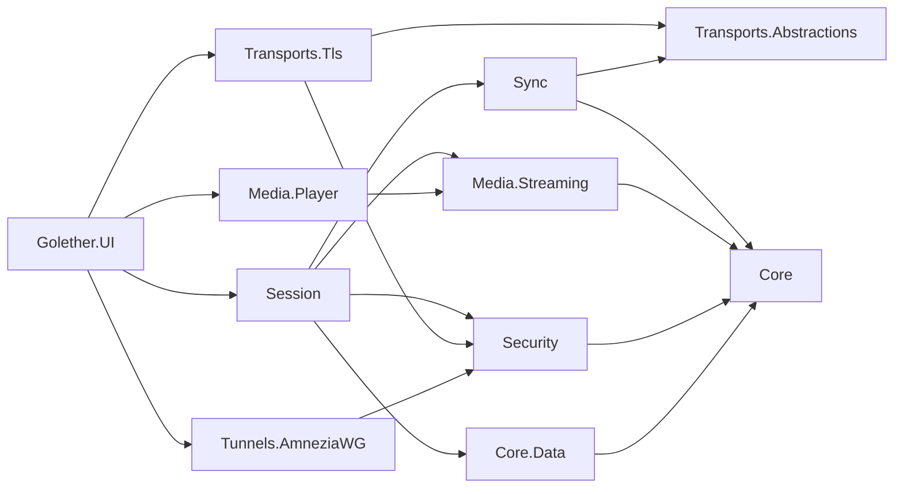

# Arquitetura do Golether

## Objetivo

Ver um vídeo em conjunto, com as câmaras dos participantes:

- o vídeo ocupa a maior parte da janela, os quadros dos participantes ficam à direita (até 5 pessoas, incluindo o
  anfitrião);
- o vídeo está sincronizado para todos; pausa, salto e início feitos por qualquer participante aplicam-se a todos;
- no início, todos começam na mesma posição no mesmo momento;
- o ficheiro não fica guardado num servidor: o anfitrião serve-o na qualidade original;
- um ping acima de 1000 ms é aceitável, uma ligeira dessincronização é tolerável;
- um estranho não se consegue ligar; quando o caminho direto está bloqueado, usa-se o AmneziaWG.

## Decisões

| Questão | Decisão | Porquê |
|---|---|---|
| Como o vídeo viaja | O ficheiro original é enviado em partes de 256 KiB, não um fluxo de transmissão | Não se perde qualidade, o ping só afeta o tempo de sincronização |
| Leitor | libmpv (P/Invoke), o seu próprio protocolo `golether://` | O descodificador do FFmpeg, como no MPC, mas funciona em todos os sistemas e é controlado com precisão |
| Transporte | TLS mútuo sobre TCP, chaves fixadas | `System.Net.Quic` não funciona no Windows 10 nem no macOS; o QUIC é uma otimização futura |
| Sincronização | O estado é definido pelo tempo, o anfitrião decide, relógios ao estilo do NTP | O atraso de entrega não afeta o resultado |
| Segurança | Chave de dispositivo ECDSA P-256, convites de curta duração, admissão pelo anfitrião, código de verificação | Sem autoridade de certificação e sem servidor |
| Túneis | AmneziaWG “cada um com o anfitrião”, os pacotes “oferta / resposta” são passados pelas próprias pessoas | Sem VPS próprio |
| IP cinzentos sem reencaminhamento de portas | Servidor de encontro próprio: apresenta os lados e responde a STUN, a ligação é aberta diretamente (TCP simultaneous open) | O servidor não retransmite nada e não vê nada da sessão; basta uma máquina com IP público |
| Câmaras e voz | GStreamer `webrtcbin` | LGPL, WebRTC, captura e cancelamento de eco num só framework; o SIPSorcery é incompatível com a GPL |
| Dados | SQLite, esquema através do FluentMigrator, acesso através do EF Core | Um requisito do projeto |
| Idiomas | Os textos estão em ficheiros JSON, um por idioma; o código obtém um texto por chave do pacote do idioma escolhido | Um idioma novo é um ficheiro novo, o código não tem ramificações por idioma |

## Módulos

```
Sources/
  Core/Golether.Core                       PeerId, PlaybackState, DriftCorrector, MediaDescriptor, PeerEndpoint, AppDataPaths
  Core/Golether.Localization               idiomas: ficheiros JSON com textos, escolha do idioma, Localizer e Texts
  Core/Golether.Core.Data                  EF Core: contactos, túneis, definições
  Core/Golether.Core.Data.Migrations       FluentMigrator: migrações com scripts SQL e o executor
  Core/Golether.Core.Data.Migrations.SQLite scripts SQL e versões para SQLite
  Database/Golether.Dbs.SQLite.DbMigrator  o migrador de consola
  Security/Golether.Security               chave do dispositivo, proteção de segredos, convites, código de verificação,
                                           admissão, o endereço selado do servidor de encontro
  Components/Golether.Components          catálogo de componentes nativos (libmpv, GStreamer, AmneziaWG), procura e instalação
  Tools/Golether.Tools.Components          o utilitário golether-components: prepara os componentes para compilar um pacote
  Transports/Golether.Transports.Abstractions  PeerStream, conector e escuta, FrameChannel
  Transports/Golether.Transports.Tls       mTLS sobre TCP com uma chave fixada
  Transports/Golether.Transports.PortMapping  reencaminhamento de portas no router: NAT-PMP e UPnP IGD, renovação da concessão
  Transports/Golether.Transports.Relay     o relé TURN do anfitrião para câmaras e voz (RFC 5766 sobre TCP)
  Transports/Golether.Transports.Rendezvous  protocolo do servidor de encontro, cliente do anfitrião e do participante, TCP hole punching
  Sync/Golether.Sync                       protocolo, estimativa do desvio dos relógios, PlaybackAuthority, PlaybackFollower
  Media/Golether.Media.Streaming           servidor de partes, cliente paralelo, cache, leitura antecipada, fluxo para o leitor
  Media/Golether.Media.Player              libmpv (P/Invoke, incorporação, golether://), um leitor simulado
  Media/Golether.Media.Conference          contrato de câmaras e voz, um substituto
  Media/Golether.Media.Conference.GStreamer  câmaras e voz: captura, VP8/Opus, webrtcbin, misturador, cancelamento de eco
  Tunnels/Golether.Tunnels.AmneziaWG       chaves X25519, ofuscação, .conf, pacotes assinados, controlo através da CLI
  Session/Golether.Session                 HostSession e ParticipantSession
  Apps/Golether.UI                         Avalonia: janela, diálogos, composição de dependências
  Apps/Golether.Web.Server                 o servidor de encontro (uma aplicação à parte, ver RendezvousServer.md)
  Apps/Golether.Web.Server.Contracts       o que o servidor e o monitor partilham: definições, nomes do serviço, estado, registo
  Apps/Golether.Web.Server.UI              Golether Server Monitor: o estado, o registo, o serviço e as definições
  Apps/Golether.Pages                      a página do projeto no GitHub Pages: página inicial, convites por ligação, os
                                           ficheiros com a versão mais recente e o endereço do servidor de encontro (estáticos)
```

As dependências apontam para dentro: o Core não depende de nada; a interface junta tudo em `AppServices`.



## Canais entre os nós

Cada fluxo é uma ligação TLS separada com o preâmbulo `GLTH`, uma versão e uma finalidade:

- **Control**: mensagens JSON da sessão (boas-vindas, estado, relógios, estados), uma ligação por participante.
- **MediaData**: pedidos binários de partes do ficheiro. Um participante abre até 4 ligações paralelas para que, em
  ligações com RTT grande, a velocidade não fique limitada por um único fluxo TCP.
- **Relay**: o tráfego TURN das câmaras e da voz para o relé do anfitrião viaja num fluxo TLS da sessão, pela mesma rota
  que os outros fluxos (um endereço direto ou um encontro através do servidor de encontro). Do lado do participante, o
  `webrtcbin` aponta para a porta local do `RelayTunnel` (`127.0.0.1`); todas as ligações feitas para ela partilham um
  fluxo `RelayShared` como canais do `RelayMultiplexer` (com um anfitrião de uma versão anterior, cada uma recebe um
  fluxo `Relay` próprio); o anfitrião entrega cada canal de um participante admitido ao `TurnServer`. É por isso que as
  câmaras e a voz funcionam onde quer que a sessão funcione, mesmo com o UDP bloqueado e a porta do relé fechada a partir
  de fora. O ICE continua a oferecer também UDP direto e usa-o quando passa.
- **TURN** (porta da sessão + 1): o relé `Golether.Transports.Relay` para WebRTC (RFC 5766 sobre TCP, retransmissão sobre
  UDP). Só os participantes de versões anteriores precisam de uma porta própria. As credenciais do relé são criadas para
  uma sessão e só chegam a um participante nas boas-vindas após a admissão; o relé só reencaminha pacotes para endereços
  para os quais o cliente criou uma permissão. Não é dada permissão para os endereços do próprio computador do anfitrião
  (loopback) nem para endereços de difusão e multidifusão: todos os participantes conhecem a palavra-passe do relé, e ela
  não pode abrir caminho para os serviços do anfitrião. Uma atribuição que o cliente não renovou antes de expirar é
  fechada juntamente com a ligação, para que clientes desaparecidos não ocupem lugar. Os meios continuam cifrados com
  DTLS-SRTP; o anfitrião não os consegue ver.
- **Encontro através do servidor de encontro**: se nenhum endereço do convite respondeu em 4 segundos, o participante
  encontra-se com o anfitrião através do servidor indicado no convite: ambos se ligam ao servidor a partir das portas de
  onde vão perfurar, ficam a saber os endereços públicos um do outro e ligam-se diretamente um ao outro no mesmo momento.
  A ligação perfurada leva o mesmo TLS com a chave fixada; o anfitrião entrega essas ligações ao seu `TlsPeerListener`
  (`Adopt`). A rota escolhida é usada para todos os fluxos da sessão. Pormenores: [RendezvousServer.md](RendezvousServer.md).
- **Moderação**: a mensagem `moderate` do anfitrião desliga o microfone e/ou a câmara de um participante; o protocolo não
  tem um comando para os ligar. Os participantes indicam o estado dos seus dispositivos nos estados (`MicrophoneOff`,
  `CameraOff`).

Formatos em pormenor: [Protocol.md](Protocol.md).

## Sincronização

O estado da sessão (`PlaybackState`): “no momento `ReferenceTime` segundo o relógio do anfitrião, a posição era
`Position` e a velocidade `Rate`”. Cada nó calcula por si a posição necessária: `Position + (now − ReferenceTime) × Rate`.

- **Relógios.** Um participante envia sondas `ping/pong` (6 rápidas, depois uma a cada 2 s). O desvio
  `((t1 − t0) + (t2 − t3)) / 2` é tirado da sonda com a menor RTT numa janela de 16. Enquanto o desvio não for
  conhecido, o estado não é aplicado ao leitor.
- **Decisões.** O `PlaybackAuthority` no anfitrião aceita os pedidos de todos os participantes pela ordem em que chegam
  (ganha o último) e atribui versões. Os nós só aplicam versões mais recentes.
- **Início.** A reprodução é agendada para `now + max(RTT) + 1,5 s` (no máximo 8 s); a interface mostra uma contagem
  decrescente.
- **Pausa.** Quem a inicia pausa de imediato e envia a sua imagem; os outros passam para ela.
- **Sem eco de comandos.** As intenções do utilizador vêm apenas dos comandos da interface; os eventos do mpv não são
  reencaminhados. Assim, uma ação aplicada por ordem de outra pessoa nunca volta a ser enviada.
- **Correção** (`DriftCorrector`):

| Desvio | Ação |
|---|---|
| < 150 ms | nada (se já estiver em curso uma correção, até 50 ms: histerese) |
| 150 ms – 2 s | velocidade ± até 5 % durante 8 s, o tom é mantido |
| > 2 s | um salto exato; sem correção durante 1,5 s após um salto |

- **Fim do filme.** Quando a posição esperada atinge a duração, o anfitrião fixa uma pausa na última imagem (causa
  `Ended`). Um seguidor nunca espera uma posição além da duração e, no fim, nem salta nem inicia o leitor (o mpv com
  `keep-open` pausa sozinho). “Reproduzir” no fim começa o filme do início.
- **Carregamento.** A política `WaitForAll`: se um participante estiver a carregar e mais de 2 s atrasado, o anfitrião
  pausa todos e continua quando cada um tiver ≥ 5 s de dados. A alternativa é `LetLaggardsCatchUp`.
- **Preparação antes do início.** Com `WaitForAll`, “reproduzir” primeiro põe todos em pausa na posição necessária
  (causa `WaitingForParticipants`) até cada participante ter o ficheiro aberto e ≥ 5 s carregados nessa posição (perto do
  fim do filme: o que restar). Depois a sessão começa sozinha (`ParticipantsReady`). O anfitrião pode saltar a espera
  (`PlayNow`), e ao fim de 45 segundos a espera termina sozinha; ambos dão a causa `StartedWithoutWaiting`.

## Conversa, reações, a caneta e o regresso

- As mensagens da conversa, as reações e os traços da caneta viajam pelo mesmo canal TLS da sessão que a sincronização:
  o anfitrião verifica o conteúdo, limita a frequência, coloca o remetente verificado e envia-os a todos. Nada é escrito
  em disco.
- As reações vivem 3 segundos e são desenhadas numa janela transparente separada por cima do vídeo (caso contrário, a
  janela do mpv tapá-las-ia). No Windows, essa janela responde `HTTRANSPARENT` ao teste de impacto, por isso os cliques
  no vídeo atravessam-na. A janela fica aberta durante toda a sessão: as ligações de dados de um popup fechado ficam
  inativas, e uma reação que já desapareceu voltaria na próxima vez que abrisse.
- A mesma janela cobre toda a área do vídeo e transporta o `StrokeCanvas`, a tela da caneta. Enquanto a caneta está
  desligada, a janela continua transparente para o rato; quando o botão é premido,
  `ClickThroughWindow.SetClickThrough` deixa de responder `HTTRANSPARENT` e a tela recebe ela própria os eventos do
  ponteiro. O `DrawingViewModel` junta pontos e envia-os em lotes (~60 ms), e só desenha o que o anfitrião devolveu,
  incluindo os seus próprios traços, para que a ordem seja a mesma para todos.
- As coordenadas de um traço são frações da *imagem*, não da janela: o `StrokeCanvas` calcula o retângulo da imagem a
  partir da proporção indicada pelo mpv (`video-params/aspect`), para que o sítio rodeado coincida seja qual for a forma
  das janelas. A cor de um traço é a cor do participante em `ParticipantColors`, a mesma do avatar.
- Ao ser admitido, um participante recebe um bilhete (`reconnectTicket`) válido até ao fim da sessão. Depois de uma
  quebra, o `SessionService` tenta voltar oito vezes com pausas de 2, 3, 5, 10, 20 e 30 segundos; o anfitrião confirma a
  entrada de cada vez.

## Servir o ficheiro

- `MediaDescriptor`: nome, tamanho, tamanho da parte, um identificador rápido (SHA-256 do tamanho e de três amostras de
  1 MiB).
- O `ChunkServer` entrega partes com o seu SHA-256; o cliente verifica o hash e o comprimento.
- O `RemoteChunkSource` remove pedidos duplicados e recria fluxos falhados (3 tentativas).
- O `CachedMediaReader` mantém partes na memória (LRU, 1 GiB) e lê 32 partes à frente em lotes de 4.
- O `MediaReadStream` é entregue à libmpv através de `mpv_stream_cb_add_ro`; uma leitura é cancelada através de
  `cancel_fn`.
- Um participante com o mesmo ficheiro (o identificador rápido coincide) reprodu-lo a partir do disco.
- **Indicador de carregamento.** O leitor indica que intervalos já estão na cache (`demuxer-cache-state` do mpv), e a
  linha de tempo mostra-os com um preenchimento claro: vê-se onde um salto não precisa de espera. Para o anfitrião e para
  um participante com a sua própria cópia do ficheiro, toda a linha de tempo está marcada.
- **Partilha entre espectadores** (`Media.Streaming.Sharing`): os participantes anunciam uns aos outros que partes têm (a
  cache na memória ou uma cópia local inteira) e passam-nas por um canal de dados WebRTC. O `SwarmChunkSource` obtém uma
  parte de um participante, verifica o seu SHA-256 com o hash que o anfitrião dá sem os dados (a operação GetHash) e, em
  caso de erro, transfere a parte do anfitrião. Assim, o anfitrião entrega cada parte uma vez, não a cada espectador.

## Segurança

- **Dispositivo:** ECDSA P-256 e um certificado autoassinado; `PeerId` = SHA-256 do SubjectPublicKeyInfo. A chave fica
  em `identity/device.key` sob DPAPI (Windows) ou com modo 600 (Linux/macOS, até à passagem para libsecret/Keychain).
- **Convite:** `golether://join/v1/<base64url JSON>` com a impressão digital do anfitrião, endereços, um token de 128 bits
  e uma hora de expiração; o anfitrião só guarda o hash do token. O token e a hora de expiração vêm primeiro no JSON:
  todo o resto é igual em cada convite de uma sessão, por isso um convite novo distingue-se desde os primeiros
  caracteres.
  - *Duas formas.* A **chave** (`golether://…`) é colada na aplicação, a **ligação**
    (`https://depthrel.github.io/Golether/join/#…`) é clicável em qualquer serviço de mensagens; o conteúdo é o mesmo. A
    janela do convite emite-as como dois convites com tokens próprios: a ligação vive 15 minutos, a chave 15 minutos ou
    uma hora. O `InviteRegistry` não emite nada que dure mais de uma hora.
  - *Um para todo o grupo.* Todos os que o anfitrião chamou entram com um convite até ele expirar ou ter trazido 16
    pedidos (`InviteRegistry.MaxUses`, o limite para uma ligação divulgada). Não é o convite que deixa entrar as
    pessoas, mas o anfitrião, que aprova cada uma.
  - *A validade só é verificada à entrada* (pelo participante antes de se ligar, pelo anfitrião em
    `InviteRegistry.TryUse`): um participante admitido fica na sessão e volta depois de uma quebra com o bilhete, não com
    o convite.
  - *Removido e recusado.* O anfitrião lembra-se do dispositivo juntamente com o número do último convite emitido até
    esse momento (`HostSession._turnedAway`). Esses convites já não deixam entrar esse dispositivo, embora continuem a
    funcionar para os outros; um convite criado depois, sim. Não é um bloqueio, e um anfitrião que simplesmente não
    respondeu a tempo não recusou ninguém. O dispositivo recebe o motivo de imediato, sem perguntar ao anfitrião. A um
    participante admitido que o anfitrião removeu, ou cuja sessão o anfitrião terminou, é mostrado o motivo numa mensagem
    própria (`ISessionService.ClosedByHost`): a lista de eventos desaparece juntamente com a sessão.
- **Ligação:** o participante fixa a chave do anfitrião durante o handshake TLS. O anfitrião aceita qualquer certificado,
  calcula o `PeerId`, verifica o token (os contactos de confiança não precisam dele) e pergunta ao utilizador.
- **Código de verificação:** três palavras e um número a partir de ambos os `PeerId` e do contexto; os lados comparam-no
  de viva voz. As palavras aparecem no idioma de cada lado (ver “Idiomas da interface”).
- **O ficheiro** só é entregue a participantes admitidos; quando um participante sai, é removido ou volta a ligar-se, os
  seus fluxos de dados são fechados.
- **As câmaras e a voz** são cifradas com DTLS-SRTP. O `webrtcbin` não verifica o certificado do outro lado com a
  impressão digital do SDP, por isso o `WebRtcPeer` fá-lo ele próprio: o SDP só chega pelo canal protegido da sessão,
  nenhuma imagem nem som é enviado (`valve`) ou aceite até o certificado coincidir, e se não coincidir a ligação é
  cortada. Não se usam servidores STUN/TURN alheios; quando o convite indica um servidor de encontro, a sua porta UDP
  serve de servidor STUN da sessão (`IConferenceMedia.SetStunServer`), e as câmaras também atravessam o NAT diretamente.
- **Uma câmara ou um microfone desligado** é libertado: o dispositivo é parado, não apenas silenciado.
- **Os dados recebidos** (JSON, pacotes, configurações, nomes de ficheiros) são validados e limitados em tamanho.

## Túneis AmneziaWG

- O anfitrião mantém uma interface `golether0` com a sub-rede `10.64–127.x.0/24`; cada participante é um par `/32`.
- Uma oferta: a chave pública AWG, endereços, o endereço atribuído, os parâmetros comuns `S1/S2/H1–H4`, uma chave P-256
  efémera, uma hora de expiração, o certificado do dispositivo, uma assinatura. Uma resposta: o mesmo do lado do
  participante.
- PSK = SHA-256(ECDH(chaves P-256 efémeras)); nunca viaja pela rede.
- As chaves privadas não saem do dispositivo; os segredos na base de dados são protegidos pelo `ISecretProtector`.
- Um túnel é ligado com `amneziawg.exe /installtunnelservice` (Windows) ou `awg-quick up` (Linux/macOS). A configuração
  é exportada num formato compatível com o AmneziaVPN.
- **Motor próprio.** No Windows, a aplicação tem o seu próprio AmneziaWG: não faz parte do pacote da aplicação, mas é
  transferido a pedido como o componente `Tunnel` (o botão “Instalar” da janela dos túneis). É o pacote oficial
  `amneziawg-<arch>-3.1.0.msi`, fixado por SHA-256 e tamanho, do qual o `msiexec /a` extrai `amneziawg.exe`, `awg.exe` e
  `wintun.dll` para `data/components/tunnel/<version>/amneziawg`. Nada é instalado no sistema e a descompactação não
  precisa de direitos de administrador. O `ComponentLocator` deliberadamente **não** procura um AmneziaWG instalado pelo
  utilizador: o Golether só chama a sua própria cópia, para que o cliente do sistema e os seus túneis não sejam tocados.
  Sem o componente, `AwgCliOptions.WindowsExecutable` recorre ao caminho em Program Files. O assistente elevado
  `--tunnel-helper` calcula o mesmo caminho, por isso ambos os lados chamam o mesmo programa. O caminho é procurado
  **antes de cada chamada** (`AwgCliOptions.FindCarriedExecutable`), não uma vez no arranque: o componente pode ser
  instalado sem reiniciar a aplicação. É instalado a partir da janela dos túneis, que mostra o cartão do componente; sem
  o motor, `UpAsync` e `DownAsync` dão de imediato um erro claro em vez de um arranque de processo falhado.
- O intervalo de endereços dos túneis `10.64–127.x.0/24` foi escolhido para não se sobrepor a redes domésticas típicas
  (`192.168.x`, `10.0.0.x`) nem a túneis que o utilizador ligou por si.
- **Endereço público e travessia de NAT** (`NatTraversal`). Antes de criar uma oferta e antes de aceitar uma resposta, um
  lado abre um socket UDP na porta do futuro túnel e pergunta a servidores STUN públicos como essa porta é vista de fora.
  O endereço só entra no pacote quando dois servidores indicaram **a mesma** porta: portas diferentes significam um NAT
  simétrico, e esse endereço não serve. Depois, cada lado envia alguns pacotes para os endereços do outro a partir da
  mesma porta: o primeiro pacote é rejeitado pelo router do outro, mas abre um buraco no próprio, e o handshake passa. O
  socket é fechado mesmo antes de o túnel arrancar: o mapeamento do router dura bastante mais.
- A lista de servidores STUN é dada no construtor do `TunnelWorkflow`; uma lista vazia desliga todos os pedidos para o
  exterior (os testes funcionam assim, e pode ser feito por privacidade).
- **Um túnel vive tanto quanto a aplicação.** Os nomes das interfaces ligadas são escritos em `data/tunnels/raised.txt`;
  ao sair, `AppServices.DisposeAsync` desliga-as (durante no máximo dois minutos; recusar o pedido de administrador não
  retém a saída). O ficheiro sobrevive a uma falha, por isso um túnel esquecido é removido no arranque seguinte, e a
  janela dos túneis tem o botão “Desligar o túnel” para não ter de esperar pela saída. Os túneis que não foram ligados
  pelo Golether não são tocados: o ficheiro só lista os seus.
- A porta da interface é escolhida entre 40000–60000 **verificando que está livre**: o intervalo sobrepõe-se às portas
  que o Windows atribui a qualquer programa, e uma porta ocupada significaria tanto um túnel falhado como não conseguir
  saber o endereço público.

## Idiomas da interface

Tudo o que o utilizador lê (ecrãs, diálogos, mensagens de erro, eventos da sessão, o relatório de diagnóstico) vem dos
pacotes de idioma `Sources/Core/Golether.Localization/Languages/<code>.json`: um objeto plano “chave → texto” em que
`Language.Code` e `Language.Name` nomeiam o idioma (`en` é “English”, `de` é “Deutsch”, `ru` é “Русский”). A aplicação
inclui inglês, alemão, espanhol, francês, português e russo. Os pacotes estão incorporados no assembly; o
`LanguageCatalog` encontra-os sozinho. O inglês é o idioma predefinido e a origem dos textos que faltem a outro idioma.

Como está construído:

- `ILanguagePack` é uma estratégia: os textos de um idioma. O `Localizer` procura uma chave no pacote do idioma atual,
  depois no inglês e depois devolve a própria chave (a falha vê-se, o ecrã não se parte). Nunca pergunta que idioma está
  ativo.
- `Texts` (`Texts.Get(key)`, `Texts.Format(key, values)`) é o acesso para o código sem modelo de vista: exceções, eventos
  da sessão, dicas. `Texts.Scope(...)` dá a um fluxo de trabalho o seu próprio idioma (os testes precisam disso).
- XAML: `Text="{loc:Loc Main.Title}"`, com um valor: `{loc:Loc Key=Main.Device, Arg={Binding Fingerprint}}`. A ligação
  passa pelo `LocalizationSource`, por isso todos os textos mudam de imediato com o idioma, sem reiniciar. Os textos que
  os próprios modelos de vista compõem são relidos em `MainWindowViewModel.RefreshTexts`.
- As chaves que dependem de uma enumeração são construídas a partir dos seus valores: `Session.Reject.<RejectReason>`,
  `Session.Playback.<PlaybackCause>`, `Component.Source.<ComponentSource>`, `Component.Stage.<InstallStage>`,
  `Log.Level.<LogLevel>`. Os testes garantem que cada valor tem um texto em cada idioma.

A escolha do idioma (`LanguageService`, a definição `ui.language` na tabela `Settings`):

1. Primeiro arranque: a base de dados não tem idioma, por isso é usado o idioma do sistema operativo
   (`CultureInfo.CurrentUICulture`) quando há um pacote para ele, seja qual for a região (`de-CH` recebe alemão, `pt-BR`
   português), e caso contrário o inglês. O resultado é guardado e aparece de imediato na lista de idiomas.
2. Arranques seguintes: o idioma é lido da base de dados; o sistema já não é consultado.
3. O utilizador escolhe o idioma na janela das definições (a bandeira `Assets/Flags/<code>.png` e o nome do idioma nesse
   idioma); a escolha é aplicada com o botão “Aplicar”, de imediato para todos os textos, e guardada.

O monitor do servidor usa os mesmos pacotes (as chaves `Monitor.*`) e as mesmas bandeiras; guarda a sua escolha em
`config/monitor.json` da pasta do servidor.

As palavras do código de verificação são traduzidas: o `VerificationCode` guarda três números de palavra (0–63) e um
número, e cada pacote nomeia as mesmas 64 coisas pela mesma ordem (`Verification.Word.00` … `Verification.Word.63`).
Por isso, o código é o mesmo dos dois lados, sejam quais forem os seus idiomas, e duas pessoas com idiomas de interface
diferentes veem traduções das palavras uma da outra.

O que não depende do idioma da interface:

- pela rede viajam motivos, não textos: `rejected` leva um `RejectReason`, `bye` não leva texto; o leitor formula o
  motivo no seu próprio idioma (o anfitrião e um participante podem usar idiomas diferentes);
- o assistente de túneis e firewall (um processo à parte com direitos de administrador) não conhece nenhum idioma:
  indica factos (programa, código de saída, saída), e a aplicação transforma-os em palavras
  (`TunnelHelper.DescribeFailure`);
- as mensagens do sistema operativo e do .NET (`Win32Exception`, `HttpRequestException`) e a saída de programas externos
  são mostradas tal como estão; as mensagens do registo para programadores (`ILogger`) continuam em inglês, só a
  etiqueta do nível numa linha do registo é traduzida.

## Página do projeto, entrada por ligação e instância única

A página `Sources/Apps/Golether.Pages` (GitHub Pages, os endereços estão em `ProjectSite`) é uma comodidade, não uma
dependência: uma chave funciona sem ela, o servidor de encontro pode ser escrito à mão, a origem das atualizações pode ser
substituída.

- **Ligação de convite.** `join/` lê o convite depois do `#` (o navegador não envia essa parte ao servidor), mostra o nome
  da sessão e o do anfitrião e vai para `golether://join/v1/…`. A página não carrega nada de outros servidores e não
  envia nada para lado nenhum (`Content-Security-Policy`), e retira de imediato o convite da barra de endereço. Uma
  segunda ligação aberta no mesmo separador faz a página recarregar, por isso nunca entrega o convite anterior.
- **O esquema `golether://`** é registado na instalação: o Windows usa `Software\Classes\golether` (Inno Setup, `HKA`),
  o macOS `CFBundleURLTypes` em `Info.plist`, o Linux `MimeType=x-scheme-handler/golether` no ficheiro `.desktop`.
- **Instância única** (`SingleInstance`): um mutex com nome por utilizador e pasta de dados decide quem é o primeiro; um
  segundo arranque entrega os seus argumentos ao primeiro por um pipe com nome aberto apenas ao utilizador atual, e
  termina. A mensagem é limitada em tamanho e interpretada como uma lista curta de cadeias. No macOS, uma ligação chega
  como evento (`IActivatableLifetime`).
- **Entrar nunca é silencioso.** Qualquer página pode abrir `golether://`, por isso
  `MainWindowViewModel.OfferInviteAsync` primeiro interpreta o convite e depois pergunta: “entrar na sessão?” ou, quando
  há uma sessão em curso, “mudar para outra sessão?”. Os nomes na pergunta vêm do convite, ou seja, foram escritos pelo
  seu autor; quem é de facto o anfitrião é confirmado pela chave fixada e pelo código de verificação.
- **Endereço do servidor de encontro** (`RendezvousMode`): “Automaticamente” significa que o `RendezvousDirectory` lê o
  `config.json` da página (até 5 segundos, até 4 KiB), caso contrário usa a última resposta boa da definição
  `network.rendezvousDirectory`, e caso contrário a sessão decorre sem servidor e o anfitrião vê um evento sobre isso;
  “Diretamente” significa sem servidor; “O meu próprio servidor” significa o endereço da definição
  `network.rendezvousServer`. O endereço no ficheiro está selado com `EndpointSeal` (AES-256-GCM, a chave está
  incorporada na aplicação): é uma máscara contra scanners, não um segredo, pois a chave está no código aberto e o
  endereço faz parte de cada convite. Um ficheiro falsificado poderia mostrar a um servidor alheio quem se encontra com
  quem e estragar o encontro, mas não poderia ler uma sessão nem fazer-se passar pelo anfitrião: o participante fixa a
  chave do anfitrião a partir do convite. O texto para o ficheiro é feito pelo utilitário do proprietário
  `Golether.AdminSettings` (um repositório à parte) com a sua própria cópia do algoritmo; o `EndpointSealTests` guarda
  uma amostra da sua saída.

## Atualizações e relatórios

- O `UpdateService` lê o manifesto da página do projeto (`updates.json`) ou do endereço nas definições (`updates.url`,
  apenas `https://` ou um endereço local) e compara a versão. A aplicação avisa de uma versão nova com uma barra cujo
  botão abre a página de transferência (o campo `page` da versão, caso contrário `url`); a caixa “Ignorar esta versão”
  guarda a versão em `updates.ignoredVersion`, e a verificação é desligada com a definição `updates.check`. Nada é
  transferido nem instalado sozinho. A transferência com verificação SHA-256 (`DownloadAsync`) continua no serviço, mas
  a interface não a chama; sem um hash no manifesto, recusa.
- O `FileLogProvider` escreve o registo em `data/logs/golether-<date>.log` (7 dias, até 8 MiB por dia), retirando cadeias
  hexadecimais longas, chaves e palavras-passe do relé.
- Uma exceção não tratada em que a aplicação parou, e as falhas de tarefas em segundo plano por que ninguém esperava,
  também chegam ao registo (`App.LogCrashes`): depois de uma falha, há algo para anexar a um relatório.
- O `DiagnosticReport` constrói a partir disso o relatório: versão, sistema, componentes, o estado da sessão (sem o nome
  do ficheiro) e o fim do registo.
- O instalador (`Scripts/App/golether.iss`, Inno Setup) pergunta para quem instalar: “só para mim” (predefinição) instala
  em `%LOCALAPPDATA%\Programs\Golether` sem direitos de administrador, com os dados em `data` dentro da instalação; “para
  todos” instala em `C:\Program Files\Golether`, coloca `golether.shared` junto a `golether.install`, e os dados de cada
  utilizador ficam em `%LOCALAPPDATA%\Golether`. A escolha é uma página do assistente: o Inno Setup não consegue mudar os
  seus direitos a meio, por isso “para todos” volta a iniciar a instalação com direitos de administrador (`/ALLUSERS`). O
  assistente fala inglês, alemão, espanhol, francês, português e russo: está pré-selecionado o idioma do Windows, e o
  inglês quando o assistente não o fala. As imagens com o logótipo são desenhadas por
  `Scripts/Assets/generate-installer-art.ps1`. Os dados pessoais nunca são substituídos e só são removidos com um
  consentimento à parte. O instalador do servidor de encontro (`Scripts/Server/golether-server.iss`) é feito da mesma
  forma, mas instala sempre para todos os utilizadores.

## Dados

A aplicação é autónoma: o `AppDataPaths` procura a marca `golether.install` na pasta do programa e em até três pastas
acima (os pacotes colocam-na na raiz de `Golether/`, junto a `app/` ou `Golether.app`) e guarda tudo em `data` ao lado;
sem a marca (uma compilação a partir de `bin`), em `data` junto ao executável. O perfil do utilizador não é usado,
exceto numa instalação “para todos os utilizadores” (a marca `golether.shared`), onde um utilizador comum não pode
escrever; os dados de compilações antigas em `%LOCALAPPDATA%\Golether` são movidos uma vez. `GOLETHER_DATA_DIR`
substitui o caminho para desenvolvimento e testes.

| Tabela | Conteúdo |
|---|---|
| `Contacts` | dispositivos conhecidos: nome, indicação de confiança, último endereço, hora |
| `HostTunnelInterfaces` | chaves protegidas e parâmetros da interface do anfitrião |
| `Tunnels` | ofertas e túneis: papel, estado, endereço, par, segredos protegidos |
| `Settings` | definições (nome do utilizador, idioma da interface `ui.language`, volume, dispositivos) |

O esquema é criado pelas migrações no arranque da aplicação ou através do `Golether.Dbs.SQLite.DbMigrator`.

## Etapas

| Etapa | Estado |
|---|---|
| Base: solução, núcleo, dados, segurança, transporte, sincronização, servir o ficheiro, leitor, interface, testes, pacotes | **feito** |
| Instalação automática de componentes com um clique (libmpv, GStreamer) | **feito** |
| Câmaras e voz: GStreamer `webrtcbin`, “todos com todos”, cancelamento de eco `webrtcdsp` | **feito** |
| Túneis sem executar o programa como administrador (assistente UAC, pkexec, osascript), escolha da câmara e do microfone, verificação do certificado DTLS | **feito** |
| Reencaminhamento automático da porta do anfitrião (NAT-PMP, UPnP IGD) | **feito** |
| Retransmissão das câmaras e da voz através do anfitrião (TURN próprio sobre TCP), o anfitrião desliga os dispositivos de um participante, volume e cliques no vídeo | **feito** |
| Partilha de partes entre espectadores por canais de dados WebRTC, verificadas com os hashes do anfitrião | **feito** |
| Faixas e legendas próprias para cada um, continuar onde se parou, esperar que todos estejam prontos antes do início | **feito** |
| Conversa e reações pelo canal da sessão, volume por participante, indicador de carregamento na linha de tempo | **feito** |
| Qualidade da câmara adaptável segundo as estatísticas da ligação, religação automática, relatório de diagnóstico | **feito** |
| Instalador do Windows (Inno Setup) e verificação de atualizações num endereço configurável | **feito** |
| Ecrã de arranque e a caneta: desenhar sobre o vídeo, visível para todos os participantes | **feito** |
| Regra da firewall do Windows para ligações de entrada (uma única confirmação de administrador) | **feito** |
| Motor AmneziaWG próprio como parte da aplicação (o componente `Tunnel`), sem tocar no cliente do sistema | **feito** |
| Endereço público através de STUN nos pacotes do túnel e travessia de NAT a partir da porta do túnel | **feito** |
| Um túnel vive enquanto a aplicação está em execução: registo dos ligados e remoção à saída | **feito** |
| Servidor de encontro: anfitrião e participante encontram-se sem portas abertas, TCP hole punching, STUN para câmaras | **feito** |
| Página do projeto, ligação de convite que abre a aplicação, instância única, procura automática do servidor de encontro | **feito** |
| Um convite para todo o grupo, remoção de um participante pelo anfitrião | **feito** |
| Seis idiomas (inglês, alemão, espanhol, francês, português, russo) na aplicação, no monitor, nos instaladores, na página e na documentação; palavras traduzidas do código de verificação | **feito** |
| API de renderização da libmpv para macOS e Wayland, QUIC para Windows 11/Linux | planeado |
| Armazenamento de segredos Keychain / libsecret, instaladores assinados | planeado |

## Limitações conhecidas da compilação atual

- As câmaras e a voz vão diretamente e, quando não há caminho direto, através do relé TURN do anfitrião sobre os fluxos
  da sessão (`Relay`). O som e o vídeo viajam então dentro de TCP: com perdas na linha, podem ocorrer atrasos. Entre dois
  participantes sem caminho direto, o tráfego passa pelo computador do anfitrião (cifrado com DTLS-SRTP). O caminho é
  escolhido no momento da ligação: se o UDP desaparecer a meio de um encontro, o par só passa para o relé depois de as
  câmaras voltarem a ligar-se.
- Os estados ICE de cada ligação são escritos no registo (`ICE to …: checking / connected / failed`): mostram se foi
  encontrado um caminho de rede para as câmaras.
- Desligar os dispositivos de um participante é executado pelo programa do participante; um cliente modificado pode
  ignorá-lo.
- Quem está a falar é determinado por cada participante a partir do nível de som (`VoiceActivityDetector`: −42 dBFS,
  60 ms para começar, 450 ms de manutenção): a própria voz a partir de um ramo separado da cadeia do microfone, a dos
  outros a partir do som recebido.
- No Windows, o mpv cria a sua janela desativada (`WS_DISABLED`), por isso os cliques no vídeo são apanhados pela janela
  contentora `VideoHost` (um procedimento de janela substituído); no Linux e no macOS, os cliques chegam através das
  ligações de entrada do mpv.
- A qualidade da câmara adapta-se a cada participante: com perdas ≥ 5 % ou um tempo de ida e volta ≥ 0,5 s (duas sondas
  seguidas, estatísticas do `webrtcbin`) um participante recebe um fluxo económico de 320×180 a 10 imagens/s, e depois
  de cinco sondas boas volta o habitual de 640×360. O codificador económico só trabalha enquanto alguém precisar dele; a
  mudança acontece numa imagem-chave.
- No macOS, a libmpv abre uma janela própria (sem incorporação sem a API de renderização).
- Os elementos do Avalonia não podem ser desenhados por cima da área do vídeo (airspace), por isso as dicas aparecem em
  vez do vídeo, e as reações e os traços da caneta numa janela transparente separada que também deixa passar os cliques
  (exceto com a caneta ativa).
- Enquanto a aplicação prepara os seus dados e chaves, é mostrado o ecrã de arranque `SplashWindow`; a janela principal é
  criada já pronta, por isso já não se vê uma moldura vazia com uma área transparente.
- A firewall do Windows trata um adaptador novo (incluindo um de túnel) como rede pública e rejeita as ligações de
  entrada, por isso o `WindowsFirewall` lê as regras através do objeto COM `HNetCfg.FwPolicy2` (sem direitos) e, quando
  não há regra para esta cópia, propõe adicionar uma com uma breve execução de `Golether.exe --firewall-helper allow`
  através do UAC. Há uma só regra, ligada ao programa, não a uma porta.
- Os túneis só são alterados com direitos de administrador durante a operação: o Windows executa
  `Golether.exe --tunnel-helper` através do UAC, o Linux usa `pkexec`, o macOS `osascript … with administrator
  privileges`. Não há um serviço permanente, por isso cada alteração de um túnel precisa de uma confirmação.
