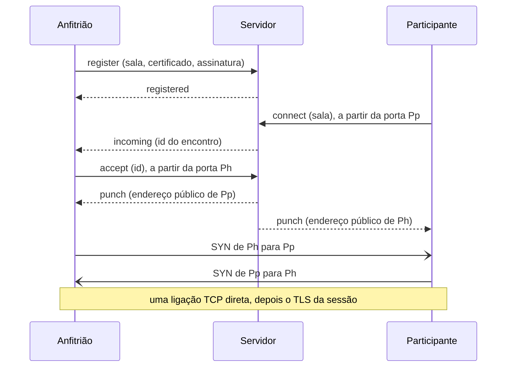

# Servidor de encontro do Golether

O `Golether.Web.Server` (o executável `golether-server`) é um pequeno servidor que apresenta o anfitrião e um
participante um ao outro quando ambos estão atrás de routers sem porta aberta: um IP cinzento, o NAT do fornecedor, sem
reencaminhamento de portas. O servidor diz a cada lado com que endereço público é visto e onde procurar o outro, e
depois os lados abrem por si uma ligação TCP **direta** entre eles. O filme, a sincronização, a conversa, as câmaras e a
voz não passam pelo servidor.

O servidor precisa de uma máquina com IP público (ou com uma porta reencaminhada no router). Só o anfitrião precisa do
endereço do servidor: os participantes recebem-no no convite. O anfitrião obtém-no de uma de duas formas (o seletor
“Modo de ligação” do ecrã inicial):

- **Automaticamente**: a aplicação lê o endereço do servidor do projeto no ficheiro `config.json` da página do projeto
  (`Sources/Apps/Golether.Pages`). O endereço no ficheiro está selado (`EndpointSeal`): uma máscara contra scanners, não
  um segredo. A última resposta boa é guardada e usada quando a página não está acessível.
- **O meu próprio servidor**: o anfitrião escreve o endereço, por exemplo `203.0.113.7:47900`.

**A instalação, a configuração e a manutenção do servidor** estão descritas no guia do administrador
[`Sources/Apps/Golether.Web.Server/ADMIN-GUIDE.pt.md`](../../Sources/Apps/Golether.Web.Server/ADMIN-GUIDE.pt.md) para
Windows, Linux e macOS. O mesmo ficheiro está junto ao programa em cada pacote do servidor. Este documento trata de como
o servidor está construído.

- [Como funciona](#como-funciona)
- [Compilar e publicar](#compilar-e-publicar)
- [Segurança](#segurança)
- [Protocolo (versão 1)](#protocolo-versão-1)
- [Limitações](#limitações)

## Como funciona

Um router sem reencaminhamento de portas não deixa entrar uma ligação de que ninguém lá dentro estava à espera. Mas
quando um dispositivo sai por si, o router lembra-se de que porta externa deu à porta local do dispositivo e deixa passar
as respostas. É nisto que assenta o NAT hole punching:

1. **O anfitrião ocupa uma sala.** Ao criar uma sessão, o Golether inventa um nome de sala aleatório (128 bits), mantém
   uma ligação permanente com o servidor e assina o registo com a chave do dispositivo. A sala pertence a essa chave: outro
   dispositivo não a pode ocupar.
2. **O convite leva o endereço do servidor e a sala** juntamente com os endereços habituais do anfitrião.
3. **O participante** tenta primeiro diretamente os endereços do convite. Se nada responder em 4 segundos (ou se todos os
   endereços já tiverem falhado), liga-se ao servidor **a partir da porta de onde vai perfurar** e pede para ser juntado
   ao anfitrião da sala.
4. **O servidor** avisa o anfitrião de que alguém está à espera. O anfitrião abre uma nova ligação ao servidor, também a
   partir da porta de onde vai perfurar. Agora o servidor vê os endereços públicos das duas portas e envia a cada lado o
   endereço do outro no mesmo momento.
5. **Os dois lados ao mesmo tempo** ligam-se um ao outro a partir das mesmas portas. Os primeiros pacotes podem ser
   rejeitados pelo router do outro lado, mas cada um abre um “buraco” no próprio, e a tentativa seguinte do outro lado
   passa. Dois SYN em sentidos opostos fundem-se numa só ligação TCP (TCP simultaneous open). As tentativas repetem-se
   durante até 15 segundos.
6. **A partir daqui tudo é como numa ligação direta:** TLS mútuo com a chave fixada do anfitrião, admissão, o código de
   verificação. O servidor sai da cadeia.

Cada fluxo de uma sessão (o de controlo e até quatro de ficheiro) encontra-se assim em separado; cada encontro é um par
de trocas curtas com o servidor.



**Câmaras e voz.** O mesmo servidor responde a pedidos STUN no mesmo número de porta por UDP. O `webrtcbin` de cada
participante fica a saber por ele o seu endereço UDP público, coloca-o entre os candidatos ICE e também abre um caminho
direto. O servidor não tem um relé TURN próprio: os meios nunca passam por ele.

## Compilar e publicar

Os pacotes prontos são compilados pelos scripts de `Scripts/`, como para a aplicação. Tudo vai para `artifacts/publish`:

| Script | Resultado |
|---|---|
| `Scripts/Server/publish-server-win.ps1` | a pasta `win-x64/GoletherServer` e o arquivo `GoletherServer-<version>-win-x64.zip` |
| `Scripts/Server/build-server-installer.ps1` | o mesmo mais o instalador `GoletherServer-<version>-setup.exe` (precisa do [Inno Setup](https://jrsoftware.org/isdl.php)); `-SkipPublish` usa a pasta que já existe |
| `Scripts/Server/publish-server-linux.ps1 [-Runtime linux-x64\|linux-arm64]` | a partir do Windows: o pacote Linux abaixo, compilado no Git Bash |
| `Scripts/Server/publish-server-macos.ps1 [-Runtime osx-arm64\|osx-x64]` | a partir do Windows: o pacote macOS abaixo, compilado no Git Bash |
| `Scripts/Server/publish-server.sh [linux-x64\|linux-arm64\|osx-x64\|osx-arm64]` | a pasta `<rid>/GoletherServer`, um arquivo `.tar.gz` e, se a ferramenta `zip` existir, um `.zip` |

```powershell
./Scripts/Server/build-server-installer.ps1              # Windows: pasta, zip e instalador
./Scripts/Server/publish-server-win.ps1 -Runtime win-arm64
```

```bash
./Scripts/Server/publish-server-linux.ps1                 # Windows: o pacote Linux x64 (é preciso o Git Bash)
./Scripts/Server/publish-server-macos.ps1                 # Windows: o pacote macOS para Apple silicon
./Scripts/Server/publish-server.sh                        # Linux x64 (também funciona no Windows a partir do Git Bash)
./Scripts/Server/publish-server.sh linux-arm64            # para um Raspberry Pi ou um VPS ARM, por exemplo
```

As compilações são autónomas: a máquina do servidor não precisa de .NET nem de mais nada. A estrutura do pacote é criada
pelo próprio projeto (o target `GoletherServerPackageLayout` em `Golether.Web.Server.csproj`, ativado com a propriedade
`GoletherServerPackageRoot`); os scripts acrescentam a nota, os ficheiros do serviço e o arquivo:

```
GoletherServer/
  golether-server(.exe)   o iniciador: o mesmo host .NET com o ícone do servidor, que aponta para bin/ (como o Golether.exe)
  bin/                    o programa, o runtime do .NET e as bibliotecas
  config/appsettings.json as definições; o programa em bin/ encontra-as sozinho (PackageLayout); config/monitor.json as definições do monitor
  docs/                   ADMIN-GUIDE.md e README.txt em inglês, ADMIN-GUIDE.<code>.md e README.<code>.txt em
                          alemão, espanhol, francês, português e russo (de, es, fr, pt, ru)
  service/                Linux e macOS: install-service.sh e golether-server.service / org.golether.server.plist
  golether-server-monitor(.exe)  o iniciador do monitor: o host da aplicação que aponta para monitor/
  monitor/                Golether Server Monitor (Golether.Web.Server.UI), autónomo como o servidor
```

Ao executar a partir do código-fonte (`dotnet run`) não há estrutura, e o `appsettings.json` fica junto ao programa. Os
arquivos para Linux e macOS também podem ser compilados no Windows (Git Bash): o script define ele próprio as permissões
de execução, e a assinatura local para macOS é colocada pelo `install-service.sh` durante a instalação.

O instalador do Windows fala inglês, alemão, espanhol, francês, português e russo (está pré-selecionado o idioma do
Windows, e o inglês quando o assistente não o fala); depois da instalação mostra a nota e abre o guia do administrador no
idioma escolhido.

O ícone do servidor é o ícone da aplicação com um emblema de bastidor de servidores: `Assets/golether-server.svg` no
projeto do servidor; as versões rasterizadas são desenhadas por `Scripts/Assets/generate-icon.ps1 -Server`.

Para depuração, o servidor é executado diretamente a partir do código-fonte:
`dotnet run --project Sources/Apps/Golether.Web.Server` ou o perfil “Rendezvous server” do VS Code.

## O monitor

O `Golether.Web.Server.UI` (o executável `golether-server-monitor`) é uma janela para o administrador: o estado do
servidor, o seu registo de eventos em colunas, iniciar e parar o serviço, exportar o registo e editar as definições. O
que o servidor e o monitor partilham (as definições e as suas verificações, os nomes do serviço em cada sistema, o
relatório de estado, o registo) está em `Golether.Web.Server.Contracts`, que não precisa nem de ASP.NET nem de Avalonia.

- **O registo de eventos.** O servidor regista o que acontece (`ServerJournal`): o arranque, os endereços de escuta, um
  anfitrião que ocupa e deixa uma sala, os encontros pedidos, apresentados e falhados (com o motivo), as ligações
  recusadas, os pedidos inválidos. Cada evento tem um número, a hora, o endereço IP do dispositivo, o identificador curto
  do anfitrião e uma etiqueta da sala: os primeiros 8 dígitos hexadecimais do SHA-256 do seu nome, para que dois eventos
  sobre uma sala se distingam dos outros, mas a etiqueta não permite a ninguém perguntar pelo anfitrião. O registo guarda
  os últimos 5000 eventos apenas na memória e começa vazio em cada execução.
- **`GET /journal?after=N`** no endereço de estado responde com os eventos depois do número N (no máximo 1000) e a hora de
  arranque da execução; uma hora de arranque diferente diz ao monitor que o servidor foi reiniciado. Só responde a
  pedidos deste computador (caso contrário, `403`), seja qual for o endereço em `Urls`. Os eventos e os motivos viajam
  pelo nome (`ServerContract.Json`), e o monitor formula-os no seu próprio idioma (`Monitor.Event.*`, `Monitor.Reason.*`):
  o idioma do sistema no primeiro arranque e depois o escolhido no seu seletor de idioma (com bandeiras).
- **O serviço** é controlado com as ferramentas do sistema: `sc query` e PowerShell como administrador no Windows,
  `systemctl` e `pkexec` no Linux, `launchctl` e `osascript ... with administrator privileges` no macOS. O estado é lido
  sem direitos especiais; cada alteração pede-os no momento da ação. Guardar as definições coloca o ficheiro novo no seu
  lugar e reinicia um serviço em execução numa só ação, por isso o utilizador só é questionado uma vez.
- **Onde estão as definições.** O monitor está em `monitor/` da pasta do servidor e encontra `config/appsettings.json` um
  nível acima; caso contrário, usa a pasta de instalação habitual do sistema. Ao escrever, mantém todas as partes do
  ficheiro que não edita.

## Segurança

**O que o servidor vê:** os endereços IP e as portas dos dispositivos, os nomes das salas, os certificados (chaves
públicas) dos anfitriões e a hora dos encontros. **O que não vê:** nada da sessão: nem o filme, nem a conversa, nem as
câmaras, nem sequer os nomes dos participantes. Uma sessão é cifrada com TLS mútuo entre os dispositivos, as câmaras e a
voz com DTLS-SRTP.

- **O servidor não se pode fazer passar pelo anfitrião.** O participante fixa a chave do anfitrião a partir do convite e
  verifica-a durante o handshake TLS sobre a ligação perfurada. Um servidor malicioso, no máximo, pode não juntar os
  lados.
- **Uma sala não pode ser usurpada.** O registo é assinado com a chave do dispositivo do anfitrião (ECDSA P-256) sobre um
  valor aleatório de uso único do servidor e o nome da sala: um registo alheio gravado não pode ser repetido, e uma sala
  ocupada por uma chave não é dada a outra. A mesma chave pode voltar a ocupar a sala; é assim que o anfitrião volta
  depois de uma quebra.
- **Uma sala não pode ser encontrada pela chave.** O nome da sala são 128 bits aleatórios, novos em cada sessão; só os
  destinatários do convite o conhecem. Quem conhece a sala continua a chegar ao anfitrião apenas para a admissão normal
  com o código de verificação.
- **Os dados recebidos não são de confiança.** As tramas têm no máximo 16 KiB, o JSON é validado, um certificado tem no
  máximo 8 KiB, uma assinatura no máximo 256 bytes, no máximo 8 endereços por mensagem, apenas IPv4 com porta (sem nomes
  de host). Cada espera tem um limite; o número de ligações, salas e encontros pendentes tem limites; a frequência das
  ligações e do STUN é limitada por IP. A tabela de endereços desse limitador também é limitada (200 000 endereços): um
  remetente UDP pode falsificar o seu endereço, e uma avalanche de falsificações não pode ocupar toda a memória; acima do
  limite, os endereços novos são recusados até os antigos expirarem.
- **Os endereços locais** de um lado só são passados ao outro quando ambos têm o mesmo endereço público (o mesmo router):
  caso contrário, não servem de nada e só revelariam algo da rede alheia.
- **O STUN não serve para ataques de amplificação:** a resposta é só um pouco maior do que o pedido, vai apenas para onde
  veio o pedido e tem a frequência limitada. O servidor só responde a Binding.
- **O canal com o servidor não é cifrado.** Tudo o que viaja nele, o servidor vê-o de qualquer forma, não há segredos
  nele, e a autenticidade do anfitrião é verificada de ponta a ponta. Quem escutar o canal fica a saber os endereços e o
  nome da sala: o mesmo que veria olhando para o tráfego da própria sessão.

## Protocolo (versão 1)

TCP, IPv4. Uma trama são 4 bytes de comprimento (big-endian) e JSON UTF-8 (1 byte – 16 KiB). O tipo de mensagem é dado
pelo campo `$t`; os nomes dos campos estão em camelCase. Os endereços são cadeias `a.b.c.d:porta`. S é o servidor, A o
anfitrião, P um participante, D qualquer dispositivo.

| `$t` | Sentido | Campos | Significado |
|---|---|---|---|
| `server-hello` | S → D | `version`, `nonce` | a primeira mensagem do servidor em cada ligação; `nonce` são 16 bytes aleatórios em base64url |
| `register` | A → S | `room`, `certificate` (DER, base64), `signature` (base64) | o anfitrião ocupa uma sala; a ligação fica aberta |
| `registered` | S → A | `observed` | a sala está ocupada; `observed` é o endereço do anfitrião como o servidor o vê |
| `ping` / `pong` | A ↔ S | — | manter o registo vivo (o anfitrião: a cada 20 s) |
| `connect` | P → S | `room`, `locals[]` | um participante pede um encontro; a ligação é aberta a partir da porta de perfuração |
| `incoming` | S → A | `punch` | pelo registo: um participante está à espera; `punch` são 16 bytes aleatórios em base64url |
| `accept` | A → S | `punch`, `locals[]` | o anfitrião responde a um encontro com uma nova ligação a partir da porta de perfuração |
| `punch` | S → ambos | `peer`, `peerLocals[]` | o endereço público do outro lado e os seus endereços locais (só com um IP público partilhado) |
| `error` | S → D | `error` | recusa; depois a ligação é fechada |

A assinatura do registo é ECDSA P-256 / SHA-256 da cadeia UTF-8 `golether-rendezvous-v1\n<nonce>\n<room>`. O dono de uma
sala é o SHA-256 do SubjectPublicKeyInfo da chave (o mesmo `PeerId` que numa sessão).

Os motivos de uma recusa (`error`) viajam como nomes; o dispositivo escolhe o texto para uma pessoa no seu próprio idioma:

| Valor | Quando |
|---|---|
| `UnsupportedVersion` | versões do protocolo diferentes |
| `BadRequest` | uma mensagem mal formada ou inesperada |
| `BadSignature` | a assinatura do registo não coincide com o certificado |
| `RoomTaken` | a sala está ocupada por outra chave |
| `RoomNotFound` | ninguém ocupa a sala (a sessão terminou ou o anfitrião perdeu o servidor) |
| `Busy` | demasiados encontros pendentes para este anfitrião |
| `Timeout` | o anfitrião não respondeu a tempo; o encontro é desconhecido ou já foi respondido |
| `ServerFull` | todas as salas estão ocupadas |
| `Unreachable`, `PunchFailed` | apenas no dispositivo: não é possível chegar ao servidor / os routers não deixaram passar a ligação |

O servidor mantém as ligações de encontro (`connect`, `accept`) até os dispositivos as fecharem (não mais do que
`AnswerTimeout` depois do `punch`): enquanto uma estiver aberta, o router não esquece o mapeamento da porta.

Quem escolhe a ligação. Podem abrir-se várias ligações (pelos endereços públicos e pelos locais), e os lados poderiam
escolher ligações diferentes. Por isso só o participante escolhe: a primeira que se abriu, e o participante é também o
primeiro a falar (TLS ClientHello). O anfitrião mantém todas as que se abriram e fica com aquela em que o participante
falou; as restantes são fechadas.

## Limitações

- **Um NAT simétrico** (o router dá uma nova porta externa a cada destino) em qualquer um dos lados torna a perfuração
  impossível: o endereço que o servidor viu não serve ao outro lado. Alguns operadores móveis e redes empresariais
  funcionam assim. O participante recebe um erro a dizer que os routers não deixaram passar a ligação direta; resta um
  túnel AmneziaWG ou uma porta reencaminhada pelo menos do lado do anfitrião.
- **Apenas IPv4.** Um servidor em `::` aceita também IPv6, mas os dispositivos ligam-se sempre a ele por IPv4 e perfuram
  IPv4.
- **Não há retransmissão TURN**, de propósito: quando as câmaras não têm caminho direto, não passam pelo servidor. São
  então levadas pelo relé do anfitrião incorporado na aplicação: o seu tráfego viaja pelos próprios fluxos da sessão, por
  isso funciona onde quer que a sessão funcione.
- Cada fluxo de uma sessão precisa de um encontro próprio, por isso ligar através do servidor demora alguns segundos a
  mais do que ligar diretamente.
