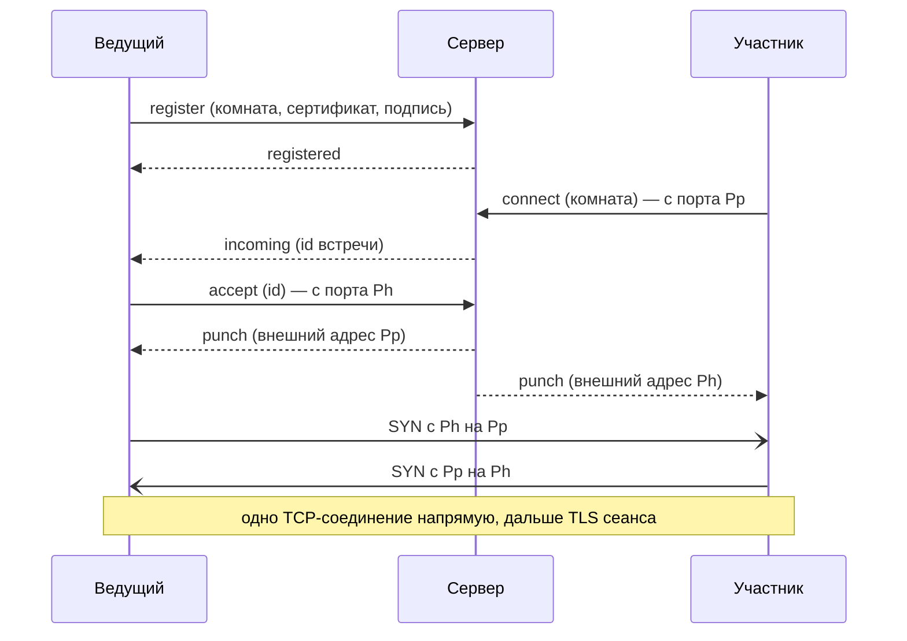

# Сервер рукопожатий Golether

`Golether.Web.Server` (исполняемый файл `golether-server`) — небольшой сервер, который знакомит ведущего и
участника, когда оба сидят за роутерами без открытого порта: серый IP, NAT провайдера, никакого проброса. Сервер
сообщает каждой стороне, по какому внешнему адресу её видно и где искать другую, после чего стороны сами пробивают
**прямое** TCP-соединение друг к другу. Фильм, синхронизация, чат, камеры и голос через сервер не идут.

Серверу нужна одна машина с белым IP (или с пробросом порта на роутере). Адрес сервера нужен только ведущему:
участникам он приходит в приглашении. Ведущий получает его одним из двух способов (переключатель «Метод соединения»
на стартовом экране):

- **Автоматически** — приложение читает адрес сервера проекта из файла `config.json` на странице проекта
  (`Sources/Apps/Golether.Pages`). Адрес в файле запечатан (`EndpointSeal`): это маска от сканеров, а не тайна.
  Последний удачный ответ запоминается и используется, когда страница недоступна.
- **Свой сервер** — ведущий вписывает адрес сам, например `203.0.113.7:47900`.

**Установка, настройка и обслуживание сервера** описаны в руководстве администратора
[`Sources/Apps/Golether.Web.Server/ADMIN-GUIDE.ru.md`](../../Sources/Apps/Golether.Web.Server/ADMIN-GUIDE.ru.md) — для
Windows, Linux и macOS. Оно же лежит рядом с программой в каждом пакете сервера. Этот документ — о том, как сервер
устроен.

- [Как это работает](#как-это-работает)
- [Сборка и публикация](#сборка-и-публикация)
- [Безопасность](#безопасность)
- [Протокол (версия 1)](#протокол-версия-1)
- [Ограничения](#ограничения)

## Как это работает

Роутер без проброса не пускает внутрь соединение, которое никто изнутри не ждал. Но если устройство само
обратилось наружу, роутер запоминает, какой внешний порт он выдал его локальному порту, и пропускает ответы. На этом
построено пробивание NAT (hole punching):

1. **Ведущий занимает комнату.** При создании сеанса Golether придумывает случайное имя комнаты (128 бит), держит
   с сервером постоянное соединение и подписывает регистрацию ключом устройства. Комната принадлежит этому ключу:
   занять её другим устройством нельзя.
2. **Приглашение несёт адрес сервера и комнату** вместе с обычными адресами ведущего.
3. **Участник** сначала пробует адреса из приглашения напрямую. Если за 4 секунды ничего не ответило (или все
   адреса уже отказали), он подключается к серверу **с того порта, с которого будет пробивать**, и просит свести
   его с ведущим комнаты.
4. **Сервер** сообщает ведущему, что его ждут. Ведущий открывает к серверу новое соединение — тоже с порта, с
   которого будет пробивать. Теперь сервер видит внешние адреса обоих портов и одновременно отправляет каждому адрес
   другого.
5. **Обе стороны одновременно** подключаются друг к другу с тех же портов. Первые пакеты могут отбросить чужие
   роутеры, но каждый открывает «дырку» в своём, и следующая попытка другой стороны проходит. Два встречных
   SYN сливаются в одно TCP-соединение (TCP simultaneous open). Попытки повторяются до 15 секунд.
6. **Дальше всё как при прямом подключении:** взаимный TLS с закреплённым ключом ведущего, допуск, код сверки.
   Сервер из этой цепочки выпадает.

Каждый поток сеанса (управление и до четырёх потоков файла) встречается таким образом отдельно; каждая встреча —
это пара коротких обращений к серверу.



**Камеры и голос.** Тот же сервер отвечает на STUN-запросы на том же номере порта по UDP. `webrtcbin` у всех
участников сеанса узнаёт через него свой внешний UDP-адрес, кладёт его в кандидаты ICE и тоже пробивает прямой путь.
Своего TURN-ретранслятора в сервере нет: медиа через него не идут никогда.

## Сборка и публикация

Готовые пакеты собирают скрипты из `Scripts/`, как и для приложения. Всё складывается в `artifacts/publish`:

| Скрипт | Что получается |
|---|---|
| `Scripts/Server/publish-server-win.ps1` | папка `win-x64/GoletherServer` и архив `GoletherServer-<версия>-win-x64.zip` |
| `Scripts/Server/build-server-installer.ps1` | то же плюс установщик `GoletherServer-<версия>-setup.exe` (нужен [Inno Setup](https://jrsoftware.org/isdl.php)); `-SkipPublish` берёт уже готовую папку |
| `Scripts/Server/publish-server-linux.ps1 [-Runtime linux-x64|linux-arm64]` | с Windows: пакет для Linux, как ниже, собранный в Git Bash |
| `Scripts/Server/publish-server-macos.ps1 [-Runtime osx-arm64|osx-x64]` | с Windows: пакет для macOS, как ниже, собранный в Git Bash |
| `Scripts/Server/publish-server.sh [linux-x64|linux-arm64|osx-x64|osx-arm64]` | папка `<rid>/GoletherServer`, архив `.tar.gz` и, если есть утилита `zip`, `.zip` |

```powershell
./Scripts/Server/build-server-installer.ps1              # Windows: папка, zip и установщик
./Scripts/Server/publish-server-win.ps1 -Runtime win-arm64
```

```bash
./Scripts/Server/publish-server-linux.ps1                 # Windows: пакет для Linux x64 (нужен Git Bash)
./Scripts/Server/publish-server-macos.ps1                 # Windows: пакет для macOS на Apple silicon
./Scripts/Server/publish-server.sh                        # Linux x64 (можно запускать и на Windows из Git Bash)
./Scripts/Server/publish-server.sh linux-arm64            # например, для Raspberry Pi или ARM-VPS
```

Сборки самодостаточные: на сервере не нужен ни .NET, ни что-то ещё. Раскладку пакета делает сам проект (цель
`GoletherServerPackageLayout` в `Golether.Web.Server.csproj`, включается свойством `GoletherServerPackageRoot`),
скрипты добавляют памятку, файлы службы и архив:

```
GoletherServer/
  golether-server(.exe)   запускатель: тот же хост .NET с иконкой сервера, указывающий на bin/ (как Golether.exe)
  bin/                    программа, среда .NET и библиотеки
  config/appsettings.json настройки; программа из bin/ находит их сама (PackageLayout); config/monitor.json — настройки монитора
  docs/                   ADMIN-GUIDE.md и README.txt на английском, ADMIN-GUIDE.<код>.md и README.<код>.txt на
                          немецком, испанском, французском, португальском и русском (de, es, fr, pt, ru)
  service/                Linux и macOS: install-service.sh и golether-server.service / org.golether.server.plist
  golether-server-monitor(.exe)  запускатель монитора: хост приложения, указывающий на monitor/
  monitor/                Golether Server Monitor (Golether.Web.Server.UI), самодостаточный, как и сервер
```

При запуске из исходников (`dotnet run`) раскладки нет, и `appsettings.json` лежит рядом с программой. Архивы для
Linux и macOS можно собирать и на Windows (Git Bash): права на запуск программ скрипт выставляет сам, а локальную
подпись для macOS ставит `install-service.sh` при установке.

Установщик для Windows говорит по-английски, по-немецки, по-испански, по-французски, по-португальски и по-русски
(заранее выбран язык Windows, а если мастер его не знает — английский); после установки он показывает памятку и
открывает руководство администратора на выбранном языке.

Иконка сервера — иконка приложения с бейджем серверной стойки: `Assets/golether-server.svg` в проекте сервера,
растровые версии рисует `Scripts/Assets/generate-icon.ps1 -Server`.

Для отладки сервер запускается прямо из исходников: `dotnet run --project Sources/Apps/Golether.Web.Server` или
профиль «Rendezvous server» в VS Code.

## Монитор

`Golether.Web.Server.UI` (программа `golether-server-monitor`) — окно для администратора: состояние сервера, его
журнал событий в колонках, запуск и остановка службы, экспорт журнала и правка настроек. То, что сервер и монитор
делят (настройки и их проверка, имена службы на каждой системе, отчёт о состоянии, журнал), лежит в
`Golether.Web.Server.Contracts`, которому не нужны ни ASP.NET, ни Avalonia.

- **Журнал событий.** Сервер записывает происходящее (`ServerJournal`): запуск, адреса приёма, занятие и
  освобождение комнаты ведущим, запрошенные, состоявшиеся и несостоявшиеся встречи (с причиной), отклонённые
  соединения, неверные запросы. У каждого события есть номер, время, IP-адрес устройства, короткий идентификатор
  ведущего и метка комнаты: первые 8 шестнадцатеричных цифр SHA-256 её имени — по метке видно, что два события про
  одну комнату, но по ней нельзя попросить ведущего. Журнал хранит последние 5000 событий только в памяти и при
  каждом запуске начинается заново.
- **`GET /journal?after=N`** на адресе состояния отвечает событиями после номера N (не больше 1000) и временем
  запуска; другое время запуска говорит монитору, что сервер перезапускали. Отвечает только запросам с этого
  компьютера (иначе `403`), какой бы адрес ни стоял в `Urls`. События и причины передаются именами
  (`ServerContract.Json`), а монитор переводит их на свой язык (`Monitor.Event.*`, `Monitor.Reason.*`): на первом
  запуске — язык системы, потом — выбранный в его списке языков (с флагами).
- **Служба** управляется средствами системы: `sc query` и PowerShell от администратора на Windows, `systemctl` и
  `pkexec` на Linux, `launchctl` и `osascript ... with administrator privileges` на macOS. Состояние читается без
  особых прав; любое изменение просит их в момент действия. Сохранение настроек кладёт новый файл на место и
  перезапускает работающую службу одним действием, поэтому спрашивают один раз.
- **Где настройки.** Монитор лежит в `monitor/` папки сервера и находит `config/appsettings.json` уровнем выше;
  иначе берёт обычную папку установки системы. При записи всё, что он не правит, в файле сохраняется.

## Безопасность

**Что видит сервер:** IP-адреса и порты устройств, имена комнат, сертификаты (открытые ключи) ведущих и время
встреч. **Чего не видит:** ничего из сеанса — ни фильма, ни чата, ни камер, ни даже имён участников. Сеанс
шифруется взаимным TLS между устройствами, камеры и голос — DTLS-SRTP.

- **Сервер не может подменить ведущего.** Участник закрепляет ключ ведущего из приглашения и проверяет его при
  TLS-рукопожатии уже по пробитому соединению. Злонамеренный сервер может разве что не свести стороны.
- **Комнату нельзя перехватить.** Регистрация подписана ключом устройства ведущего (ECDSA P-256) поверх случайного
  одноразового значения сервера и имени комнаты: запись чужой регистрации не повторить, а комната, занятая одним
  ключом, другому не отдаётся. Тот же ключ может занять комнату снова — так ведущий возвращается после обрыва.
- **Комнату не найти по ключу.** Имя комнаты — 128 случайных бит, новое для каждого сеанса; его знают только
  получатели приглашения. Кто знает комнату, всё равно попадает к ведущему лишь на обычный допуск с кодом сверки.
- **Входящие данные недоверенные.** Кадры не больше 16 КиБ, JSON проверяется, сертификат — не больше 8 КиБ,
  подпись — не больше 256 байт, адресов в сообщении — не больше 8, только IPv4 с портом (без имён хостов). У каждого
  ожидания есть предел, у числа соединений, комнат и ожидающих встреч — лимиты, у частоты подключений и STUN —
  ограничение по IP. Таблица адресов этого ограничения сама ограничена (200 000 адресов): отправитель UDP может
  подделать свой адрес, и поток подделок не должен занять всю память — сверх предела новым адресам отказывают, пока
  не устареют старые.
- **Локальные адреса** одной стороны пересылаются другой, только если у обеих один внешний адрес (один роутер):
  иначе они бесполезны и лишь рассказали бы о чужой сети.
- **STUN не годится для усиления атак:** ответ лишь немного больше запроса, уходит только туда, откуда пришёл
  запрос, и ограничен по частоте. Отвечает сервер только на Binding.
- **Канал с сервером не шифруется.** Всё, что в нём ходит, сервер и так видит, секретов там нет, а подлинность
  ведущего проверяется концом-в-конец. Кто подслушивает канал, узнает адреса и имя комнаты — то же, что увидел бы,
  глядя на сам трафик сеанса.

## Протокол (версия 1)

TCP, IPv4. Кадр — 4 байта длины (big-endian) и UTF-8 JSON (1 байт – 16 КиБ). Тип сообщения задаётся полем `$t`,
имена полей в camelCase. Адреса — строки `a.b.c.d:port`.

| `$t` | Направление | Поля | Смысл |
|---|---|---|---|
| `server-hello` | С → У | `version`, `nonce` | первое сообщение сервера на каждом соединении; `nonce` — 16 случайных байт base64url |
| `register` | В → С | `room`, `certificate` (DER, base64), `signature` (base64) | ведущий занимает комнату; соединение остаётся открытым |
| `registered` | С → В | `observed` | комната занята; `observed` — адрес ведущего глазами сервера |
| `ping` / `pong` | В ↔ С | — | поддержание регистрации (ведущий — раз в 20 с) |
| `connect` | У → С | `room`, `locals[]` | участник просит встречу; соединение открыто с порта пробивания |
| `incoming` | С → В | `punch` | по регистрации: участник ждёт, `punch` — 16 случайных байт base64url |
| `accept` | В → С | `punch`, `locals[]` | ведущий отвечает на встречу новым соединением с порта пробивания |
| `punch` | С → обоим | `peer`, `peerLocals[]` | внешний адрес другой стороны и её локальные адреса (только при общем внешнем IP) |
| `error` | С → У | `error` | отказ, после него соединение закрывается |

Подпись регистрации — ECDSA P-256 / SHA-256 от UTF-8 строки `golether-rendezvous-v1\n<nonce>\n<room>`. Владелец
комнаты — SHA-256 от SubjectPublicKeyInfo ключа (тот же `PeerId`, что и в сеансе).

Причины отказа (`error`) передаются именем, текст для человека устройство подбирает на своём языке:

| Значение | Когда |
|---|---|
| `UnsupportedVersion` | разные версии протокола |
| `BadRequest` | неверное или неожиданное сообщение |
| `BadSignature` | подпись регистрации не сходится с сертификатом |
| `RoomTaken` | комнату держит другой ключ |
| `RoomNotFound` | комнату никто не держит (сеанс закончился или ведущий потерял сервер) |
| `Busy` | слишком много ожидающих встреч у этого ведущего |
| `Timeout` | ведущий не ответил вовремя; встреча неизвестна или уже отвечена |
| `ServerFull` | заняты все комнаты |
| `Unreachable`, `PunchFailed` | только на устройстве: сервер недоступен / роутеры не пропустили соединение |

Соединения встречи (`connect`, `accept`) сервер держит, пока их не закроют устройства (не дольше `AnswerTimeout`
после `punch`): пока оно открыто, роутер не забывает отображение порта.

Кто выбирает соединение. Соединений может открыться несколько (по внешнему и по локальным адресам), и стороны могли
бы выбрать разные. Поэтому выбирает только участник — первое открывшееся соединение, и он же первым говорит (TLS ClientHello).
Ведущий держит все открывшиеся и берёт то, в котором участник заговорил; остальные закрываются.

## Ограничения

- **Симметричный NAT** (роутер выдаёт новый внешний порт каждому адресату) у любой из сторон делает пробивание
  невозможным: адрес, который увидел сервер, для другой стороны не годится. Так устроены некоторые мобильные
  операторы и корпоративные сети. Участник получит ошибку «Роутеры не пропустили прямое соединение»; остаются
  туннель AmneziaWG или проброс порта хотя бы у ведущего.
- **Только IPv4.** Сервер на `::` принимает и IPv6, но устройства всегда подключаются к нему по IPv4 и пробивают
  IPv4.
- **Ретрансляции TURN нет** намеренно: если прямого пути для камер нет, через сервер они не пойдут. Тогда их
  несёт ретранслятор ведущего, встроенный в приложение: его трафик идёт по потокам самого сеанса, поэтому он работает
  везде, где работает сеанс.
- Каждый поток сеанса требует отдельной встречи, поэтому подключение через сервер на несколько секунд дольше
  прямого.
